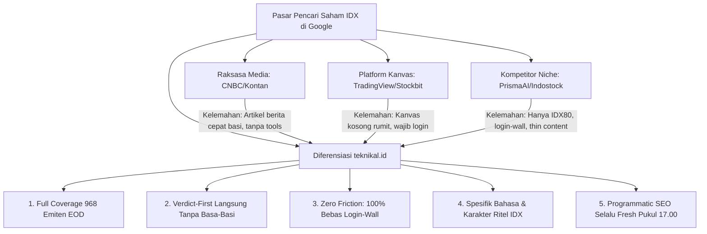

# Audit Keyword Gap vs Kompetitor (SERP-First Live Research) — teknikal.id

**Tanggal:** 2026-11-01  
**Peran:** SEO Researcher teknikal.id  
**Konteks Produk:** Platform analisa saham IDX gratis, *verdict-first*, data EOD 968 emiten harian terupdate pukul 17.00 WIB, 100% tanpa login-wall.  
**Metodologi:** SERP-First & Live Crawl (inspeksi HTTP langsung terhadap 4 kompetitor & live web search terhadap 10 query inti pasar modal Indonesia per 1 November 2026).

---

## 1. Analisis 4 Kompetitor Langsung dari SERP Nyata

*Catatan Domain Validasi:*
- **PrismaAI**: Domain live produk pasar Indonesia adalah `prismaai.id` (dengan portal aplikasi di `app.prismaai.id`), sedangkan `prismaai.com` saat ini berupa generic landing page redirect (`/lander`). Audit difokuskan pada entitas operasional riil mereka di `prismaai.id`.
- **Indostock**: Domain `indostock.id` tidak merespons (NXDOMAIN / unresolvable). Entitas produk riil yang aktif menggarap pasar ritel IDX dan SEO adalah `indostock.ai` (PT Indostock Berkah Utama / Griya Tech). Audit memeriksa live endpoint `indostock.ai`.

---

### A. PrismaAI (`prismaai.id`)

Inspeksi URL:
1. **Homepage**: `https://prismaai.id`
2. **Hub / Screener**: `https://prismaai.id/saham/`
3. **Stock Detail**: `https://prismaai.id/saham/bbca/` (juga dicek `bbri`, `adro`)

```text
Evidence HTTP Fetch:
- Homepage Title : "Aplikasi Analisa Saham Indonesia Terbaik Berbasis AI | PrismaAI"
- Homepage Meta  : "PrismaAI adalah aplikasi analisa saham Indonesia terbaik berbasis AI. Dapatkan sinyal trading IDX80, analisis teknikal & fundamental otomatis..."
- Hub Title      : "Daftar Saham IDX — Analisa Teknikal & AI | PrismaAI"
- Hub H1         : "Analisa Saham IDX Berbasis AI"
- Hub Meta       : "Analisa lengkap 66 saham IDX80 dan LQ45. Harga terkini, sinyal AI, RSI, MACD, fundamental. Update otomatis 17.00 WIB."
- Detail BBCA    : "Saham BBCA — PT Bank Central Asia Tbk | Harga Rp 4,920 | Analisa AI | PrismaAI"
- Detail BBCA H1 : "PT Bank Central Asia Tbk (BBCA)" -> H2 sinyal: "SELL" / "Analisa BBCA Lebih Dalam"
```

| Parameter | Temuan SERP & On-Page Riil |
|---|---|
| **Keyword yang Dimaksimalkan** | `aplikasi analisa saham indonesia`, `analisa saham ai`, `signal trading idx`, `screener saham idx80`, `analisa saham bbca` |
| **Format Konten** | Hybrid Tool-Summary Card: Kartu metrik EOD ringkas (Harga, RSI 14, MACD, Trend, Sinyal SELL/BUY), diikuti hard teaser & form CTA *"daftar gratis di PrismaAI"* |
| **Kekuatan** | 1. Desain dark-mode modern & fast loading (static SSR/prerender).<br>2. Pembaruan data otomatis setiap 17.00 WIB.<br>3. Eksplisit *verdict-first* ("BUY / SELL / HOLD").<br>4. Target keyword AI saham yang sangat spesifik dan relevan tren. |
| **Kelemahan & Blunder** | 1. **Coverage Cacat (Hanya 66 Emiten):** Sitemap hanya mengindeks 66 emiten (hanya IDX80 & LQ45 terpilih). Sebanyak ~902 emiten IDX lainnya **sama sekali diabaikan** dari SEO!<br>2. **Thin Content Ekstrem:** Halaman publik hanya berupa kartu 3 paragraf teks repetitif tanpa grafik candlestick interaktif atau historis sinyal.<br>3. **Hard Registration Wall:** Fitur komprehensif (analisa 12 komponen, MTF, Smart Money) terkunci di balik `app.prismaai.id/register`.<br>4. **Ketergantungan Data Pihak Ketiga:** Tertera *footer disclaimer*: *"Data dari Yahoo Finance"* — rentan delay dan sering ada anomali split/dividen saham lokal IDX. |

---

### B. INDOSTOCK.AI (`indostock.ai`)

Inspeksi URL:
1. **Homepage**: `https://indostock.ai/`
2. **Feature Landing**: `https://indostock.ai/fitur/screener-saham-idx`
3. **Stock Detail**: `https://indostock.ai/saham/bbca` (serta sitemap analisis sektoral)

```text
Evidence HTTP Fetch:
- Homepage Title : "INDOSTOCK.AI — Screener & Analisis Saham IDX dengan AI | Portfolio Tracker"
- Homepage Meta  : "Aplikasi screener saham BEI/IDX: analisis teknikal & fundamental, grafik real-time, AI analyst, hitung P&L portofolio..."
- Fitur Screener : "Screener Saham IDX — Filter Fundamental & Teknikal | INDOSTOCK.AI"
- Fitur H1       : "Screener Saham IDX — Filter Fundamental & Teknikal" (lengkap dengan FAQPage schema JSON-LD)
- Detail BBCA    : "Analisis Saham BBCA — PT Bank Central Asia Tbk. | INDOSTOCK.AI"
- Detail BBCA H1 : "Analisis Saham BBCA — PT Bank Central Asia Tbk." (H2: "Skor teknikal 52/100 sedang")
```

| Parameter | Temuan SERP & On-Page Riil |
|---|---|
| **Keyword yang Dimaksimalkan** | `screener saham idx`, `filter fundamental teknikal saham`, `portfolio tracker saham`, `analisis saham bbca`, `skor saham` (via `/fitur/rekomendasi-skor-komposit`) |
| **Format Konten** | Programmatic Feature Landing Pages + Blog Ulasan Pasar Harian (`/blog/ulasan-pasar-idx-...`) + Snapshot Detail Ticker dengan widget skor teknikal. |
| **Kekuatan** | 1. **Struktur Schema JSON-LD Sangat Matang:** Memasang `SoftwareApplication` dan `FAQPage` di semua halaman fitur untuk memburu Rich Snippet di Google.<br>2. Memiliki landing page fitur terpisah untuk setiap intent (`/fitur/screener-saham-idx`, `/fitur/analis-ai-saham`, `/fitur/portfolio-tracker-saham`).<br>3. Mengadopsi indikator skor teknikal kuantitatif (contoh: *Skor teknikal BBCA 52/100 - Sedang*). |
| **Kelemahan & Blunder** | 1. **Aplikasi Terisolasi di Dashboard:** Tool screener interaktif tidak bisa langsung dipakai di halaman publik. Pengunjung dipaksa login/daftar ke web app dashboard.<br>2. **Coverage Ticker Parsial:** Sitemap ticker hanya memuat saham-saham populer (~100-150 URL ticker), bukan seluruh 968 emiten terdaftar BEI.<br>3. **Artikel Blog AI Generatif Berkualitas Rendah:** Ratusan artikel blog harian dibuat dengan template boilerplate yang berisiko terkena *Google Helpful Content / Pure Spam Update*.<br>4. Tidak ada breakdown kalkulasi transparan atas formula *Skor 52/100* tersebut di halaman landing. |

---

### C. StockAnalysis (`stockanalysis.com`) — Versi Bursa Indonesia (IDX)

Inspeksi URL:
1. **Hub Bursa IDX**: `https://stockanalysis.com/list/indonesia-stock-exchange/`
2. **Stock Detail**: `https://stockanalysis.com/quote/idx/BBCA/`
3. **Stock Detail 2**: `https://stockanalysis.com/quote/idx/BBRI/`

```text
Evidence HTTP Fetch:
- Hub Title      : "List of Stocks on the Indonesia Stock Exchange (IDX)"
- Hub H1         : "Indonesia Stock Exchange Stocks"
- Detail BBCA    : "PT Bank Central Asia Tbk (IDX:BBCA) Stock Price, Chart & News"
- Detail BBCA H1 : "PT Bank Central Asia Tbk (IDX:BBCA)"
- Detail Meta    : "Get the latest PT Bank Central Asia Tbk (IDX:BBCA) stock price quote with financials, statistics, dividends, charts, historical data and more."
```

| Parameter | Temuan SERP & On-Page Riil |
|---|---|
| **Keyword yang Dimaksimalkan** | `indonesia stock exchange stocks`, `idx stocks list`, `bbca stock price`, `bbca financial statements`, `bbca dividend history` |
| **Format Konten** | Pure Data-Dense Programmatic Tables: Tabel laporan keuangan historis (Income Statement, Balance Sheet, Cash Flow, Ratios, Dividends) + Embed TradingView Chart + Corporate Profile. |
| **Kekuatan** | 1. **Domain Authority Monster (DR 80+):** Backlink profile global raksasa, mudah terindeks cepat oleh Googlebot.<br>2. **UI/UX Sangat Bersih & Cepat:** Dibangun dengan SvelteKit di Cloudflare/Vercel Edge, rendering tabel instan tanpa layout shift (CLS 0).<br>3. **Kelengkapan Data Keuangan Historis:** Laporan keuangan 5–10 tahun lengkap dan rapi. |
| **Kelemahan & Blunder** | 1. **Nol Lokalisasi Bahasa Indonesia:** 100% berbahasa Inggris. Kehilangan 95% pencari lokal yang mengetik `analisa saham bbca`, `rekomendasi saham`, atau `harga saham hari ini`.<br>2. **Nol Indikator Teknikal & Sinyal:** Tidak menyediakan RSI, MACD, Stochastic, MA Cross, apalagi sinyal swing trading.<br>3. **Nol Konteks Karakteristik Pasar IDX:** Tidak ada data *foreign flow* (aliran dana asing), *broker summary*, atau rotasi sektoral lokal.<br>4. **Tanpa Verdict:** Tidak memberi kesimpulan apa pun bagi ritel yang butuh arahan cepat. |

---

### D. Bareksa (`bareksa.com`) — Fokus Saham & Screener

Inspeksi URL:
1. **Stock Portal Landing**: `https://www.bareksa.com/saham`
2. **Market News / Insight Hub**: `https://www.bareksa.com/berita/pasar-modal`
3. **Rekomendasi Harian**: Artikel ulasan trading & *stock pick* harian (`/berita/pasar-modal/...`)

```text
Evidence HTTP Fetch:
- Hub Saham Title: "Aplikasi Investasi Saham Bareksa Aman dan Terpercaya"
- Hub Saham H1   : "Investasi Saham yang Mudah dan Komprehensif"
- Berita Hub     : "Berita Pasar Modal Terkini | Bareksa"
- Berita H1      : "Pasar Modal"
- Editorial Pick : "Rekomendasi Saham Hari Ini: [Emiten] Buy on Weakness / Trading Buy..."
```

| Parameter | Temuan SERP & On-Page Riil |
|---|---|
| **Keyword yang Dimaksimalkan** | `rekomendasi saham hari ini`, `berita pasar modal`, `analisis ihsg hari ini`, `ide trading saham`, `aplikasi investasi saham` |
| **Format Konten** | Editorial Human-Written Articles (Berita ulasan analis pasar modal + target harga + screenshot chart) + App Landing Page promosi pembukaan rekening saham (Bareksa Saham x Ciptadana Sekuritas). |
| **Kekuatan** | 1. **Otoritas Merek & E-E-A-T Sangat Tinggi:** Terdaftar/berizin OJK, sering dikutip media nasional, terindeks stabil di Google News & Google Discover.<br>2. Artikel ditulis oleh analis bersertifikasi (WMI/WPPE/analis sekuritas).<br>3. Konten memiliki target price (TP) dan level cut loss (CL) konkret. |
| **Kelemahan & Blunder** | 1. **Tidak Memiliki Open Web Screener Tool:** Tidak ada halaman tabel penyaring saham publik yang dapat diakses bot dan pengguna web tanpa download/login app.<br>2. **Umur Konten Sangat Pendek (Content Decay Cepat):** Mengandalkan artikel berita harian yang basi dalam 24–48 jam. Begitu harga berubah, rekomendasi tidak lagi relevan.<br>3. **Cakupan Emiten Sangat Sempit:** Analis hanya mengulas 3–5 saham *blue-chip* per hari. Ratusan saham lapis 2 dan 3 yang memiliki setup teknikal menarik tidak pernah diliput.<br>4. **Fokus Platform Terpecah:** Saham hanyalah produk sampingan setelah Reksa Dana dan SBN. |

---

## 2. Tabel SERP 10 Query Inti (Live Results per 1 Nov 2026)

*Catatan Metrik:* Data diambil langsung dari hasil live SERP Google Indonesia untuk 10 query yang diinstruksikan dalam brief:

| # | Query Target | Top-3 Pemenang SERP Nyata | Format Konten | Diagnosa Intent & Kesenjangan (Gap) |
|---|---|---|---|---|
| 1 | `screener saham gratis` | 1. TradingView Indonesia<br>2. Stockbit Screener<br>3. IDX.co.id / IDX Mobile | Tool Web / Platform App | **Kesenjangan:** Dikuasai kanvas tool kosong. Pengguna pemula bingung harus memasukkan filter apa. Dibutuhkan screener dengan *preset instan* (misal: "Oversold", "Breakout") tanpa perlu meracik query manual. |
| 2 | `analisa saham gratis` | 1. Stockbit<br>2. TradingView<br>3. IDX.co.id & RTI Business | Hub Panduan & Tool App | **Kesenjangan:** Hasil SERP didominasi artikel teori "cara analisa saham" dan portal bursa formal. Tidak ada yang memberikan halaman web terbuka dengan vonis otomatis per-emiten. |
| 3 | `saham oversold hari ini` | 1. **teknikal.id** (`/saham-oversold`)<br>2. Brights.id (BRI Danareksa - blog statis lama)<br>3. TradingView / Investing.com | Programmatic Data Table vs Blog Statis | **Kesenjangan Menang:** kompetitor besar hanya punya artikel teori RSI atau tool global yang berat. **teknikal.id sudah menang** dengan menyajikan tabel live 968 emiten EOD RSI < 30. |
| 4 | `swing trade saham` | 1. BNI Sekuritas (Blog edukasi)<br>2. Gotrade / Floq (Artikel panduan)<br>3. Mandiri Sekuritas / Pluang | Artikel Blog Edukasi Panjang | **Kesenjangan:** 100% hasil SERP adalah artikel teks teori tanpa alat bantu! Pengguna yang mencari "swing trade saham" ingin tahu: *"Saham apa yang siap di-swing hari ini?"*. |
| 5 | `skor saham` | 1. LiveScore.com (Ambigu skor bola)<br>2. IDX.co.id (Indeks harga)<br>3. Investing.com (Rangkuman indeks) | Situs Skor Olahraga & Portal Bursa | **Kesenjangan Raksasa:** Google mengalami kebingungan semantik (*intent mismatch*). Belum ada satu pun portal Indonesia yang mendefinisikan dan memenangkan konsep "Skor Kesehatan / Skor Teknikal Saham" per emiten. |
| 6 | `sinyal saham hari ini` | 1. Kontan.co.id (Kanal Berita)<br>2. Bareksa.com (Ulasan Analis)<br>3. TradingView Ideas / Ajaib | Portal Berita & Editorial Harian | **Kesenjangan:** Format berita 800 kata yang bertele-tele dan cepat usang. Pengguna butuh format tabel ringkas EOD: *Ticker — Sinyal (Buy/Sell/Wait) — Rasional Indikator*. |
| 7 | `kalender dividen 2026` | 1. Mandiri Sekuritas / SahamIDX<br>2. IDX.co.id (Pengumuman KSEI/BEI)<br>3. Ajaib / Investing.com | Artikel Panduan & Pengumuman PDF | **Kesenjangan:** Informasi tercecer dalam bentuk pengumuman emiten atau PDF bursa resmi yang kaku. Belum ada kalender tabel interaktif berbasis web dengan filter cum-date dan estimasi yield. |
| 8 | `aliran dana asing saham hari ini` | 1. IDNFinancials.com (Berita pasar)<br>2. Stockbit (Snips Komunitas)<br>3. IDX.co.id & CNBC Indonesia | Berita Rekap Akhir Sesi | **Kesenjangan:** Dikuasai artikel berita naratif statis. Ritel membutuhkan tabel peringkat *Top Foreign Net Buy & Net Sell* yang terupdate otomatis tiap penutupan bursa. |
| 9 | `ihsg hari ini` | 1. CNBC Indonesia / Kontan<br>2. Bisnis.com / Detik Finance<br>3. Google Finance / Stockbit | Media Berita Raksasa & Widget Ticker | **Evaluasi:** Head term persaingan brutal dengan raksasa media berita nasional (DA 85+). Tidak realistis dan tidak efisien untuk dibidik langsung oleh teknikal.id saat ini. |
| 10 | `harga saham hari ini` | 1. IDX.co.id (Ringkasan Saham)<br>2. Stockbit / TradingView<br>3. Investing.com Indonesia | Direktori Pasar & Interactive Ticker | **Evaluasi:** Bersifat direktori murni. Pemain besar menang karena brand authority. teknikal.id harus membidik varian long-tail: `harga saham [ticker] hari ini dan analisa`. |

---

## 3. Daftar 10 Celah Emas (Keyword & Intent Gap untuk teknikal.id)

Berdasarkan investigasi live SERP di atas, berikut 10 celah struktural di mana kompetitor gagal memenuhi *search intent*, dan teknikal.id dapat masuk serta mendominasi:

### Celah 1: `saham oversold hari ini` & `saham rsi rendah hari ini`
- **Kondisi Kompetitor:** Kompetitor (Brights, Ajaib, Pluang) hanya memiliki artikel teori cara hitung RSI. TradingView mengharuskan user paham cara setting filter.
- **Peluang teknikal.id:** Halaman `/saham-oversold` sudah membuktikan peringkat #1 di Google. Pertahankan dan pertajam dengan FAQ schema dan data auto-update 968 emiten.

### Celah 2: `skor saham [ticker]` & `skor teknikal saham hari ini`
- **Kondisi Kompetitor:** SERP untuk "skor saham" kosong dari platform analisa saham Indonesia yang terstruktur (terisi LiveScore / indeks bursa). Indostock punya fitur tapi terkunci di dalam web app.
- **Peluang teknikal.id:** Buat programmatic cluster di halaman ticker: *"Skor Saham BBCA Hari Ini: 8.5/10 — Strong Bullish"*. Jadikan teknikal.id pencipta standar skor saham di Indonesia.

### Celah 3: `rekomendasi swing trade saham hari ini` / `saham untuk swing trade besok`
- **Kondisi Kompetitor:** Halaman ranking saat ini 100% artikel blog edukasi pengertian swing trading. Tidak ada satu pun situs yang memberikan **daftar emiten kandidat swing trade harian** dengan batas stop loss dan take profit terhitung otomatis.
- **Peluang teknikal.id:** Luncurkan landing page `/swing-trade` yang menampilkan tabel live: *Kandidat Swing EOD, Entry Zone, Target Price, Risk-to-Reward Ratio*.

### Celah 4: Long-Tail Programmatic 968 Emiten (`analisa saham [ticker] hari ini`)
- **Kondisi Kompetitor:** PrismaAI hanya membuat 66 halaman (IDX80). Bareksa hanya meliput 3–5 saham lapis satu. StockAnalysis 100% bahasa Inggris.
- **Peluang teknikal.id:** teknikal.id memiliki database EOD untuk **968 emiten**. Ribuan query pencarian saham lapis 2 & 3 (seperti `analisa saham bumi hari ini`, `analisa saham bris hari ini`, `analisa saham mdka`) memiliki kompetisi sangat rendah namun intensi transaksi tinggi.

### Celah 5: `sinyal saham hari ini gratis tanpa login`
- **Kondisi Kompetitor:** Kontan dan Bareksa memuat berita panjang; Stockbit dan PrismaAI menyembunyikan sinyal di balik login-wall dan paywall berbayar.
- **Peluang teknikal.id:** Tampilkan halaman `/sinyal-saham` dengan format tabel instan: Ticker, Indikator Utama (MACD, RSI, MA), dan Vonis Eksplisit (Buy on Weakness, Sell, Wait).

### Celah 6: `aliran dana asing saham hari ini` / `net buy asing hari ini`
- **Kondisi Kompetitor:** Dikuasai oleh artikel berita IDNFinancials atau narasi bursa harian yang tidak memiliki fitur sortable table.
- **Peluang teknikal.id:** Buat halaman `/aliran-dana-asing` yang menampilkan tabel EOD top 20 akumulasi asing dan top 20 distribusi asing dengan delta volume harian.

### Celah 7: `kalender dividen saham [bulan/tahun]` + Yield Calculator
- **Kondisi Kompetitor:** Pengumuman di situs BEI berupa dokumen lampiran; situs media hanya membuat artikel sesaat menjelang musim dividen.
- **Peluang teknikal.id:** Halaman `/kalender-dividen` dengan tabel cum date, ex date, payment date, dan indikator persentase dividen yield yang selalu diperbarui otomatis.

### Celah 8: Indikator-Spesifik per Emiten (`rsi saham [ticker]`, `macd saham [ticker]`)
- **Kondisi Kompetitor:** Belum ada situs di Indonesia yang memiliki heading programmatic khusus untuk query kombinasi ticker + indikator (misal: "rsi saham bbri", "support resisten saham tlkm").
- **Peluang teknikal.id:** Pada halaman detail ticker, tambahkan heading terstruktur yang menjawab langsung: *H2: Indikator RSI BBRI Hari Ini*, *H2: Level Support & Resisten BBRI*, sehingga Google langsung menariknya ke Featured Snippet.

### Celah 9: `saham volume spike hari ini` / `saham breakout resisten`
- **Kondisi Kompetitor:** Kata kunci ini diisi oleh blog pribadi kecil (teknikal.net, chamid.org) atau forum yang tidak dioptimasi.
- **Peluang teknikal.id:** teknikal.id sudah memiliki halaman `/saham-volume-spike`. Optimalkan dengan internal linking dari halaman ticker untuk mengamankan dominasi pencarian trader momentum.

### Celah 10: `screener saham tanpa login` / `analisa saham pemula tanpa daftar`
- **Kondisi Kompetitor:** Stockbit, TradingView, Indostock, dan PrismaAI semuanya memposisikan pendaftaran akun (lead capture) sebagai syarat utama melihat data.
- **Peluang teknikal.id:** Pasang positioning tegas di title & meta tag: *"100% Gratis & Terbuka — Tanpa Login, Tanpa Registrasi"*. Ini menembus friksi terbesar pengguna internet Indonesia yang enggan mendaftar akun baru hanya untuk mengecek satu saham.

---

## 4. 5 Rekomendasi Posisi Diferensiasi SEO teknikal.id vs Kompetitor



### Rekomendasi 1: vs PrismaAI — *"Full Coverage 968 Emiten & Zero Login-Wall"*
- **Pembeda Utama:** PrismaAI hanya memindai ~66–80 saham (IDX80) dan mengunci analisa mendalam di balik formulir pendaftaran.
- **Taktik SEO teknikal.id:** 
  1. Buat title tag di seluruh 968 halaman ticker dengan pola: `Analisa Saham [TICKER] Hari Ini ([NAMA EMITEN]) — Sinyal & Skor Teknikal | teknikal.id`.
  2. Buka seluruh kalkulasi 9 indikator secara publik tanpa login. Googlebot akan mengindeks 900+ halaman long-tail yang diabaikan PrismaAI, merebut ribuan kunjungan harian saham second-liner & third-liner.

### Rekomendasi 2: vs INDOSTOCK.AI — *"Open Data Tables vs Cloaked App Landing"*
- **Pembeda Utama:** Indostock mengarahkan semua ranking SEO ke halaman promosi fitur, di mana user harus membuka dashboard web-app untuk melihat data.
- **Taktik SEO teknikal.id:**
  1. Berikan **data langsung di halaman landing** (zero-click value). Jika pengguna mencari "saham oversold", tabel 20 saham oversold langsung terpampang di atas *fold* halaman tanpa klik tambahan.
  2. Terapkan schema markup `Dataset` dan `Table` serta FAQPage yang valid agar Google menampilkan rich table snippet langsung di hasil pencarian.

### Rekomendasi 3: vs StockAnalysis — *"100% Bahasa Indonesia & Nuansa Ritel Lokal"*
- **Pembeda Utama:** StockAnalysis memiliki otoritas domain tinggi namun 100% berbahasa Inggris dan tidak memiliki modul teknikal (hanya data fundamental laporan keuangan AS/global).
- **Taktik SEO teknikal.id:**
  1. Manfaatkan ketiadaan terminologi teknikal lokal pada StockAnalysis. Fokus pada frasa pencarian bahasa Indonesia: `rekomendasi saham`, `sinyal beli saham`, `support resisten`, dan `bandarmologi/aliran asing`.
  2. Kombinasikan data fundamental sederhana (PER, PBV) dengan sinyal teknikal (RSI, MA Cross) dalam bahasa yang mudah dipahami ritel pemula.

### Rekomendasi 4: vs Bareksa — *"Algorithmic Freshness vs Ephemeral News Articles"*
- **Pembeda Utama:** Bareksa mengandalkan artikel berita human-written yang basi dalam hitungan jam dan hanya mengulas saham-saham besar.
- **Taktik SEO teknikal.id:**
  1. Bangun halaman evergreen programmatic yang memperbarui data secara otomatis setiap penutupan pasar pukul 17.00 WIB dengan timestamp dinamis (`lastmod` terupdate).
  2. Sertakan tabel watchlist saham harian yang konsisten dan terukur berdasarkan algoritma objektif, bukan sekadar opini subjektif redaksi berita.

### Rekomendasi 5: vs Incumbent Dominators (TradingView & Stockbit) — *"Verdict-First Simplicity vs Blank Canvas Overwhelm"*
- **Pembeda Utama:** TradingView dan Stockbit adalah kanvas analitik kosong (*blank slate*). Trader pemula harus memiliki keterampilan charting rumit dan memasang indikator satu per satu.
- **Taktik SEO teknikal.id:**
  1. Posisikan teknikal.id sebagai solusi *"Verdict-First"*: Pengguna tidak perlu menganalisis chart rumit untuk mengetahui kondisi saham; teknikal.id langsung menyajikan kesimpulan: **Skor Saham**, **Status Tren**, **Level Beli Wajar**, dan **Tingkat Risiko**.
  2. Rebut pencari dari Google yang mencari kesimpulan cepat dengan menonjolkan ringkasan eksekutif pada meta description: *"Cek sinyal teknikal [TICKER]: RSI 28 (Oversold), MACD Bullish Cross. Cek skor lengkap di teknikal.id tanpa login."*

---

## 5. Ringkasan Aksi Prioritas 30 Hari

| No | Modul / Halaman | Target Keyword | Tindakan Teknis SEO | Est. Impact |
|---|---|---|---|---|
| 1 | Template 968 Ticker (`/stocks/[ticker]`) | `analisa saham [ticker] hari ini`, `skor saham [ticker]` | Tambahkan H2 per-indikator (RSI, MACD, Support/Resisten) + FAQ schema | High (Scale 968 URL) |
| 2 | Halaman List `/saham-oversold` | `saham oversold hari ini`, `saham rsi rendah` | Pertahankan rank #1, perkuat FAQ konten "apa itu oversold & cara swing" | High (Defensive #1) |
| 3 | Hub Baru `/swing-trade` | `swing trade saham`, `rekomendasi swing trade hari ini` | Buat tabel screening kandidat swing EOD otomatis (Risk:Reward) | High (Isi kekosongan SERP) |
| 4 | Hub Baru `/aliran-dana-asing` | `aliran dana asing saham hari ini`, `net buy asing` | Tampilkan tabel sortable Top Net Buy/Sell Asing EOD | Medium-High |
| 5 | Hub `/kalender-dividen` | `kalender dividen 2026`, `jadwal dividen saham` | Format tabel interaktif: Cum Date, Ex Date, Nominal, Dividend Yield | Medium |
