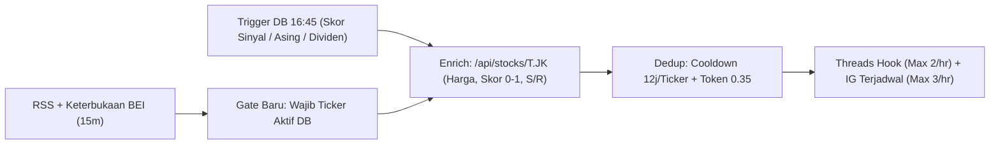

# Audit Eksternal: Content Flow & Agent Stack Sosmed `teknikal.id`

**Tanggal:** 29 Oktober 2026 | **Mode:** Read-Only Audit | **Pilar North Star:** `GROWTH` (Impressions & UV `/pasar`, `/stocks`) + `TRUST`
**Cakupan:** IG `@teknikal.id` + Threads `@teknikal.id` + Pipa atribusi kode repo `teknikal.id`

## Ringkasan Verdict (5 Baris)
1. **Alokasi mesin saat ini terbalik terhadap data:** sistem membakar 15 run/hari untuk memompa hingga +11 post/hari ke IG (hasil: 3 followers, 1 like/post), padahal 1 reply di post viral Threads menghasilkan `3,6K–20K views` (`120–660x` median post sendiri `~30 views`) namun `reply_scout` justru dibatasi maksimal 3/hari di sore hari saja.
2. **Gate RSS News Scout bias ke komoditas makro & drama:** kata kunci `ihsg/suspensi/ipo=3` + boost drama meloloskan berita klikbait CNBC/Detik tanpa nilai tambah teknikal, bertabrakan langsung dengan **Insights W44** bahwa satu-satunya konten di atas baseline (`2 likes`) adalah **brief saham spesifik**.
3. **Konversi `threads.com → situs` nyaris 0 akibat kombinasi salah tautan & BUG KODE LIVE:** self-reply Threads saat ini mempromosikan link sumber berita luar (bukan deep-link saham `teknikal.id`), DAN patch separuh jalan di `src/hooks/use-page-view.ts:64` vs `src/lib/validation.ts:240` membuat **100% klik `/s/th`, `/s/ig`, `/s/qr` tercatat `utmSource = NULL`** (tenggelam jadi `direct`).
4. **Ritme posting menabrak jam bursa BEI & melewatkan prime-time ritel:** IG Midday `12:00` telat 30 menit di hari Jumat (Sesi I tutup `11:30`) serta cepat basi di feed IG, Rekap Sabtu `17:30` berisiko mengulang angka Jumat karena bursa libur, sementara jam emas ritel selesai kerja (`19:30–20:45 WIB`) kosong dari konten saham spesifik.
5. **Threads Reply Bot baru berisiko halusinasi ticker & cap bot repetitif:** menyuntik `/api/market` saja tidak menjawab 80% komentar ritel yang menanyakan ticker spesifik di luar Top-5 movers (memicu `glm-5.3-flash` mengarang harga/sinyal beli), ditambah collector `21:30` belum merekam metrik komentar/reply sama sekali.

---

## 1. Alur RSS News (`Scout → Queue → Brain → Post`)

### Kritik Konkret
- **[P0 | Effort: 2,0 jam | Dampak: tinggi] Salah Gate Skor (Makro/Drama > Saham Spesifik) & Ketergantungan Portal Klikbait:**
  Skor `ihsg/suspensi/ipo = 3` + `43 drama keyword (+3)` membuat berita makro berulang dari CNBC/Detik (*"IHSG Kebakaran"*, *"Asing Kabur"*) selalu mengalahkan berita fundamental/teknikal emiten. Pembaca selesai di judul tanpa alasan mengunjungi `teknikal.id`, dan saham suspensi sering merupakan emiten gocap/delisting yang tidak relevan bagi mayoritas ritel. Ini melawan bukti W44 (`saham spesifik = 2 likes` vs `makro = 1 like`).
- **[P1 | Effort: 1,0 jam | Dampak: sedang] Dedup Token Containment `0.55` Bocor pada Sindikasi Multi-Portal:**
  Satu peristiwa yang ditulis ulang oleh CNBC, CNN, Detik, dan Investor.id dengan diksi berbeda memiliki token overlap `0.25–0.40` (`< 0.55`), sehingga lolos sebagai 3–4 item baru. Ini akar ledakan `+11 post/hari` (36 post dalam 4 hari di akun 3 followers) yang memicu penalti *low-engagement-rate* di algoritma IG.
- **[P1 | Effort: 1,5 jam | Dampak: sedang] Latency Worst-Case 74 Menit & Pemborosan Cron Hourly Brain untuk IG:**
  Berita rilis `09:02` → terjaring Scout `09:15` → baru diproses Brain `10:00` (basi 58–74 menit di lini masa cepat Threads). Sebaliknya, membiarkan Brain memposting ke IG setiap jam melanggar larangan Insights W44 (*"frekuensi JANGAN dinaikkan"*).

### Saran Actionable (Arsitektur `Ticker-First + DB Enrichment`)

1. **Rombak Rumus Gate News Scout:** Wajibkan kecocokan **≥1 ticker aktif likuid** dari 940 saham aktif DB (`isActive=true`, rata-rata transaksi `≥Rp1M/hari`, exclude 22 saham delisting Nov 2026) = **`+3 poin`**; turunkan kata `ihsg` tanpa ticker dari `3 → 1`. Tambahkan RSS Kontan Investasi/Bisnis Market + halaman Pengumuman UMA/Dividen BEI, dan kurangi bobot drama tanpa aksi korporasi nyata menjadi maks `+1`.
2. **Suntik Data DB Sebelum Masuk Brain (*Pre-Brain Enrichment*):** Saat Scout menangkap ticker `BBCA`, lampirkan JSON dari service SATU PINTU (`/api/stocks/BBCA.JK` + indikator): `close`, `changePercent`, `signalScore (0–1)`, `rsi14`, `support/resistance`, `1 lot = RpX`. Jika berita tidak bisa dipasangkan dengan minimal 1 saham di DB, **drop dari queue IG/Threads**.
3. **Dedup Berlapis + Pisahkan Jalur Breaking:** Pasang **Entity Cooldown 12 jam per `ticker`** dan **24 jam per `cluster_makro` (`ihsg/bi_rate/kurs`)**, serta turunkan containment threshold ke `0.35` dalam cluster ticker yang sama. Cabut izin auto-post IG dari hourly Brain; biarkan Brain dipicu langsung oleh Scout khusus saat ada breaking emiten Tier-1 (`gerak harga ≥4% + berita baru`, latency turun `<15 menit`).

---

## 2. Ritme Pagi / Siang / Sore & Kesesuaian Perilaku Ritel IDX

### Kritik Konkret
- **[P0 | Effort: 1,0 jam | Dampak: tinggi] Banjir Post IG (`+11/hari`) + Slot `12:00` Salah Kanal & Salah Jam Jumat:**
  Di akun 3 followers, memposting 11x/hari memberi sinyal rasio interaksi `~0%` ke algoritma IG. Khusus **IG Midday `12:00`**: (a) hari **Jumat Sesi I BEI tutup `11:30 WIB`** (jam `12:00` audiens pria sudah Jumatan dan data telat 30 menit); (b) feed IG didistribusikan 6–24 jam kemudian, sehingga post *"Cek Pasar Siang"* yang muncul di beranda orang pukul 20:00 langsung di-skip karena basi.
- **[P1 | Effort: 1,0 jam | Dampak: tinggi] Kosong di Prime-Time Ritel Malam (`19:30–20:45 WIB`) & Risiko Duplikat Rekap Sabtu `17:30`:**
  Investor ritel Indonesia (mayoritas pekerja kantoran) paling fokus membedah saham untuk besok pada **`19:30–21:00 WIB`**, sedangkan jadwal rutin berhenti pukul `17:30` (jam macet pulang kantor). Selain itu, **IG Rekap `17:30 Sen–Sab`** wajib dijaga demi janji bio, tetapi karena BEI tutup hari Sabtu, menjalankan skrip rekap harian yang sama di Sabtu `17:30` akan memposting ulang data Jumat.

### Saran Slot, Jam WIB & Format Baru (Total IG Feed Turun `11 → 2–3/hari`, Reply Naik `3 → 10/hari`)

| Jam (WIB) | Hari | Kanal & Aksi | Format Spesifik & Sumber Data `teknikal.id` (Tanpa Sinyal Beli/5m/Bandar) |
|---|---|---|---|
| **08:25** | Sen–Jum | **IG Carousel** *(tetap)* | **"3 Saham Pantauan Pagi"** (bukan makro global): Slide 1 cover 3 ticker, Slide 2–4 per ticker (`Skor Sinyal 0–1`, `Support–Resistance`, `1 Lot = RpX` dari answer-block baru), Slide 5 CTA `teknikal.id/s/ig-{ticker}`. |
| **09:15–10:30** | Sen–Jum | **Threads `reply_scout` #1** | **3 reply data-backed** pada post ritel/kreator saham yang ramai membahas mover pembukaan pasar. |
| **12:10** *(Jum **11:38**)* | Sen–Jum | **Threads Teks** *(ganti IG 12:00)* | **Rekap Sesi I + Pertanyaan Terbuka** (data `/pasar` setelah bar Sesi I stabil): sebut 2 saham mover vol `≥1M` + perubahan asing, tutup dgn pertanyaan diskusi ritel. *(IG Midday `12:00` dihapus dari feed).* |
| **12:15–13:15** | Sen–Jum | **Threads `reply_scout` #2** | **3 reply data-backed** saat jam makan siang kantor. |
| **17:30** | **Sen–Jum** | **IG Carousel** *(janji bio)* | **Rekap Penutupan BEI:** IHSG + Breadth + Top 3 Movers Likuid + Top Akumulasi Asing (`/aliran-dana-asing`). |
| **17:30** | **Sabtu** | **IG Carousel** *(janji bio)* | **"Rapor Mingguan BEI & 5 Perubahan Skor Sinyal Terbesar Pekan Ini"** (data `/laporan-pasar`, cegah duplikat Jumat). |
| **19:45** | Sen–Kam | **IG Single/3-Slide + Threads** | **"Bedah Teknikal 1 Saham Spesifik"** (replikasi format pemenang `2 likes`): bedah objektif 9 indikator awam 1 emiten populer + pertanyaan opini di Threads. |
| **19:30–21:00** | Setiap Hari | **Threads `reply_scout` #3** | **4 reply data-backed** di window trafik tertinggi Threads finansial Indonesia. |
| **10:30** | Minggu | **IG Carousel + Threads** | **Sunday Evergreen:** rotasi data halaman SEO baru `/kalender-dividen` (cum-date pekan depan), `/saham-modal-100-ribu` (non-gocap), & edukasi indikator `/akademi`. |

---

## 3. Dua Kanal (IG Visual vs Threads Teks+Reply), Cross-Promo & Funnel Situs

### Kritik Konkret
- **Verdict Pembagian Peran:** Mematikan auto-mirror IG→Threads hari ini **100% tepat**. Threads adalah **mesin distribusi & akuisisi** (jangkauan reply `40–500x` post sendiri), sedangkan IG adalah **etalase bukti kredibilitas visual** tempat orang menyimpan (*save*) level teknikal.
- **[P0 | Effort: 1,0 jam | Dampak: tinggi] BUG KODE LIVE di Repo — Atribusi `utmSource` Sosmed 100% Hilang di Database:**
  Inspeksi kode menemukan ketidaksinkronan fatal: `src/hooks/use-page-view.ts:25,64-70` sudah mengosongkan query string dari `path` (`path: pathname`) dan mengirim `utmSource/utmMedium/utmCampaign` sebagai field JSON terpisah, **tetapi** `schemas.pageview` di `src/lib/validation.ts:240-250` belum menerima field tersebut (otomatis di-strip Zod) dan `src/app/api/track/pageview/route.ts:95` masih memanggil `extractPageviewAttribution(data.path)` pada `path` tanpa query! Ditambah bug `src/hooks/use-page-view.ts:20` (`window.location.origin + undefined` → `"https://teknikal.idundefined"`). Akibatnya, **setiap klik dari `/s/th`, `/s/ig`, `/s/qr` tercatat `utmSource = NULL`**, dan karena WebView IG/Threads kerap mengosongkan `document.referrer`, trafik sosmed terbaca `0` (masuk `direct`).
- **[P0 | Effort: 1,0 jam | Dampak: tinggi] Self-Reply Threads Mengirim Trafik ke Portal Berita Luar & Shortlink `/s/th` Mendarat di `/`:**
  Mekanik *"self-reply sumber"* menaruh link portal berita (CNBC/Detik) di posisi konversi utama, menjadikan `@teknikal.id` kurir trafik gratis bagi media lain. Sementara di `src/lib/short-links.ts:20-34`, `/s/th`, `/s/ig`, dan `/s/qr` melempar pengunjung ke homepage `/` (bukan ke saham yang sedang dibahas atau `/pasar`), dan QR di `src/app/api/og/stock-story/route.tsx:111` tidak membawa parameter UTM.
- **[P1 | Effort: 1,0 jam | Dampak: sedang] Friksi "Caption IG via Komentar" & Kebocoran Warna Ungu/Indigo di Generator Visual:**
  Menaruh seluruh caption IG di komentar membuat teks **tidak terindeks IG Keyword Search** dan tenggelam saat ada komentar pengunjung. Selain itu, ditemukan pelanggaran larangan owner (`no purple/indigo branding`) di kode generator kartu: `src/app/api/og/stock-story/route.tsx:56,137,171` masih memakai `#818cf8` & `#6366f1` (indigo), dan `src/app/admin/social-cards/_components/SocialCardGenerator.tsx:52-54,62,67` memakai default `#5B21B6/#4338CA` (ungu/indigo).

### Saran Actionable Funnel & Cross-Promo
1. **Perbaiki Pipa UTM Server & Dynamic Ticker Shortlink (`src/lib/validation.ts`, `pageview/route.ts`, `src/lib/short-links.ts`):**
   - Terima `utmSource`, `utmMedium`, `utmCampaign` di `schemas.pageview` dan gunakan nilainya di `pageview/route.ts:156-158`.
   - Tambahkan pola dinamis tanpa DB di `resolveShortLink()` (`src/lib/short-links.ts:50`):
     - `teknikal.id/s/t-bbca` → `/stocks/BBCA.JK?utm_source=threads&utm_medium=reply&utm_campaign=t-bbca`
     - `teknikal.id/s/kn-bris` → `/saham/bris/kenapa-naik-hari-ini?utm_source=threads&utm_medium=reply&utm_campaign=kn-bris`
     - `teknikal.id/s/ig-bbca` → `/stocks/BBCA.JK?utm_source=instagram&utm_medium=slide&utm_campaign=ig-bbca`
     - Arahkan `/s/th` & `/s/ig` ke `/pasar` (Koran Saham Live — sesuai janji bio pantauan harian).
2. **Ganti Self-Reply Sumber menjadi "70/30 Curiosity-Gap Payoff":** Sebut sumber media cukup sebagai teks (`"Sumber berita: Investor.id"` tanpa link keluar), berikan 70% angka inti di post utama (`Harga, %Change, Skor Sinyal 0,xx`), dan isi self-reply dengan alasan klik spesifik: *"Rincian 9 indikator awam, level support-resistance & aliran asing {TICKER} hari ini (gratis tanpa login): teknikal.id/s/t-{ticker}"*.
3. **Standar IG Caption + Brand Hygiene:** Taruh 2 baris hook ber-keyword (`"Analisa Teknikal Saham BBCA..."`) langsung di field caption utama IG, cetak URL ketik-mudah `teknikal.id/s/ig-bbca` di footer slide visual + arahkan diskusi ke `"Threads @teknikal.id"`, serta ganti hex `#818cf8/#6366f1/#5B21B6` di `stock-story/route.tsx` & `SocialCardGenerator.tsx` ke biru/slate resmi (`#0284c7`, `#0ea5e9`, `#0f172a`).

---

## 4. Audit Threads Reply Bot Baru (`08–21` Jam-an)

### Kritik Risiko
- **[P0 | Effort: 1,5 jam | Dampak: tinggi] Risiko Halusinasi Angka Emiten & Jebakan "Sinyal Beli/Jual" akibat Hanya Memakai `/api/market`:**
  Endpoint `/api/market` (`stockMarketService.getMarketOverview()`) hanya memuat ringkasan IHSG, breadth, sektor, dan Top-5 movers. Ketika pengunjung berkomentar *"Min kalau ADRO / BBRI gimana?"* (saham di luar Top-5 hari itu), `glm-5.3-flash` tidak memegang angka emiten tersebut → berisiko tinggi **mengarang harga/RSI** atau terpancing menjawab *"boleh beli/tahan"* (melanggar larangan `no trading-signal-otomatis` & merusak kepercayaan data).
- **[P0 | Effort: 1,0 jam | Dampak: sedang] Pola Cron Presisi `:00` & "Template Hangat" Repetitif Memicu Cap Spam/Bot Meta:**
  Membalas komentar setiap jam tepat di menit `:00` via CDP Chrome menciptakan sidik jari otomasi periodik. Lebih buruk lagi, sapaan template seragam (*"Halo kak, terima kasih sudah mampir..."*) terlihat berderet di tab *Replies* profil `@teknikal.id`, membuat calon follower yang mengintip profil langsung batal follow.
- **[P1 | Effort: 1,0 jam | Dampak: sedang] Risiko Infinite Ping-Pong Loop, Emotikon Basa-Basi, & Umpan Bandarmologi/Troll:**
  Tanpa batas balasan per user per utas, ucapan *"sip makasih min"* di bawah `<1 jam` akan dibalas lagi di jam berikutnya. Komentar pancingan *"bandar lagi akumulasi nih"* juga berisiko diiyakan LLM dan melanggar pantangan `no bandarmologi`.
- **[P1 | Effort: 1,0 jam | Dampak: tinggi] Kebutaan Analytics Collector `21:30` terhadap Performa Komentar & Reply:**
  Collector saat ini hanya mencatat followers dan likes 4 post terbaru (`komentar belum terekam`). Tanpa metrik `reply_views` dan `comments_count`, `Growth Analyst Senin 08:00` buta terhadap kanal pertumbuhan utama kita sendiri.

### Saran Pengembangan Reply Bot
1. **Dynamic Ticker Lookup + Hard Guardrail Non-Advisory:** Ekstrak regex `\b[A-Z]{4}\b` dari komentar pengunjung → validasi ke 940 ticker aktif → fetch `/api/stocks/{T}.JK` & `/api/stocks/{T}.JK/indicators`. Jika user tanya *"beli/jual/TP?"*, wajibkan struktur: **Fakta EOD/Live (Harga, Skor Sinyal `0,xx`, RSI/posisi MA20) + Penolakan halus non-rekomendasi + Link `/s/t-{ticker}` + 1 pertanyaan balik** (mis. *"Horizon pegangnya buat swing mingguan atau dividen kak?"* untuk memancing reply ke-2 yang mengangkat ranking post). Jika ticker tidak ada di komentar, baru gunakan `/api/market`.
2. **Filter Intent 3-Jalur + Cap `1 Reply/User/Post` + Jitter Waktu:**
   - Komentar `<4 kata` tanpa tanda tanya/ticker (*"mantap"*, *"🔥"*) → **cukup klik Like via CDP**, jangan balas teks.
   - Komentar mengandung kata `bandar/goreng/pompom/kasar` → **skip 100%**.
   - Tambahkan **random delay `2–14 menit`** pada trigger cron + jeda `30–75 detik` antar-balasan, hapus salam pembuka CS, dan batasi `max 1 teks auto-reply per username per post`.
3. **Upgrade Collector `21:30`:** Scrape tab `Replies` Threads (`views`, `likes`, `replies` pada 15 reply terakhir kita) + jumlah komentar di post sendiri + query harian klik DB `PageView WHERE utmSource IN ('threads','instagram')` ke `analytics.jsonl` untuk bahan `insights.json` Senin `08:00`.

---

## 5. Top 3 Perubahan Berdampak Tertinggi (30 Hari ke Depan, Infra Sekarang, Rp 0)

| Prioritas | Perubahan Konkret (Tanpa Tools Berbayar) | Label, Effort & Dampak | Target Terukur 30 Hari |
|---:|---|---|---|
| **#1** | **Sambung Pipa Konversi & Atribusi yang Putus:** 1. Fix bug `utmSource=NULL` di `src/lib/validation.ts:240`, `src/app/api/track/pageview/route.ts:95,156`, & `src/hooks/use-page-view.ts:20`. 2. Aktifkan dynamic shortlink `/s/t-{ticker}`, `/s/kn-{ticker}`, `/s/ig-{ticker}` + ubah `/s/th` & `/s/ig` → `/pasar` di `src/lib/short-links.ts` (+ UTM QR & hapus hex indigo di `stock-story/route.tsx:56,111,137,171`). 3. Ubah seluruh self-reply Threads & CTA Reply Bot dari link portal berita luar menjadi deep-link `teknikal.id/s/t-{ticker}`. | **[P0]** Effort: **2,5 jam** Dampak: **tinggi** | Sesi web terukur dari `utm_source IN ('threads','instagram','social')` naik dari **`~0` → `300–600 sesi/30 hari`**; `0%` trafik klik bocor ke portal berita luar. |
| **#2** | **Re-Alokasi Mesin ke "3-Wave Data Sniper Replies" & Pangkas Spam IG:** 1. Stop auto-post IG dari hourly Brain & hapus IG Midday `12:00` (turunkan IG dari `+11/hari` → **2–3 post/hari**: `08:25` 3 Saham Pagi, `17:30` Rekap/Sabtu Mingguan, `19:45` Bedah 1 Saham Spesifik). 2. Ekspansi `reply_scout` dari `max 3 sore` menjadi **10 reply/hari dalam 3 wave** (`09:15`, `12:15`, `19:30`) pada post saham viral `<3 jam` dengan injeksi angka DB `teknikal.id` (`Skor Sinyal 0–1`, `RSI`, `Support/Resistance`, `Asing 5D`) — 70% murni nilai data (pancing kunjungan profil), 30% + `/s/t-{ticker}`. | **[P0]** Effort: **4,0 jam** Dampak: **tinggi** | `300 reply/30 hari` × eksposur post viral → **`150K–450K` impresi komentar organik**; followers Threads naik **`2 → 80–150`**, IG naik **`3 → 35–70`** dgn rata-rata likes/saves keluar dari lantai `1/post`. |
| **#3** | **Ticker-First Queue + Hardening Reply Bot + Closed-Loop Collector:** 1. Ubah gate News Scout menjadi **Wajib Ticker Aktif Likuid DB + Cooldown 12j/Emiten** + tambah trigger non-RSS `16:45` dari DB (`Perubahan Skor Sinyal`, `/aliran-dana-asing`, H-3 `/kalender-dividen`). 2. Pasang ekstraktor ticker `/api/stocks/{T}.JK`, guardrail anti-sinyal-beli/bandarmologi, jitter waktu, & cap `1 reply/user` di Threads Reply Bot. 3. Rekam `reply_views`, `comments_count`, & klik UTM DB harian di Collector `21:30` → suapkan ke `Growth Analyst Senin 08:00`. | **[P1]** Effort: **3,5 jam** Dampak: **tinggi** | `100%` konten & balasan punya anchor data saham spesifik `teknikal.id` (`0` halusinasi harga, `0` duplikat berita sindikasi); rekomendasi Senin `insights.json` berbasis klik web & views reply nyata. |
