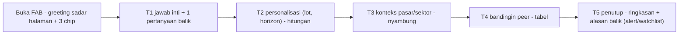

# Juri Produk — Tanya AI (10 transkrip live, 30 Okt 2026)

> Juri independen (bukan pembuat fitur). Read-only, satu file output ini aja.
> Basis: 10 transkrip prod (glm-5.3-flash). Kriteria per transkrip: **routing** (ngerti maksud + ambil data yang tepat) · **analisa** (ada "so what"-nya, angka bener) · **bahasa** (enak dibaca retail).

**Verdict umum: BELUM OKE untuk "sekelas Gemini/Claude", tapi fondasinya sudah bener.** Halaman saham (stock page) udah CUKUP–OK: jawabannya terstruktur, jujur soal data yang nggak ada, dan chip follow-up-nya relevan. Halaman **screener** jauh di bawah: jawabannya cuma satu paragraf, pembukanya diulang-ulang, label yang dipakai nggak punya kriteria ("golden cross", "gorengan", "sehat"), dan ada kata-kata aneh. Rata-rata: **6,0/10**.

---

## 1. Tabel skor

| # | Konteks · Pertanyaan | Skor | Verdict | Masukan spesifik (1 hal paling penting) |
|---|---|---|---|---|
| 1 | stock/BBCA · "nyangkut di 6000" | **7,5** | OK | Empatinya dapet, levelnya lengkap. **Tapi pertanyaan aslinya ("gimana dong?") belum dijawab.** Retail yang nyangkut butuh **hitungan skenario**: BEP butuh +21,5% (4.940→6.000); kalau average down di 4.740 avg jadi 5.370 (BEP +8,7%), tapi eksposurnya dobel. Tambah chip *"Berapa lot & horizon kamu?"* biar turn-2 bisa dipersonalisasi. Bug kecil: urutan support kebalik (support **awal** itu 4.740, baru 4.550), "panel" → "panik", dan "kalau kita di akhir Oktober" artinya bot nggak tahu tanggal hari ini → **inject `today` ke system prompt**. |
| 2 | stock/BBRI · "kenapa turun terus?" | **7** | OK | Formatnya oke ("kandidat penjelas" + "yang tidak ada di data" = jujur, bagus). **Yang miss: konteks pasar.** Hari itu IHSG -3,49% dan asing buang BBCA/BBRI/BMRI barengan, jadi jawaban yang bener itu *"satu sektor bank lagi dibuang, bukan cuma BBRI"*. Di stock page, konteks IHSG + sektor + peers belum di-inject → **tambah blok `marketContext` ke prompt stock page** (reuse `market-snapshot.service`). Selain itu, ngutip artikel teknikal.id sendiri ("judul merah, label Bearish") sebagai *penyebab* itu argumen muter, karena artikelnya dibuat dari data yang sama. Typo: "bullis". |
| 3 | stock/TLKM · "dividennya masih aman?" | **5,5** | CUKUP | **Insight paling penting kelewat padahal datanya ada.** Yield 10,43% × harga 1.980 ≈ DPS **Rp206**, sedangkan EPS **176,5** → payout **~117%**. Dividennya lebih gede dari labanya. Itu jawaban *"aman nggak"* yang paling tajam, dan bot malah bilang "nggak bisa disimpulkan". **Prompt: wajib hitung metrik turunan** (payout = DPS/EPS, BEP, jarak ke support %) sebelum bilang "data tidak ada". Satu lagi: angka mentah "10,4283%" bocor, harusnya 2 desimal. Ada juga inkonsistensi data: BBCA punya DPS + ex-date, TLKM nggak → cek coverage tabel dividen (ada `/kalender-dividen`, jadi datanya harusnya bisa di-reuse). |
| 4 | stock/ANTM · "bandingin sama INCO" | **8** | OK | Ini **jawaban terbaik dari 10**: ada tabel, trade-off dua sisi, dan satu poin pantauan. Perbaiki: (a) "INCO lebih **malam**" maksudnya "lebih dalam", "kapan **tuang**" maksudnya "kapan dibagi"; (b) kolom "Sinyal -0,58 vs -0,36" nggak dijelasin artinya, padahal user awam nggak paham skala skor → tambah 1 baris legenda; (c) data INCO bolong (nggak ada BB/support) padahal big cap → cek kenapa compare-nya nggak ambil indikator lengkap. Kalau ada, sebut juga driver komoditas (nikel/emas). Kalau datanya nggak ada, bilang terus terang. |
| 5 | screener · "saham apa yang lagi oke hari ini?" | **6** | CUKUP | Di hari IHSG -3,49%, saham yang "oke" itu yang **relative strength**-nya kuat (hijau pas pasar merah, volume naik). Bukan cuma yang skornya tinggi. Format juga perlu: jangan satu paragraf, pakai **mini-tabel 3–5 baris** (ticker · %chg · skor · alasan 1 frasa). "situ arahnya ke sana" itu kalimat rusak. Sinyal teknikal dan net-buy asing disebut terpisah, padahal insightnya ada di **irisan** keduanya. |
| 6 | screener · "apa itu golden cross?" | **4** | **JELEK** | Definisinya bener. **Tapi INCI/ASPI/MBSS disebut "karakter bullish pas golden cross" padahal sama sekali nggak dicek apakah mereka beneran golden cross.** Itu cuma saham skor tertinggi. Ini **misleading**, dan merusak trust lebih parah dari typo. Fix routing: pertanyaan edukasi → jawab edukasi (+ caveat: indikatornya lagging, sering false signal kalau pasar sideways). Kalau mau kasih contoh, **ambil dari screen yang memang sudah ada (`/saham-golden-cross`)**, jangan dari skor generik (sesuai rule REUSE). Kalau screen-nya kosong, bilang kosong. Desimal juga campur ("0.66" vs "0,66"). |
| 7 | screener · "IHSG kenapa anjlok kemarin?" | **6** | CUKUP | Mekanismenya bener (asing jual bank big cap). Tapi (a) **"pemicu utamanya keliatan jelas" itu overclaim**: net sell asing itu *mekanisme*, bukan *pemicu*. Pemicu makro/news nggak ada di data, dan ini harus bilang terus terang kayak jawaban #2. (b) **"rotasi ke energi" nggak didukung angka**: keluar ±Rp808 M dari 3 bank, masuk cuma ±Rp65 M ke BUMI+CUAN. Itu bukan rotasi, itu *exit*. (c) Breadth (naik/turun/flat) dan sektor terburuk nggak ada, padahal ada di snapshot. Disclaimer "bukan rekomendasi beli" di pertanyaan *kenapa* juga kerasa template. |
| 8 | screener · "saham syariah yang sehat?" | **5,5** | CUKUP | User bilang **"sehat"**, artinya fundamental (laba positif, utang wajar, ROE). Bot malah jawab pakai skor teknikal doang. Wajib **sebut kriterianya di kalimat pertama** ("sehat = laba positif + DER < 1 + tren di atas SMA50") dan filter pakai itu. Bot sendiri juga bingung ("INCI agak aneh skornya vs harganya"). Jujur sih, tapi itu tanda skor EOD lagging terhadap harga hari ini → perlu penjelasan *skor dihitung per close kapan*. Status syariah (ISSI/DES) juga perlu dikonfirmasi sumbernya. |
| 9 | screener · "asing lagi borong apa?" | **5** | CUKUP | Datanya benar, **bahasanya rusak**: "asing hari ini justru **kelola besar**", "kontribusi besar **kepenjeblokan**", "jadi arusnya rotate…, **bukan borong**" (kontradiktif, user nanya yang diborong kok dijawab "bukan borong"). Link juga nggak konsisten: BUMI/CUAN/AMRT cuma bold, sedangkan bank di-link. Isinya ±80% sama dengan #7 → turn screener butuh **variasi pembuka** (jangan semua dimulai "IHSG anjlok -3,49%"). Satuan "M" juga ambigu (miliar atau million?) → standarkan "Rp34,9 miliar". |
| 10 | screener · "emiten gorengan yang waspada?" | **4** | **JELEK** | **Risiko trust dan legal.** Bot melabeli GMTD/KOPI/KOKA "gorengan" cuma karena turun paling dalam dan skornya rendah. Itu definisi *top loser*, bukan gorengan. Gorengan butuh kriteria eksplisit: market cap kecil, free float rendah, volatilitas/ATR% ekstrem, lonjakan volume tanpa berita, riwayat UMA/suspensi. Fix: **jangan pakai kata "gorengan" ke emiten spesifik**, ganti "saham dengan **profil risiko tinggi** (kriteria: …)" dan tampilkan kriterianya. Ada yang bagus juga: nasihat "jangan asal average down" itu tepat. |

**Rata-rata: 6,0** · Stock page **7,0** · Screener **5,1**

### Pola yang muncul di banyak transkrip (lebih penting dari skor per baris)

1. **Label waktu "hari ini" vs data EOD.** BBRI bilang "turun -3,77% **hari ini**", screener bilang "IHSG anjlok **hari ini**", tapi #7 bilang "**kemarin**" untuk angka yang sama, dan TLKM/ANTM pakai "per 29 Okt". Kalau user buka jam 13:50 pas sesi 2, ini kebaca sebagai data hari ini yang salah. **Wajib: selalu tulis "close 29 Okt", dan saat jam bursa pakai `live-quotes`.**
2. **Satuan asing berantakan.** Kadang "juta lembar", kadang "Rp…M", kadang "juta" tanpa satuan. Ada juga kecurigaan inkonsistensi data: BBCA di stock page "-82,97 juta (5 hari)", padahal di screener BBCA net sell **Rp494 M dalam 1 hari**. Kalau 82,97 juta itu lembar (×~5.000 ≈ Rp415 M untuk 5 hari), angkanya *lebih kecil* dari 1 hari → **perlu dicek CTO**, ini bisa melanggar invariant konsistensi lintas halaman.
3. **Kata aneh/typo khas model flash**: panel, bullis, malam, tuang, kelola besar, kepenjeblokan, "situ arahnya ke sana". 1 kata aneh per jawaban udah cukup bikin kesan "bot murahan".
4. **Disclaimer template di akhir tiap jawaban** (5 variasi kalimat). Pindahin ke **footer UI permanen**, terus di teks cukup sesekali kalau topiknya memang beli/jual.
5. **Format screener = 1 paragraf, stock page = terstruktur.** Kualitasnya kerasa beda kelas antar halaman.
6. **Chip follow-up kadang ngajak bot jawab hal yang dia tolak** ("BUMI layak dibeli sekarang?", "GMTD masih layak ditahan?"). Ujungnya pasti disclaimer. Chip harus **bisa dijawab pakai data**: "BUMI di atas SMA20 belum?", "Level invalidasi GMTD?".

---

## 2. FLOW YANG ENAK (5 turn, contoh: user lagi di `/saham/BBCA`)

**T0 — buka FAB (greeting sadar halaman, tanpa user ngetik)**
> 👋 Lagi lihat **BBCA** ya. Close **29 Okt: 4.940 (-6,35%)**, tinggal 4% di atas low 52 minggu (4.740). Asing lagi net sell di semua bank besar.
> Mau mulai dari mana?
> `[Kenapa turun dalam?]` `[Aku nyangkut, gimana?]` `[Level penting minggu ini]` `[Bandingin sama BBRI]`

**T1 — user: "aku nyangkut di 6000"**
> Minus **17,7%**, wajar kalau kepikiran. Biar nggak emosional, ini posisinya:
> - Buat balik ke 6.000, harga perlu naik **+21,5%**. Tren masih turun (di bawah SMA20 5.565, ADX 28,7 = turunnya kuat).
> - **Garis invalidasi:** close di bawah **4.740** (low 52 minggu). Tembus itu, acuan berikutnya **4.550**.
> - **Tanda tekanan reda:** reclaim **5.275**, terus asing berhenti net sell 2–3 hari.
>
> Biar aku bisa hitung skenario yang pas buat kamu: **pegang berapa lot, dan horizonnya berapa lama?**
> `[10 lot, 1 tahun]` `[Trading, < 1 bulan]` `[Kenapa asing jual?]`

**T2 — user: "10 lot, horizon setahun"**
> Oke, modal awal **Rp6 jt**, nilai sekarang **Rp4,94 jt** (-Rp1,06 jt). Tiga skenario (cuma hitungan, bukan suruhan):
>
> | Skenario | Avg | BEP butuh naik | Eksposur | Kalau tembus 4.550 |
> |---|---|---|---|---|
> | Diam | 6.000 | +21,5% | Rp6 jt | -Rp1,45 jt |
> | Avg down 10 lot @4.740 | 5.370 | +8,7% | Rp10,74 jt | -Rp1,64 jt |
> | Kurangi separuh | 6.000 | +21,5% (sisa 5 lot) | Rp3 jt | -Rp0,72 jt |
>
> Average down bikin BEP lebih dekat, **tapi** risikonya dobel kalau 4.740 jebol. Buat horizon setahun, PE 10,2 dan yield 6,6% jadi bantalan. Yang belum mendukung: arus asing.
> `[Kenapa asing jual bank?]` `[Kapan dividen BBCA berikutnya?]` `[Bandingin sama BBRI]`

**T3 — user: "kenapa asing jual?"** (nyambung, nggak ngulang dari nol)
> Bukan cuma BBCA: 29 Okt asing net sell **BBCA Rp494 miliar, BBRI Rp162 miliar, BMRI Rp152 miliar**. Satu sektor dibuang barengan, dan IHSG ikut -3,49%. Artinya ini tekanan **sektor/makro**, bukan masalah spesifik BBCA.
> ⚠️ Pemicu makronya (kurs/suku bunga/global) **nggak ada di data kami**, jadi aku nggak mau nebak.
> `[Asing sudah jual berapa hari?]` `[Bandingin sama BBRI]`

**T4 — user: "bandingin sama BBRI"** → tabel kayak jawaban ANTM vs INCO (yang terbaik sejauh ini) + 1 kalimat: *"Buat posisi kamu, bedanya BBRI yield lebih tinggi tapi payout perlu dicek…"*

**T5 — penutup (inisiatif bot, bukan nunggu user)**
> **Ringkasan BBCA kamu:** avg 6.000 · garis invalidasi **4.740** · tanda reda **5.275 + asing berhenti jual**.
> Mau aku kabarin kalau **BBCA close di bawah 4.740** atau **asing net buy 2 hari berturut**? Biar kamu nggak perlu mantengin chart tiap jam.
> `[🔔 Pasang alert]` `[⭐ Tambah ke watchlist]` `[Cukup dulu, makasih]`

**Kenapa flow ini enak:** (1) greeting langsung kasih nilai tanpa user ngetik; (2) bot **nanya balik 1 hal** yang bikin jawaban jadi personal; (3) tiap turn nyambung ke turn sebelumnya (pakai avg 6.000 & 10 lot); (4) penutupnya kasih **alasan konkret buat balik** (alert/watchlist), bukan disclaimer. Halaman `/watchlist` udah ada, jadi alert = langkah kecil berikutnya.

---

## 3. GAP TERBESAR vs Gemini/Claude (yang paling kerasa kalau aku user)

1. **Datanya ada, kesimpulannya nggak diturunin ("so what" gap).** Gemini/Claude refleks ngitung: payout TLKM 117%, BEP nyangkut +21,5%, "rotasi" yang ternyata cuma 8% dari outflow. Tanya AI cuma *membacakan* angka. Ini gap #1. Fix murah: di prompt, daftar **metrik turunan wajib** per intent (dividen → payout; nyangkut → BEP & skenario avg; compare → selisih %; market → breadth & proporsi flow), terus ada **cek konsistensi klaim** ("rotasi" butuh inflow ≥ 50% outflow).
2. **Nggak ada konteks & memori: pasar, sektor, dan user.** Claude bakal nanya *"kamu pegang berapa, horizonnya apa?"* lalu jawabannya jadi personal. Tanya AI jawab semua orang sama. Di stock page, IHSG -3,49% dan sektor bank yang dibuang barengan nggak disebut sama sekali (#2), padahal itu penjelasan paling penting. User ngerasain ini sebagai "bot-nya nggak nyambung".
3. **Polish bahasa + kejujuran label.** Satu typo/kata aneh ("kepenjeblokan"), satu label tanpa kriteria ("golden cross", "gorengan", "sehat"), atau satu "hari ini" yang ternyata data kemarin, itu yang bikin orang langsung tahu ini *bukan* Claude. Gemini/Claude jarang salah kata, dan kalau nggak yakin mereka bilang kriterianya. Buat produk finansial, **trust > fitur**.

*(Runner-up: "kenapa" tanpa berita. Gemini punya grounding web, Tanya AI nggak. Selama nggak ada feed berita, jujur bilang "pemicu nggak ada di data" secara KONSISTEN itu udah menang trust. Sekarang ini cuma konsisten di stock page, nggak di screener.)*

---

## 4. MASUKAN BEBAS (biar naik kelas)

**Trust (prioritas 1)**
- **Badge freshness di tiap jawaban**: `📊 Data close 29 Okt 16:00` atau `🟢 Live 13:50` (pakai `live-quotes` pas jam bursa). Hapus kata "hari ini" kalau datanya EOD.
- **Glosarium satuan baku** di system prompt: asing = **Rp miliar** (bukan "M"), volume = **juta lembar**, desimal koma, maksimal 2 desimal, harga pakai titik ribuan.
- **"Kriteria dulu, daftar kemudian"** untuk semua kata sifat subjektif (oke, sehat, gorengan, murah, kuat). Satu baris kriteria = trust naik drastis, sekaligus pelindung legal.
- **Larangan menempelkan contoh saham ke konsep yang nggak diverifikasi** (kasus golden cross). Contoh harus datang dari screen yang beneran (`/saham-golden-cross`, `/saham-oversold`, `/saham-volume-spike`, `/aliran-dana-asing` udah ada semua → REUSE).
- **Self-check pasca-generate** (murah, bisa rule-based): regex kata aneh/typo list, cek desimal, cek setiap ticker yang disebut di-link, cek nggak ada frasa "kalau kita di akhir Oktober".

**Format**
- Screener disamakan kualitasnya dengan stock page: **jawaban 1 kalimat → mini-tabel 3–5 baris → 1 poin pantauan**. Tabel itu bentuk yang paling "Claude-like" dan paling enak buat retail.
- **Variasi pembuka.** 5 dari 6 jawaban screener mulai dengan "IHSG anjlok -3,49%". Cukup sebut sekali di greeting, sisanya langsung ke inti.
- **Disclaimer ke footer UI permanen** (abu-abu kecil). Di teks cuma muncul kalau user nanya beli/jual.
- Ticker selalu jadi **link + mini-chip harga** (`BUMI +2,1%`), jangan campur bold dan link.

**Fitur yang bikin balik lagi**
- **Alert dari chat** ("kabarin kalau tembus 4.740"). Ini *alasan balik* paling kuat, dan nyambung ke `/watchlist`.
- **Kalkulator nyangkut/average down inline.** "Nyangkut" itu pertanyaan #1 retail Indonesia, dan Tanya AI bisa jadi satu-satunya bot yang jawab pakai angka posisi user.
- **Greeting sadar halaman di semua halaman**: `/kalender-dividen` → "ex-date minggu ini: …"; `/aliran-dana-asing` → "asing paling getol beli 5 hari: …".
- **"Kartu ringkasan" di akhir sesi** yang bisa di-share (WA/Telegram). Ini growth loop gratis.

**Tone**
- Santainya udah pas. Yang perlu dibuang: kata yang *dipaksa gaul* tapi salah ("tuang", "kelola besar", "malam"). Aturan prompt: **"kalau ragu sama sebuah kata gaul, pakai bahasa Indonesia baku sehari-hari."**
- Pertahanin yang udah bagus: empati 1 kalimat di awal (#1), bagian "yang tidak ada di data" (#2, #3), trade-off dua sisi (#4), dan "jangan asal average down" (#10).

**Prioritas eksekusi (saran juri → CTO queue)**

| P | Item | Effort | Dampak |
|---|---|---|---|
| P0 | Inject `today` + label freshness, berhenti pakai "hari ini" untuk data EOD | S | Trust |
| P0 | Golden cross & gorengan: contoh wajib dari screen yang sudah ada / kriteria eksplisit | S | Trust + legal |
| P0 | Cek inkonsistensi asing BBCA (stock page -82,97 jt/5 hari vs screener Rp494 M/1 hari) | S | Invariant konsistensi |
| P1 | Glosarium satuan + desimal + blacklist kata aneh (post-check) | S | Bahasa |
| P1 | Metrik turunan wajib per intent (payout, BEP, proporsi flow) | M | Analisa |
| P1 | `marketContext` (IHSG + sektor + peers) di prompt stock page, reuse `market-snapshot.service` | M | Nyambung |
| P2 | Format screener = tabel; disclaimer ke footer; chip harus bisa dijawab data | S | Format |
| P2 | Pertanyaan balik (lot/horizon) + kalkulator nyangkut | M | Personal |
| P3 | Alert dari chat + kartu ringkasan shareable | L | Retensi/growth |

**Bottom line:** analisa di stock page udah 70% jalan menuju "Claude spesialis saham". Yang belum ada itu **disiplin**: hitung metrik turunannya, sebut kriterianya, label waktunya jujur, bahasanya rapi. Kalau P0+P1 beres, ekspektasi skor rata-rata naik dari **6,0 → 7,5+** tanpa ganti model.
