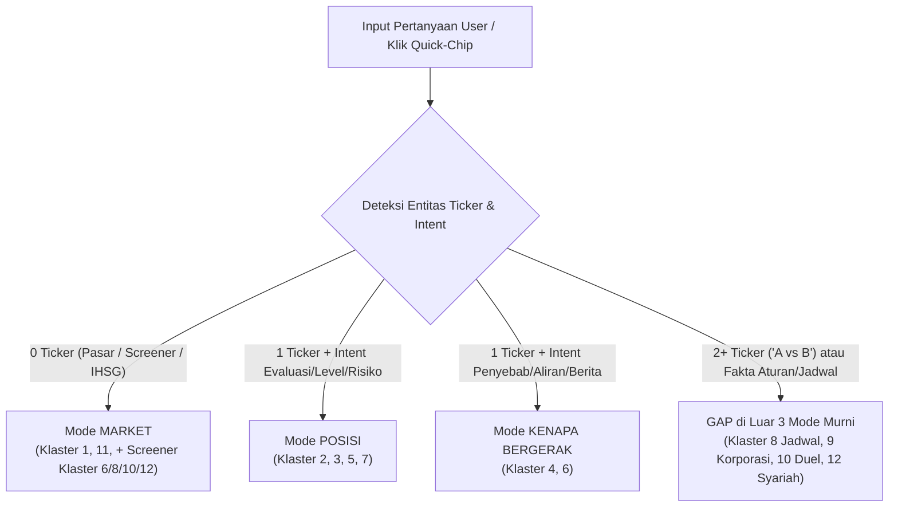

# Riset Produk: Taxonomi Pertanyaan Investor Ritel Indonesia & Desain Fitur AI `teknikal.id`

**Tanggal:** 30 Oktober 2026 | **Mode:** Read-Only Product & UX Research | **Pilar North Star:** `STICKY` (`returning_ip_pct ≥8%`, `dwell_median_s ≥45s`) + `AI_SEARCH` + `TRUST`
**Konteks Teknis `teknikal.id`:** Migrasi AI user-facing dari MLX lokal (`gemma-3-4b`, serial ~7s) ke **`glm-5.3-flash` via Z.ai** (paralel ~3,5s, MLX sebagai fallback otomatis) untuk mendukung 3 mode baru (**MARKET**, **POSISI**, **KENAPA BERGERAK**) + **Quick-Chips Instan**, tetap terikat doktrin *angka 100% dari PostgreSQL DB (nol karangan LLM)* dan kepatuhan non-rekomendasi OJK.

---

## 1. Taxonomi Lengkap Pertanyaan Ritel Indonesia Soal Saham (12 Klaster Bahasa Sehari-hari)

Berdasarkan penelusuran langsung pada *Google Indonesia Autocomplete & People Also Ask (`hl=id&gl=id`)*, utas diskusi *Reddit `r/finansial`*, *Quora Indonesia*, *Stockbit Stream*, dan komentar kanal *YouTube Saham Indonesia* pada Oktober 2026, pertanyaan ritel Indonesia terbagi ke dalam **12 klaster utama** berikut (masing-masing disertai contoh frasa **asli/verbatim** yang diketik user):

### Klaster 1 — Ide Saham Harian & Screening Cepat (*Market Discovery*)
User datang tanpa ticker spesifik dan ingin disodori kandidat saham yang sedang bergerak positif, murah secara teknikal, atau cocok untuk modal terbatas.
- `"saham apa yang bagus dibeli hari ini"` *(Google Autocomplete ID)*
- `"saham apa yang akan naik hari ini"` *(Google Autocomplete ID)*
- `"saham apa yang bagus untuk pemula"` *(Google Autocomplete ID)*
- `"modal 100 ribu bisa beli saham yang bagus"` *(Google Autocomplete ID)*
- `"Saham apa saja yang ada di Indonesia dan tips bagi pemula untuk mulai investasi?"` *(Quora Indonesia)*

### Klaster 2 — Kelayakan Beli, Timing Entry & Harga Wajar (*Entry Validation*)
User sudah mengincar 1 kode saham (sering karena baru turun atau sedang ramai) dan meminta kepastian apakah sekarang waktu yang tepat untuk masuk atau justru *value trap* / pucuk.
- `"apakah saham bbri masih layak dibeli"` *(Google Autocomplete ID)*
- `"Ada yg pny insight BBCA perkiraan bottom ny d level brp?"` *(Reddit `r/finansial`)*
- `"harga wajar saham bmri"` / `"harga wajar saham bumi 2026"` *(Google Autocomplete ID)*
- `"kapan beli saham yang tepat"` *(Google Autocomplete ID)*
- `"Min, saham ini PER sama PBV-nya udah murah banget, tapi kok dibilang value trap? Penjelasannya dong buat pemula."` *(Komentar YouTube Saham ID)*

### Klaster 3 — Dilema Posisi & Saham Nyangkut (*Hold, Cut Loss, atau Average Down*)
Klaster dengan muatan emosi tertinggi. User mengalami *floating loss* (sering akibat FOMO atau beli tanpa *trading plan*) dan bingung harus keluar rugi, tahan, atau tambah muatan (*serok bawah*).
- `"BBRI: should I cut loss? INVEST."` *(Reddit `r/finansial`)*
- `"mending cut loss atau average down"` / `"cut loss atau hold"` *(Google Autocomplete ID)*
- `"saham nyangkut lalu apa solusinya"` / `"nyangkut di saham goto"` *(Google Autocomplete ID)*
- `"saham nyangkut di 50"` *(Google Autocomplete ID — merujuk saham parkir di Rp50/gocap)*
- `"Terjebak aset banyak tapi nyangkut semua (Asset Rich Cash Poor). Ada yang pernah ngalamin? Advice needed"` *(Reddit `r/finansial`)*

### Klaster 4 — Diagnostik Pergerakan Harga Mendadak (*Kenapa Naik / Turun?*)
User melihat perubahan persentase tajam di portofolio/running trade dan mencari penyebab instan (berita, aksi asing, komoditas, atau sekadar koreksi teknikal).
- `"kenapa saham bbca turun terus hari ini"` / `"kenapa saham bbca anjlok"` *(Google Autocomplete ID)*
- `"Mengapa saham ADRO anjlok?"` *(Reddit `r/finansial`)*
- `"kenapa saham bbca naik hari ini"` *(Google Autocomplete ID)*
- `"Rumor katanya saham Bbca bakal di caplok DBS. Ini good news apa bad news ya?"` *(Reddit `r/finansial`)*
- `"GOTO & CPIN didepak MSCI, tapi BBNI & EXCL malah naik di hari yang sama. Market cap gede ternyata ga jamin apa-apa?"` *(Reddit `r/finansial`)*

### Klaster 5 — Level Teknikal, ARA/ARB, Papan FCA & Setup Auto Order (*Tactical Microstructure*)
Spesifik mikrostruktur Bursa Efek Indonesia (BEI): trader menanyakan titik *support/resistance*, batas *Auto Reject Atas/Bawah* (ARA/ARB), kepanikan tidak bisa jual saat ARB/FCA (*Full Call Auction* / Papan Pemantauan Khusus), serta cara memasang *Auto Order* (beli saat *breakout* atas / jual otomatis *stop loss* bawah).
- `"support resistance saham bbri"` / `"support dan resistance saham antm"` *(Google Autocomplete ID)*
- `"saham ara berapa persen"` / `"saham ara hari ini"` *(Google Autocomplete ID)*
- `"saham arb apakah bisa dijual"` / `"saham arb tidak bisa dijual"` *(Google Autocomplete ID)*
- `"auto order saham adalah"` / `"rsi saham yang bagus"` *(Google Autocomplete ID)*
- `"fca saham berapa hari"` / `"fca saham jam berapa"` *(Google Autocomplete ID)*

### Klaster 6 — Bandarmologi, Arus Dana Asing & Anomali Volume (*Flow & Accumulation*)
Khas kultur pasar saham Indonesia: ritel sangat terobsesi melacak jejak "bandar" (*market maker*) dan *foreign flow* (akumulasi vs distribusi) sebelum ikut masuk.
- `"bandar akumulasi dan distribusi"` / `"ciri bandar akumulasi"` *(Google Autocomplete ID)*
- `"screener bandar akumulasi"` *(Google Autocomplete ID)*
- `"asing net buy saham apa hari ini"` / `"asing net buy hari ini"` *(Google Autocomplete ID)*
- `"cara tahu saham akan naik atau turun"` *(Google Autocomplete ID)*

### Klaster 7 — Identifikasi Saham Gorengan, UMA & Risiko Pompom (*Volatility & Trap*)
Ritel ingin memverifikasi apakah lonjakan suatu saham lapis dua/tiga murni kinerja atau sedang "digoreng" bandar dan rawan terkena UMA (*Unusual Market Activity*) / suspensi BEI.
- `"Bagaimana caranya untuk mengetahui apabila suatu saham adalah saham gorengan?"` *(Quora Indonesia)*
- `"Bagaimana kita tahu kalau saham sedang digoreng?"` *(Quora Indonesia)*
- `"saham gorengan hari ini"` / `"cara tahu saham gorengan"` *(Google Autocomplete ID)*
- `"uma saham hari ini"` / `"uma saham berapa lama"` *(Google Autocomplete ID)*
- `"Apakah ada history saham lain yg pernah seperti ini?"` *(Reddit `r/finansial` — utas bedah pola pump & dump saham gorengan)*

### Klaster 8 — Dividen, Jadwal Cum Date & Jebakan *Dividend Trap* (*Income Play*)
Sangat populer di kalangan ritel Indonesia yang menyukai arus kas pasif dari emiten batubara dan perbankan, tetapi sering terjebak ARB saat *ex-date*.
- `"saham apa yang akan bagi dividen dalam waktu dekat"` *(Google Autocomplete ID)*
- `"kapan beli saham bbri agar dapat dividen"` / `"kapan jual saham agar tetap dapat dividen"` *(Google Autocomplete ID)*
- `"dividen saham terbesar 2026"` / `"dividen saham tlkm 2026"` *(Google Autocomplete ID)*
- `"dividen trap adalah"` *(Google Autocomplete ID)*
- `"Dividen yield BBCA cuma 1,5%-2,5%, kalah jauh dari bank BUN yang 7-10%. Tapi kenapa institusi asing tetep jadiin BBCA core holding?"` *(Reddit `r/finansial`)*

### Klaster 9 — Aksi Korporasi Spesifik: Right Issue (HMETD), IPO & Stock Split (*Corporate Actions*)
Pertanyaan musiman berintensitas tinggi saat emiten mengumumkan HMETD (*Right Issue*), memecah nilai nominal saham (*stock split*), atau melantai lewat *e-IPO*.
- `"Apakah right issue menguntungkan investor saham?"` *(Quora Indonesia)*
- `"Ketika perusahaan hendak right issue dari mana saham baru nya di ambil?"` *(Quora Indonesia)*
- `"tebus right issue stockbit"` / `"right issue saham enrg"` *(Google Autocomplete ID)*
- `"Strategi beli saham setelah IPO"` / `"Kalau hold ADRO buat beli AADI, apa perlu ikut penawaran awal di IPO"` *(Reddit `r/finansial`)*
- `"saham ipo yang akan datang 2026"` / `"Udah lama gak main saham. Tadi cek BBCA. Izin mau tanya, BBCA lagi stock split ya?"` *(Google ID & Reddit `r/finansial`)*

### Klaster 10 — Blue Chip Jangka Panjang & Perbandingan Antar-Saham (*Long-Term & Peer Duel*)
Investor "nabung saham" yang mencari ketenangan jangka panjang atau membandingkan dua saham sejenis di sektor yang sama (*head-to-head*).
- `"Saham Indo - Cukup BBCA untuk long term?"` *(Reddit `r/finansial`)*
- `"apakah saham bbca bagus untuk jangka panjang"` *(Google Autocomplete ID)*
- `"saham blue chip dengan dividen tertinggi"` / `"saham blue chip indonesia apa saja"` *(Google Autocomplete ID)*
- `"Bagaimana perbandingan BBCA dan BBRI untuk investasi jangka panjang?"` *(Google People Also Ask ID)*
- `"apakah saham goto akan menjadi besar, seperti awal2 pt.telkom hingga sekarang(20 tahun ++)?"` *(Reddit `r/finansial`)*

### Klaster 11 — Arah IHSG, Sentimen Makro & Rotasi Sektor (*Market Pulse*)
Pertanyaan tingkat pasar saat IHSG bergejolak tajam, rupiah melemah, atau suku bunga BI berubah.
- `"kenapa ihsg turun hari ini"` / `"kenapa ihsg merah hari ini"` *(Google Autocomplete ID)*
- `"ihsg hari ini prediksi"` *(Google Autocomplete ID)*
- `"apakah saat ini waktu yang buruk untuk masuk ke pasar saham indonesia?"` *(Reddit `r/finansial`)*
- `"IHSG: adakah alasan untuk Hold?"` *(Reddit `r/finansial`)*

### Klaster 12 — Saham Halal / Syariah DSN-MUI (*Sharia Compliance*)
Segmen besar investor Muslim ritel Indonesia yang memastikan kehalalan instrumen (apakah masuk Daftar Efek Syariah/DES OJK, ISSI, JII, dan bagaimana hukum bank konvensional).
- `"apakah saham bbca halal"` / `"apakah saham bbca syariah"` *(Google Autocomplete ID)*
- `"saham halal atau haram"` / `"fatwa saham mui"` / `"hukum saham mui"` *(Google Autocomplete ID)*
- `"saham syariah yang rutin bagi dividen"` / `"saham blue chip syariah"` *(Google Autocomplete ID)*
- `"saham syariah dengan dividen terbesar"` *(Google Autocomplete ID)*

---

## 2. Format Jawaban yang Diinginkan User per Klaster (Studi Lintas Platform)

### Observasi Pola Konsumsi Jawaban di Ekosistem Saham Indonesia
- **Stockbit (Stream & AI Reports):** Di *Stream*, komentar/post yang mendapat *like* terbanyak bukanlah esai panjang, melainkan **angka bullet cepat + chart/tabel singkat** (mis. *"Support 4.850, asing net sell 3 hari, wait & see dulu"*). Pada *AI Reports*, Stockbit sukses besar karena memeras PDF keterbukaan informasi 40 halaman menjadi **5 bullet angka kunci** (rasio, harga tebus, target dana, % dilusi, tanggal).
- **Ajaib (Ajaib Terminal & Artikel Riset):** Trader aktif membuka *Stock News AI* untuk membaca **3–4 bullet "Poin Utama"** ber-badge `% perubahan harga` tanpa keluar dari halaman chart. Di blog harian Ajaib, format paling laku adalah kartu `Buy Area / Target / Stop Loss` yang langsung menyebut angka Rupiah per lembar.
- **Nanovest & Aplikasi Ritel Muda:** Pengguna pemula menyukai *bite-sized highlight* (1 kalimat kesimpulan sentimen + label warna visual hijau/kuning/merah) tanpa jargon singkatan rumit.
- **Google "People Also Ask" (PAA) & Quora Indonesia:** User pencari edukasi/syariah/mekanisme menginginkan **jawaban langsung Ya/Tidak di kalimat pertama** (*"BBCA tidak termasuk saham syariah/DES karena..."*), baru diikuti alasan 2–3 kalimat.
- **Reddit `r/finansial` & X/Threads Finance-ID:** Audiens skeptis terhadap klaim sepihak; jawaban yang dipercaya adalah yang **menyajikan dua sisi (*bull case vs bear risk*)** dengan bukti rasio (`PE`, `PBV`, `DER`, `Dividend Yield`, `Opportunity Cost`).
- **Komentar YouTube Saham ID:** User bertanya dengan nada personal (*"Bang/Koh, hold atau CL?"*) karena menginginkan **kerangka batas toleransi** (*"Kalau jebol support X artinya tren patah; selama di atas X masih konsolidasi"*).

### Matriks Format Jawaban Ideal per Klaster

| Klaster | Format Utama yang Diinginkan User | Elemen Angka / Visual Wajib | Anti-Pattern (Yang Bikin User Kesal / Skip) |
| :--- | :--- | :--- | :--- |
| **1. Ide Saham Harian** | **Daftar 3–5 ticker terkurasi** (chip klik langsung ke halaman saham) + 1 alasan metrik per ticker. | Harga tutup, `%Change`, `Skor Sinyal (0–1)`, harga `1 lot = RpX`. | Memberi >10 ticker tanpa filter likuiditas (memunculkan saham tidur/gocap) atau ceramah teori investasi. |
| **2. Kelayakan Beli / Entry** | **Status kondisi multi-dimensi** (Tren + Momentum + Valuasi) + **Skenario Konfirmasi**. | Posisi `Close vs SMA20/200`, `RSI14`, jarak `%` ke `Support/Resistance`, `PE/PBV`. | Menjawab ngambang *"tergantung profil risiko Anda"* tanpa satu pun angka level harga dari saham tersebut. |
| **3. Dilema Nyangkut (CL/Hold)** | **Decision-Framework 2 Skenario (*If-Then*)** berbasis jarak harga ke level invalidation. | Level `Support Kritis`, `Resistance Pantulan`, `SMA200`, `ATR` (rentang gerak harian), status `ForeignFlow 5D`. | Menyalahkan user karena FOMO atau memberi perintah mutlak *"Cut loss sekarang!"* (ilegal & memicu defensif). |
| **4. Kenapa Naik/Turun** | **1 Kalimat Penyebab Utama** + **3 Bullet Bukti Data** (Volume, Asing, Berita/Sektor). | `%Change 1D & 5D`, rasio `Volume vs AvgVol20` (mis. `2,4x rata-rata`), `Net Foreign 5D`, judul artikel terbaru. | Mengarang katalis makro/berita palsu ketika tidak ada berita di DB (padahal murni koreksi teknikal). |
| **5. Level, ARA/ARB & Auto Order** | **Angka Level Presisi (Fraksi BEI)** + penjelasan aturan mekanisme singkat. | `Support 1`, `Resistance 1`, batas `ARA (Rp)` & `ARB (Rp)` hari ini, status `listingBoard` (Reguler vs FCA). | Memberi angka desimal/non-fraksi BEI (mis. `Rp4.963,4` padahal fraksi harga Rp2.000–5.000 adalah `Rp10`). |
| **6. Bandarmologi & Asing** | **Fakta Aliran Dana Objektif** (mengonversi pertanyaan "bandar" ke data terukur Asing + Volume + OBV). | `Net Foreign 5 sesi` (lembar/ nilai), tren `OBV`, rasio `Volume / AvgVol20`. | Mengiyakan istilah spekulatif *"bandar sedang menggoreng/akumulasi senyap"* tanpa data broker riil. |
| **7. Saham Gorengan & UMA** | **Skor/Badge Risiko Volatilitas** + checklist red-flag objektif. | Flag `isGorengan`, `ATR%` (volatilitas harian), lonjakan `Change 20D`, `Market Cap`, `PE` ekstrem/negatif. | Menyebut emiten "penipu/sampah" (risiko pencemaran nama baik UU ITE); gunakan istilah *"volatilitas ekstrem / spekulatif"*. |
| **8. Dividen & Cum Date** | **Tabel Mini / Kartu Angka Dividen** + peringatan risiko *ex-date drop*. | `Dividend Yield (%)`, nominal `Rp/lembar` terakhir, tanggal `cumDate` & `paymentDate` historis/terbaru. | Hanya menyebut `% yield` tinggi tanpa memperingatkan tren harga saham yang sedang *downtrend* (*dividend trap*). |
| **9. Right Issue, IPO & Split** | **5 Poin Ringkasan Fakta** + penjelasan dampak ke pemegang saham lama (mis. arti dilusi). | Tanggal `listingDate` (umur IPO), berita aksi korporasi terkait, perubahan harga pasca-aksi. | Mengarang rasio/harga pelaksanaan HMETD jika angkanya tidak tersedia di konteks DB. |
| **10. Blue Chip & Duel Saham** | **Tabel Head-to-Head (A vs B)** pada 4–5 metrik kunci + kesimpulan karakter masing-masing. | Perbandingan `Close`, `Skor Sinyal`, `PE`, `PBV`, `Dividend Yield`, `Change 20D` kedua emiten. | Memilih satu "pemenang mutlak" tanpa menjelaskan trade-off (mis. *yield* tinggi BBRI vs stabilitas tren BBCA). |
| **11. IHSG & Makro Pasar** | **Snapshot Cuaca Pasar** (IHSG + Breadth Naik/Turun + Top Penggerak/Pemberat). | Level `IHSG (%Change)`, jumlah saham naik vs turun, `Top Net Buy/Sell Asing` pasar. | Membahas makro global panjang lebar tanpa mengaitkan ke saham/sektor IDX apa yang terdampak hari ini. |
| **12. Saham Syariah / MUI** | **Verdict Faktual Status DES/ISSI di kalimat pertama** + daftar alternatif syariah sejenis. | Status `Syariah / Non-Syariah (DES OJK)`, sektor usaha, + 2–3 saham syariah likuid bila non-syariah. | Berfatwa teologis sendiri soal halal-haram; wajib merujuk standar resmi **Daftar Efek Syariah (DES) OJK / ISSI BEI**. |

---

## 3. Penanganan Pertanyaan "Rekomendasi Beli" & Kepatuhan Regulasi OJK

### A. Peta Regulasi OJK (UUPM, UU P2SK, hingga POJK 6/2026)
1. **UU No. 8 Tahun 1995 tentang Pasar Modal (UUPM) Pasal 1 angka 14 & Pasal 34 (diperkuat UU No. 4 Tahun 2023 / UU P2SK):**
   *Penasihat Investasi* adalah Pihak yang memberi nasihat kepada Pihak lain mengenai penjualan atau pembelian Efek **dengan memperoleh imbalan jasa**, dan wajib mengantongi izin usaha dari OJK. Memberi nasihat jual/beli spesifik secara komersial tanpa izin melanggar Pasal 103 ayat (2) UUPM jo. UU P2SK (ancaman pidana penjara & denda).
   > **Implikasi Kritis bagi `teknikal.id`:** Selama fitur gratis, risiko berada pada ranah penyampaian informasi publik. Namun begitu `teknikal.id` meluncurkan **Pro Rp10–20rb/bulan (target Q1 2027 di `north-star.md`)**, unsur **"memperoleh imbalan jasa"** terpenuhi! Jika AI menjawab *"Beli BBCA di 4.950, TP 5.300"*, fitur Pro berisiko diklasifikasikan sebagai **Penasihat Investasi tanpa izin**.
2. **POJK No. 5/POJK.04/2019 (Perilaku yang Dilarang bagi Penasihat Investasi):**
   Bahkan pihak berizin pun dilarang menjanjikan imbal hasil pasti, menyembunyikan risiko, atau memberi rekomendasi tanpa dasar rasional yang objektif.
3. **POJK No. 13 Tahun 2025 & POJK No. 6 Tahun 2026 (Perilaku Penyampai Informasi Sektor Jasa Keuangan / *Finfluencer* & Platform Informasi Digital):**
   POJK 6/2026 secara eksplisit mengatur pihak **non-PUJK** yang menyampaikan informasi keuangan di kanal elektronik. Regulasi ini membedakan secara tegas 3 aktivitas:
   - **Edukasi Keuangan** (diperbolehkan bagi non-PUJK): meningkatkan literasi & menyajikan pembacaan data historis/metodologi analisis tanpa menyuruh transaksi efek spesifik.
   - **Pemasaran** (wajib perjanjian resmi dengan PUJK berizin OJK).
   - **Pemberian Rekomendasi** (saran spesifik beli/jual/hold atas efek tertentu → wajib izin OJK).
   Pelanggaran atas POJK 6/2026 (informasi menyesatkan, rekomendasi tanpa izin, janji cuan) dikenai perintah tertulis, denda administratif berat (hingga Rp15 miliar), hingga **pemutusan akses elektronik (*take down/blokir* situs)** oleh OJK/Komdigi.
4. **Mengapa Sekadar Teks *"Disclaimer On / NFA"* TIDAK CUKUP:**
   Dalam penegakan OJK & Satgas PASTI, tulisan *"Disclaimer On"* **tidak menggugurkan delik** apabila substansi kalimat utamanya tetap bersifat direktif/ajakan (*"Serok sekarang mumpung diskon, pasti balik ke 6.000"*). Kepatuhan ditentukan oleh **substansi kalimat output AI**, bukan sekadar catatan kaki.

### B. Pola Penanganan di Platform Riil (Aman Secara Hukum + Memuaskan User)

| Pola Kepatuhan | Cara Kerja di Platform Benchmark (Pluang Aura AI, Stockbit, Robinhood Cortex, WarrenAI) | Mengapa User Tetap Puas? |
| :--- | :--- | :--- |
| **1. *Imperative Verb Ban* (Larangan Kata Kerja Perintah)** | Sistem prompt & post-filter melarang keras kata perintah: *Beli, Jual, Serok, Hold, Cut Loss sekarang, Cicil, Masuk*. Diganti deskripsi status data: *"Tren berada di bawah SMA20"*, *"RSI di area jenuh jual (27,4)"*. | User sebenarnya mencari **kejelasan kondisi**, bukan perintah buta. Angka yang tegas terasa lebih profesional daripada omongan pompom. |
| **2. *Conditional Scenario Framing* ("Kerangka Jika–Maka")** | Mengubah verdict tunggal menjadi 2 skenario bersyarat objektif: • **Skenario Bullish / Konfirmasi:** *"Secara teknikal, pembalikan tren biasanya terkonfirmasi bila harga bertahan di atas support RpX atau menembus SMA20 di RpY dengan volume di atas rata-rata."* • **Skenario Risiko / Invalidation:** *"Sebaliknya, penembusan ke bawah support RpX menandakan kelanjutan tren turun menuju area RpZ."* | Menjawab langsung kecemasan trader (*"batas amannya di berapa?"*) sambil menyerahkan pilihan keputusan 100% di tangan user. |
| **3. *Multi-Factor Evidence Card* (Pro vs Kontra Data)** | Menyandingkan faktor pendukung vs faktor penahan secara berimbang (mis. Pluang Aura AI & Investing WarrenAI selalu menampilkan *Bullish Catalysts* bersanding dengan *Bearish Risks*). | Memenuhi syarat **"objektif, berimbang, dan tidak menyesatkan"** pada POJK 6/2026 sekaligus membantu ritel tidak FOMO. |
| **4. *Layered Disclosure* (Inline + Halaman Legal Bahasa Indonesia)** | 1) Micro-label persisten tepat di bawah output AI (*" Ringkasan data historis & indikator matematis untuk edukasi — bukan rekomendasi jual/beli efek"*). 2) Tautan ke halaman Disclosure penuh. | Tidak mengganggu ruang baca di mobile, tapi selalu ikut tersalin (*hardcoded*) saat user menekan tombol **📤 Bagikan** (sudah diterapkan baik di `shareAiStock()` `stock-ai-shared.ts:60`). |

> **Action Item Kepatuhan mendesak untuk `teknikal.id`:** Halaman `/disclaimer` (`src/app/(public)/disclaimer/page.tsx`) saat ini masih **100% berbahasa Inggris** (*"Not Financial Advice..."*) dan belum menyebut posisi `teknikal.id` sebagai platform perangkat lunak data & edukasi literasi teknikal non-PUJK/non-Penasihat Investasi sesuai **UU Pasar Modal & POJK No. 6 Tahun 2026**. Wajib diterjemahkan ke Bahasa Indonesia hukum yang jelas sebelum peluncuran mode POSISI & paket Pro.

---

## 4. Persona Pertanyaan: Pemula vs Trader Aktif

Desain AI `teknikal.id` harus melayani dua kutub pengguna ritel Indonesia yang menggunakan kosakata dan menuntut kedalaman jawaban sangat berbeda:

| Dimensi | Persona A: Pemula (*Newbie / Karyawan Nabung Saham*) | Persona B: Trader Aktif (*Swing / Momentum / Taktis*) |
| :--- | :--- | :--- |
| **Tujuan & Psikologi** | Takut rugi, bingung istilah, modal Rp100rb–Rp5jt, sering beli karena FOMO sosmed lalu panik saat merah, atau ingin nabung rutin dividen/syariah. | Mencari efisiensi waktu *screening* & validasi *setup* dalam <15 detik; fokus pada *risk/reward*, momentum volume, rotasi aliran asing, dan level *invalidation*. |
| **Ciri Kosakata Ketikan** | *"bagus gak"*, *"aman gak buat jangka panjang"*, *"1 lot berapa"*, *"kenapa merah terus"*, *"nyangkut di pucuk"*, *"halal gak"*, *"gimana cara dapat dividen"*. | *"S/R terdekat"*, *"RSI divergence / oversold"*, *"breakout MA20"*, *"vol spike vs MA20"*, *"net foreign 5D"*, *"batas ARB/FCA"*, *"pullback entry"*, *"ATR"*. |
| **Jam Aktif Bertanya** | Malam hari sepulang kerja (**19:30–22:00 WIB**) & akhir pekan, atau panik mendadak saat berita IHSG anjlok viral. | Pra-pembukaan (**08:15–09:00**), Sesi I (**09:00–10:30**), istirahat siang (**12:00–13:30**), menjelang tutup (**15:30–16:15**), & *screening* malam (**19:30–21:00 WIB**). |
| **Klaster Dominan** | Klaster **1** (Pemula/Modal 100rb), **3** (Nyangkut), **7** (Takut Gorengan), **8** (Cara Dapat Dividen), **10** (Blue Chip), **12** (Halal/Syariah). | Klaster **1** (Oversold/Golden Cross/Vol Spike), **2** (Timing Entry), **4** (Katalis Gerak), **5** (S/R, ARA/ARB, Auto Order), **6** (Asing/Akumulasi), **9** (Right Issue/IPO). |
| **Kedalaman Jawaban Ideal** | **Bahasa awam bebas singkatan mentah.** Setiap indikator wajib diterjemahkan artinya: bukan sekadar `"RSI 26"`, melainkan `"RSI di 26 (area jenuh jual — tekanan turun sudah sangat dalam)"` + sebut harga `1 lot (100 lembar) = Rp496.000`. Maksimal **3–4 kalimat / bullet**. | **Padat angka & multi-indikator.** Langsung sebut `Close vs SMA20/50/200`, `RSI14`, `MACD Hist`, `ADX`, `Volume x AvgVol20`, `Support/Resistance` fraksi BEI, `ATR`, `PE/PBV`, & `ForeignFlow 5D`. Tidak perlu dijelaskan apa itu RSI. |

### Rekomendasi UX: *Implicit Persona Routing* di Prompt `glm-5.3-flash`
Jangan memaksa user memilih tombol *"Mode Pemula / Mode Pro"* sebelum bertanya (menambah friksi klik). Tambahkan 2 baris aturan adaptif di `GLM_SYSTEM`:
- **Jika pertanyaan memakai bahasa awam/pendek** (*"bagus gak"*, *"kenapa turun"*, *"aman gak"*, *"nyangkut"*): wajib sertakan terjemahan awam dalam kurung untuk setiap istilah teknikal + harga 1 lot.
- **Jika pertanyaan menyebut jargon teknikal/rasio** (*"MA"*, *"RSI"*, *"MACD"*, *"OBV"*, *"support"*, *"PBV"*, *"asing"*, *"breakout"*): langsung sajikan rincian indikator teknikal & level presisi tanpa definisi dasar.

---

## 5. Konversi ke Desain Fitur `teknikal.id` (Mapping 3 Mode, Quick-Chips & Gap Analysis)

### A. Mapping 12 Klaster ke 3 Mode Rencana (`MARKET` / `POSISI` / `KENAPA`)

1. **Mode `MARKET` (Halaman `/pasar`, `/stocks`, & CTA SEO — Tanpa Ticker Spesifik):**
   - Menangani penuh **Klaster 1** (*Ide Saham Harian*) & **Klaster 11** (*Kondisi IHSG & Pasar*), serta variasi *market-wide* dari **Klaster 6** (*"asing net buy saham apa hari ini?"*), **Klaster 8** (*"saham dividen tinggi"*), dan **Klaster 10** (*"saham blue chip yang lagi diskon"*).
   - **Upgrade Arsitektur Penting:** Saat ini `/api/ai/screener/route.ts` hanya memetakan regex ke 1 preset screener dan masih memanggil `MLX_URL/screener-chat`. Pindahkan ke `glm-5.3-flash` dan suntikkan gabungan **`PasarSnapshot`** (`pasar-live.service.ts`: IHSG, top gainers/losers, top foreign net buy/sell, top signal scores) + hasil `screenerQuery(preset)`.

2. **Mode `POSISI` (Halaman `/stocks/[ticker]` & `StockAiModal` — Decision-Framework Grounded Data):**
   - Menangani penuh **Klaster 2** (*Layak dibeli / Harga wajar?*), **Klaster 3** (*Cut loss, hold, atau average down?*), **Klaster 5** (*Level S/R, batas ARA/ARB, setup level*), dan **Klaster 7** (*Cek risiko saham gorengan*).
   - **Struktur Output Baku Mode POSISI (4 Blok Pendek):**
     1. **Posisi Tren & Skor:** Harga tutup, `Skor Sinyal 0,00–1,00`, posisi terhadap `SMA20/SMA50/SMA200`, & flag risiko (`isGorengan` / papan `FCA` bila aktif).
     2. **Momentum, Valuasi & Asing:** `RSI14` + `MACD Hist` + `PE/PBV/DY` + `ForeignFlow 5 sesi`.
     3. **Kerangka Skenario (Bukan Rekomendasi):**
        - *Jika belum punya posisi:* level support pantauan & syarat konfirmasi teknikal.
        - *Jika sudah pegang posisi:* batas *support invalidation* & area *resistance* terdekat (dihitung otomatis jika user mengetik harga belinya, mis. *"nyangkut di 5.400"*).
     4. **Micro-Disclaimer:** *"Kerangka data teknikal & fundamental untuk edukasi, bukan rekomendasi jual/beli."*

3. **Mode `KENAPA BERGERAK` (Halaman `/stocks/[ticker]`, `/saham/[ticker]/kenapa-naik-hari-ini`, & Badge Mover `/pasar`):**
   - Menangani penuh **Klaster 4** (*Kenapa saham X turun/naik?*) dan **Klaster 6** level emiten (*Apakah asing/volume sedang akumulasi atau distribusi di saham X?*).
   - **Urutan Verifikasi Bukti (*Evidence Waterfall*) agar Nol Halusinasi:**
     1. Cek apakah ada berita spesifik di `recentArticles` (dalam ≤7 hari terakhir). Jika **TIDAK ADA**, AI wajib jujur menyatakan *"Belum tercatat rilis berita spesifik dalam 7 hari terakhir di sistem kami; pergerakan hari ini lebih tercermin dari dinamika teknikal & aliran dana berikut..."* (mencegah AI mengarang isu makro/akuisisi palsu!).
     2. Bandingkan `volume` hari ini terhadap `avgVol20` (apakah lonjakan volume valid `>1,5x` atau koreksi sepi volume).
     3. Cek `foreignFlow5` (apakah didorong *net sell* / *net buy* asing 5 sesi).
     4. Bandingkan `%Change` saham terhadap IHSG / tren 5–20 hari (`change5d`, `change20d`, `rsi14` *profit taking* dari area *overbought*).

### B. Desain Quick-Chips Pertanyaan Instan (Kontekstual & Berbasis State Data)

Mengingat **62,3% pengunjung eksternal `teknikal.id` menggunakan mobile** (temuan `audit-full-2026-10-29.md`), mayoritas user enggan mengetik kalimat panjang di layar HP. Quick-chips adalah pengungkit konversi nomor satu, namun **harus kontekstual terhadap state data saham saat itu**:

1. **Quick-Chips Global di `/pasar` & `/stocks` (Mode `MARKET` — 6 Chip):**
   - `🔥 Saham sinyal terkuat hari ini` *(Top Skor Sinyal likuid non-gorengan)*
   - `📉 Saham blue chip lagi diskon (oversold)` *(LQ45/Large cap dengan RSI rendah)*
   - `🌍 Saham paling banyak diborong asing` *(Top Foreign Net Buy dari `PasarSnapshot`)*
   - `📊 Kenapa IHSG naik/turun hari ini?` *(Ringkasan IHSG + breadth + penggerak utama)*
   - `💰 Saham rutin dividen yield tinggi` *(Preset `high_dividend`)*
   - `💸 Saham bagus modal ~Rp100 ribuan/lot` *(Harga Rp500–Rp1.500/lembar, non-gocap, skor sehat)*

2. **Quick-Chips Kontekstual di `/stocks/[ticker]` (Maksimal 4 Chip Muncul Sekaligus, Dinamis Sesuai State Saham):**
   - **Chip #1 (Selalu Tampil — Mode `POSISI`):** `⚖️ Cek posisi: tren, risiko & level kunci` *(menjawab intent "layak beli / hold?")*
   - **Chip #2 (Dinamis — Mode `KENAPA`):**
     - Jika `changePercent <= -1.5%`: `📉 Kenapa {TICKER} turun hari ini?`
     - Jika `changePercent >= +1.5%`: `📈 Kenapa {TICKER} naik hari ini?`
     - Jika bergerak tipis (`-1.5% < chg < +1.5%`): `🔍 Asing lagi akumulasi atau jualan?`
   - **Chip #3 (Selalu Tampil — Klaster 5 Taktis):** `🎯 Level support, resistance & batas ARA/ARB`
   - **Chip #4 (Slot Kondisional Cerdas):**
     - Jika `isGorengan === true` atau `listingBoard === "Pemantauan Khusus"`: `⚠️ Cek risiko volatilitas / gorengan`
     - Else jika `dividendYield >= 4%` atau ada `cumDate` dekat: `💰 Riwayat dividen & risiko dividend trap`
     - Else: `📊 Valuasi {TICKER} murah atau mahal (PE/PBV)?`

### C. Gap Analysis: Apa yang KURANG dari 3 Mode Rencana & Konteks DB Saat Ini?

| # | Gap yang Ditemukan | Klaster Terdampak | Solusi Konkret & Effort Implementasi |
| :-: | :--- | :--- | :--- |
| **G1** | **Tidak ada Mode/Handler `COMPARE` (Duel 2 Saham: *"BBCA vs BBRI mending mana?"*)** — 3 mode rencana hanya mencakup *0-ticker* (`MARKET`) atau *1-ticker* (`POSISI`/`KENAPA`), padahal perbandingan 2 emiten sejenis sangat masif di Google PAA & YouTube. | Klaster **10** (& **8**) | Di `/api/ai/stock`, tambahkan regex deteksi ticker ke-2 pada `question` (`\b[A-Z]{4}\b`). Bila terdeteksi ticker aktif ke-2 (mis. di halaman `BBCA` user mengetik *"bandingkan sama BBRI"*), panggil `buildStockAiContext(ticker2)` secara paralel dan sajikan perbandingan *head-to-head*. *(Effort: ~2 jam, tabel DB sudah 100% siap).* |
| **G2** | **Data DB Sudah Ada di PostgreSQL, TAPI Belum Disuntik ke `buildStockAiContext()` (`src/app/api/ai/stock/context.ts`)** — Saat ini `context.ts` belum mengirim: `StockDividend` (`cumDate`, `exDate`, `amount`), `Stock.listingBoard` (deteksi Papan Pemantauan Khusus/FCA!), `Stock.listingDate` (deteksi IPO baru), `StockIndicator.isGorengan`, `StockIndicator.signalScore/signalLabel`, `StockIndicator.atr/vwap/supertrend`, Pivot `support/resistance` eksplisit, batas `getAraArbLimits(prevClose)` (`idx-rules.ts`), dan `lotCostRp` (`close * 100`). | Klaster **2, 3, 5, 7, 8, 9** | Lengkapi `buildStockAiContext()` dengan field-field yang sudah tersedia di Prisma & `idx-rules.ts` tersebut. Tanpa ini, saat user klik chip *"Batas ARA/ARB"* atau *"Kapan bagi dividen?"*, `glm-5.3-flash` buta padahal datanya ada di DB! *(Effort: ~1,5 jam).* |
| **G3** | **Absennya Kolom `isSyariah` (DES OJK / ISSI) di Tabel `Stock` (`prisma/schema.prisma`)** — Ritel Indonesia sangat sering bertanya *"Apakah saham X halal/syariah?"* atau *"Saham syariah dividen besar"*, tetapi model `Stock` belum menyimpan status Daftar Efek Syariah (DES). | Klaster **12** (& **1, 10**) | **Jangka pendek (Prompt Guardrail):** Larang AI menebak status syariah jika tidak ada di JSON data (khusus bank konvensional dapat dijelaskan prinsip umum DES, namun wajib arahkan cek daftar ISSI/DES BEI). **Jangka menengah (Schema Patch):** Tambah `isSyariah Boolean @default(false)` di `model Stock`, sync dari konstituen indeks **ISSI** BEI (diperbarui Mei & November). *(Effort: ~2 jam).* |
| **G4** | **Mode `POSISI` Belum Mengekstrak Harga Rata-Rata Beli (*Avg Price*) User** — Pertanyaan Klaster 3 hampir selalu menyebut angka beli (*"Nyangkut BBRI di 5.400, hold atau CL?"*). | Klaster **3** | Ekstrak angka harga di pertanyaan user (atau baca `PortfolioHolding.buyPrice` / `StockThesis` jika user login) → hitung `% floating P/L` secara deterministik di server sebelum dikirim ke `glm-5.3-flash` agar AI tidak salah hitung persentase minus user. *(Effort: ~1 jam).* |
| **G5** | **Data Aksi Korporasi Non-Dividen (Rasio & Harga Tebus *Right Issue*, *Stock Split*, Status *UMA/Suspensi*) Belum Terstruktur** — Saat ini hanya mengandalkan judul `Article` bila kebetulan ter-scrape RSS. | Klaster **7, 9** | Tambahkan guardrail eksplisit di prompt: *"Untuk detail rasio/harga pelaksanaan Right Issue atau jadwal e-IPO yang tidak tercantum di `recentArticles`, jelaskan mekanismenya secara edukatif dan arahkan cek Keterbukaan Informasi BEI — DILARANG mengarang angka rasio."* Ke depan, scrape feed Keterbukaan Informasi IDX (`idx.co.id`) untuk aksi korporasi. |
| **G6** | **Endpoint `/api/ai/screener` Masih Tertinggal di MLX & Belum Membaca `PasarSnapshot`** — Menyebabkan Mode `MARKET` lambat (~7s serial) dan tidak bisa menjawab *"Kenapa IHSG turun hari ini?"* atau *"Asing borong saham apa?"*. | Klaster **1, 6, 11** | Migrasikan `/api/ai/screener/route.ts` ke `glm-5.3-flash` (fallback MLX) + tambahkan intent `ihsg_overview` & `foreign_flow` yang menyuntik `pasarLiveService.getSnapshot()`. *(Effort: ~2,5 jam).* |

---

## 6. Benchmark Fitur AI Saham di Platform Riil Hari Ini (Oktober 2026)

Berikut adalah pemetaan faktual fitur AI di platform investasi lokal Indonesia, global, dan aplikasi konsumen Indonesia sebagai acuan desain `teknikal.id`:

### 1. Stockbit — **AI Reports** (Sekuritas Lokal IDX)
- **Fitur Persisnya:** Ringkasan otomatis berbasis AI atas dokumen PDF Keterbukaan Informasi BEI yang panjang (seperti prospektus *Rights Issue*/HMETD, hasil RUPS, laporan kinerja, penjelasan sanksi/pemberitaan media massa) menjadi 4–6 bullet *Key Takeaways* berbahasa Indonesia sederhana. **Bukan chatbot tanya-jawab bebas**; Stockbit tidak menyediakan kolom "tanya AI soal teknikal/beli-jual".
- **Kedalaman Jawaban:** Sangat tajam dan faktual pada satu dokumen aksi korporasi (contoh riil pada *Rights Issue* ENRG: langsung mencantumkan jumlah saham baru `13,28 miliar`, rasio `2:1`, harga tebus `Rp310`, target dana `Rp4,12T`, dilusi maks `33,33%`, dan tanggal pelaksanaan), dilengkapi label *Beta* dan peringatan untuk tetap membaca dokumen primer.
- **Letak Entry Point UI:** Muncul **langsung di halaman detail saham terkait** (tab *Stream* / *Reports*) begitu keterbukaan informasi rilis, serta memiliki direktori khusus di Stockbit Snips.
- **Sumber:** [Stockbit Snips — Direktori AI Reports](https://snips.stockbit.com/ai-reports-stockbit) | [Penjelasan Fitur AI Reports Stockbit](https://snips.stockbit.com/fitur-stockbit/ai-reports-stockbit-inovasi-ai-dari-sekuritas-terbaik-dan-aman-di-indonesia)

### 2. Ajaib (Ajaib Terminal) — **Stock News AI / Ringkasan "Poin Utama"** (Sekuritas Lokal IDX)
- **Fitur Persisnya:** Penyaring berita katalis real-time spesifik per ticker yang dilengkapi ringkasan otomatis AI bertajuk **"Poin Utama"** di dalam *inline reader*, disertai badge korelasi harga saham (`TICKER + %Change`) tepat di bawah judul berita dan tombol `+ Watchlist` instan. Seperti Stockbit, Ajaib **belum menyediakan free-form AI chat teknikal** di halaman saham ritel.
- **Kedalaman Jawaban:** Ringkas (3–4 bullet inti berita seperti target kinerja, belanja modal, atau dividen) untuk memangkas waktu baca *day trader* saat harga bergerak cepat.
- **Letak Entry Point UI:** Di dalam panel **Berita (Stock News) pada Halaman Detail Saham** di **Ajaib Terminal** (antarmuka web/desktop trading aktif).
- **Sumber:** [Ajaib Fitur Update — Ringkasan Berita AI di Ajaib Terminal](https://ajaib.co.id/belajar/fitur-update/pantau-katalis-saham-real-time-fitur-berita-ai-di-ajaib-terminal)

### 3. Pluang — **Aura AI** & **Agentic Trading (MCP)** *(serta Klarifikasi "Plantus" & App AI IDX Independen)*
> **Catatan Verifikasi Nama ("Plantus"):** Aplikasi bernama *Plantus* di App Store/Play Store adalah aplikasi identifikasi tanaman berbasis AI (*AI Plant Identifier*), bukan platform saham. Di ekosistem investasi ritel Indonesia, platform dengan nama berdekatan yang benar-benar mengoperasikan fitur analisis AI aset adalah **Pluang (`Aura AI`)**, sementara untuk saham IDX murni terdapat aplikasi independen seperti **Gigantum AI** dan **FITStock**.
- **Fitur Persisnya (Pluang):**
  1. **Aura AI:** Laporan analisis instan *ready-to-read* satu layar yang merangkum label sentimen (*Bullish / Neutral / Bearish*), indikator teknikal, fundamental, katalis penggerak, dan faktor risiko—namun saat ini **hanya tersedia untuk Saham AS (*US Stocks*) dan Kripto** (belum mencakup saham IDX).
  2. **Pluang Agentic Trading:** Konektor berbasis *Model Context Protocol (MCP)* yang memungkinkan user menghubungkan portofolio Pluang ke ChatGPT/Claude untuk tanya-jawab portofolio real-time hingga membuat draf order (tetap wajib konfirmasi manual user).
- **Kedalaman Jawaban & Disclaimer:** Terstruktur multi-seksi (bukan chat kosong), ditutup dengan blok *disclaimer* permanen di dasar tab bahwa label *Bullish/Bearish* murni agregasi data otomatis, bukan saran investasi atau sinyal trading.
- **Letak Entry Point UI:** **Tab khusus "Aura AI" (dengan ikon AI) di bar atas Halaman Detail Aset**, ditambah cuplikan kartu ringkas di tab *Overview*, *News*, dan *Technicals* yang mengarahkan ke tab Aura AI.
- **Pembanding Independen IDX (Gigantum AI & FITStock):** Aplikasi pihak ketiga non-sekuritas yang menjual analisis multi-agen AI (teknikal, fundamental, sentimen) khusus saham BEI via aplikasi terpisah.
- **Sumber:** [Pluang Blog — Kenali Aura AI](https://pluang.com/akademi/blog/kenali-aura-ai-fitur-ai-pluang) | [Pluang FAQ — Isi & Letak Tab Aura AI](https://pluang.com/faq/features/aura-ai/isi-tab-aura-ai-di-halaman-aset) | [Pluang FAQ — Aura AI vs Agentic Trading](https://pluang.com/faq/features/aura-ai/apa-bedanya-aura-ai-dan-agentic-trading) | [Gigantum AI di Google Play](https://play.google.com/store/apps/details?id=com.gigantum.app&hl=id) | [FITStock AI](https://fitstock.id/)

### 4. StockAnalysis.com — **Structured Data-First + Earnings Calls Hub** (Global + Mencakup IDX)
- **Fitur Persisnya:** Mencakup penuh emiten BEI (mis. `IDX:BBCA`), tetapi mengambil filosofi **anti-gimmick chatbot**: tidak menaruh widget *open-ended chat* di halaman saham. Sebagai gantinya, menyajikan kartu metrik deterministik super bersih (`Market Cap`, `PE`, `Forward PE`, `Dividend Yield`, `52W Range`, konsensus `Analysts Price Target`), paragraf otomatis `Financial Performance` berbasis template data, dan menu baru **Earnings Calls**.
- **Kedalaman Jawaban:** Presisi angka fundamental & statistik tinggi dengan *zero latency* (SSR langsung terindeks Google & dikutip ChatGPT/Perplexity), namun **lemah pada narasi teknikal harian** (tidak menjawab *"kenapa turun hari ini"* atau *"support resistance terdekat"* dalam bahasa ritel).
- **Letak Entry Point UI:** Langsung terbuka (*above-the-fold*) di halaman `/quote/idx/[TICKER]/` tanpa klik tombol AI; tab horizontal `Overview | Financials | Forecast | Statistics | Dividends`.
- **Sumber:** [StockAnalysis.com — Halaman IDX:BBCA](https://stockanalysis.com/quote/idx/BBCA/) | [StockAnalysis.com Homepage](https://stockanalysis.com/)

### 5. Investing.com — **WarrenAI** (Global + Mencakup Saham IDX)
- **Fitur Persisnya:** Benchmark fitur **paling dekat secara fungsional** dengan visi 3-mode `teknikal.id`. Menggabungkan *Conversational AI Financial Researcher* (mendukung Bahasa Indonesia & data saham IDX) dengan **AI-Powered Chart Analysis** yang memindai grafik teknikal, indikator, *support/resistance*, skenario *entry/exit*, perbandingan *peer* (`BBCA vs BBRI`), dan screener bahasa alami.
- **Kedalaman Jawaban:** Sangat dalam (mengambil data *InvestingPro* live: puluhan rasio valuasi, tabel indikator teknikal, hingga berita), disajikan dengan tabel markdown + skenario teknikal + disclaimer non-nasihat keuangan. Dibatasi kuota prompt gratis ketat sebelum paywall langganan *InvestingPro*.
- **Letak Entry Point UI:** **Dual Entry Point**:
  1. **Kontekstual di Halaman Saham & Chart:** Tombol **"Chat dengan WarrenAI" / "Analyze Chart"** dilengkapi chip pertanyaan instan spesifik ticker tersebut.
  2. **Chat Global Mandiri (`/warrenai`):** Halaman chat penuh dengan *starter chips* bertema screener pasar & perbandingan saham.
- **Sumber:** [Investing.com — Halaman Resmi WarrenAI (ID)](https://id.investing.com/pro/pricing/warrenai) | [Investing Support — WarrenAI Chart Analysis FAQ](https://www.investing-support.com/hc/en-us/articles/40397093047313-WarrenAI-Powered-Chart-Analysis-FAQ)

### 6. Robinhood **Cortex**, Public.com **Alpha** & **Perplexity Finance** (Benchmark UX Ritel Global)
- **Robinhood Cortex (*Cortex Digests*):** Menempatkan kartu AI **"Why it's moving"** langsung di halaman saham (tepat di bawah grafik harga) yang otomatis menggabungkan berita terbaru + indikator teknikal + aktivitas pasar tanpa user harus mengetik apa-apa, ditambah *Cortex Assistant* berpayung dokumen disclosure resmi.
- **Public.com Alpha:** Pelopor UX **Contextual Bottom-Sheet + Dynamic Chips** di setiap halaman saham: user menggeser/mengetuk panel Alpha di halaman saham dan langsung disambut *quick-chips* yang berubah dinamis mengikuti kejadian hari itu (mis. saat rilis laporan keuangan atau saham anjlok 5%).
- **Perplexity Finance:** Entry point global untuk riset mendalam lintas sumber web + *natural language screener* (`/finance/screener`).
- **Sumber:** [Robinhood Support — Cortex Digests](https://robinhood.com/us/en/support/articles/cortex-digests/) | [Robinhood Legal — Cortex Assistant Disclosure PDF](https://cdn.robinhood.com/assets/robinhood/legal/cortex_assistant_disclosure.pdf) | [Public.com Help — What is Alpha](https://help.public.com/en/articles/9354354-what-is-alpha) | [Perplexity Finance Screener](https://www.perplexity.ai/finance/screener)

### 7. `tiket.com` (**halo tiket / CRATER**) & Pola UX Asisten AI Super-App Indonesia
- **Fitur Persisnya:** Asisten berbasis *Agentic AI* (**CRATER** — *Customer Real-time & Automatic inTElligence Response* di balik layanan **halo tiket**) yang menangani >75.000 interaksi/bulan dengan mengintegrasikan LLM langsung ke database operasional real-time (status pesanan, harga, *refund*).
- **Pelajaran UX Kritis untuk Ritel Indonesia:** Pengguna aplikasi konsumen Indonesia terbukti **tidak suka dihadapkan pada kotak teks kosong (*blank chat box syndrome*)**. Tingkat adopsi melonjak ketika entry point memadukan **(1) Guided Quick-Chips 1-ketuk** untuk 80% intent berulang + **(2) Grounding data real-time dari DB internal** (bukan jawaban generik) + **(3) Kotak ketik bebas sebagai opsi sekunder**.
- **Sumber:** [Microsoft News ID — Kolaborasi tiket.com & Agentic AI](https://news.microsoft.com/source/asia/2026/07/14/kolaborasi-tiket-com-microsoft-dorong-layanan-travel-yang-lebih-seamless-dengan-ai/?lang=id) | [Katadata — Implementasi AI CRATER tiket.com](https://katadata.co.id/digital/startup/6a5732b139b79/ai-kini-tangani-75-ribu-permintaan-pelanggan-tiketcom-per-bulan-naik-650)

### Sintesis *Competitive Whitespace* untuk `teknikal.id`
> Di pasar saham Indonesia hari ini, **Stockbit AI hanya meringkas PDF keterbukaan informasi**, **Ajaib AI hanya meringkas artikel berita di terminal desktop**, **Pluang Aura AI hanya mencakup Saham AS & Kripto**, dan **Investing.com WarrenAI mengunci kuota di balik paywall mahal**.
> Dengan menggabungkan **Panel Kontekstual Ber-Chip Dinamis di `/stocks/[ticker]`** (`POSISI` + `KENAPA`) dan **Modal Screener/Pasar Bahasa Manusia di `/pasar` & `/stocks`** (`MARKET`) di atas `glm-5.3-flash` — gratis tanpa login — `teknikal.id` mengisi celah produk yang **100% kosong di pasar ritel IDX**.

---

## 7. Tabel Actionable Tim Produk: Peta Implementasi Klaster → Mode → Data DB → Contoh Jawaban Ideal

Tabel berikut menjadi spesifikasi langsung bagi tim *Product, Backend (`/api/ai/stock` & `/api/ai/screener`), dan Prompt Engineering (`glm-5.3-flash`)*:

| # | Klaster Pertanyaan Ritel | Mode Fitur & Entry Point UI | Data DB PostgreSQL & Service `teknikal.id` yang Dipakai | Contoh Jawaban Ideal (Tepat 2 Kalimat, Padat Angka & Patuh OJK) |
| :-: | :--- | :--- | :--- | :--- |
| **1** | **Ide Saham Harian & Screening Cepat** *("saham apa yang lagi oke hari ini?")* | **Mode `MARKET`** + Quick-Chip di `/pasar` & `/stocks` | `PasarSnapshot.topSignals` (`pasar-live.service.ts`), `technicalAnalysisService.screenerQuery()`, `StockPrice` (`close`, `changePercent`, `volume`), `StockIndicator` (`signalScore`, `rsi14`, `isGorengan=false`). | Hari ini terdapat 4 saham likuid non-gorengan dengan Skor Sinyal tertinggi di atas rata-rata volume 20 harinya, dipimpin oleh **BMRI** (Rp5.850, +2,18%, Skor 0,74, 1 lot Rp585.000) dan **TLKM** (Rp2.940, +1,73%, Skor 0,69, RSI 56). Daftar ini menyaring kekuatan tren teknikal harian dari data bursa sebagai bahan riset awal, bukan rekomendasi beli. |
| **2** | **Kelayakan Beli, Timing Entry & Harga Wajar** *("apakah BBRI masih layak dibeli?")* | **Mode `POSISI`** + Quick-Chip #1 di `/stocks/[ticker]` | `StockPrice` (`close`), `StockIndicator` (`signalScore`, `sma20`, `sma200`, `rsi14`, `macdHist`, `support`, `resistance`), `StockFundamental` (`pe`, `pb`, `dividendYield`), `ForeignFlow` (5 sesi). | **BBRI** ditutup di Rp4.320 (Skor Sinyal 0,28 · Tekanan Jual) di bawah SMA20 Rp4.510 dengan RSI 31,4 (mendekati jenuh jual), sementara valuasi PBV berada di 2,05x (PE 10,8x, *dividend yield* 7,3%) disertai *net sell* asing 5 sesi. Bagi yang memantau peluang masuk, konfirmasi perbaikan momentum biasanya ditunggu saat harga bertahan di atas *support* Rp4.200 atau merebut kembali SMA20 Rp4.510 — data edukasi teknikal, bukan saran transaksi. |
| **3** | **Dilema Posisi Nyangkut: Hold, Cut Loss, atau Avg Down** *("cut loss atau hold? nyangkut di 5.200")* | **Mode `POSISI`** + Input/Chip di `/stocks/[ticker]` *(+ ekstraksi avg price user)* | `StockPrice` (`close`, `low52`), `StockIndicator` (`support`, `resistance`, `sma200`, `atr`, `rsi14`, `signalLabel`), `ForeignFlow` (`total5`), opsional `PortfolioHolding.buyPrice`. | Dari harga rata-rata Rp5.200, posisi Anda di **BBCA** (harga saat ini Rp4.960) mengalami selisih -4,62% namun masih berada di atas *support* kunci Rp4.850 dengan rentang gerak harian (ATR) Rp110 dan RSI 38,2. Dalam kerangka manajemen risiko teknikal, *level invalidation* tren berada di Rp4.850 (penembusan di bawahnya membuka risiko uji Rp4.740), sedangkan potensi pemulihan perlu menembus *resistance* SMA20 di Rp5.125 — keputusan akhir tetap menyesuaikan batas risiko Anda. |
| **4** | **Diagnostik Pergerakan Harga Mendadak** *("kenapa saham BBCA turun hari ini?")* | **Mode `KENAPA`** + Quick-Chip #2 dinamis di `/stocks/[ticker]` & `/pasar` | `StockPrice` (`changePercent`, `volume` vs `avgVol20`, `change5d`), `ForeignFlow` (`sesi`, `total5`, `state`), `Article` (`recentArticles` `tickerTag`), `StockIndicator` (`rsi14`). | Penurunan **BBCA** sebesar -2,36% ke Rp4.960 hari ini terjadi dengan lonjakan volume 1,8x rata-rata 20 hari dan didorong aksi jual bersih asing (*foreign net sell*) selama 4 dari 5 sesi terakhir, selaras dengan berita terbaru *"Asing Lepas Saham Perbankan Big Caps Jelang Rilis Suku Bunga"* (29 Okt). Secara teknikal, tekanan jual ini membawa harga menguji area Bollinger bawah Rp4.910 tanpa adanya pengumuman masalah fundamental internal emiten; informasi ini bersifat diagnostik data, bukan ajakan jual/beli. |
| **5** | **Level Teknikal, ARA/ARB, FCA & Setup Auto Order** *("support resistance & batas ARB saham ini?")* | **Mode `POSISI`** + Quick-Chip #3 di `/stocks/[ticker]` | `StockIndicator` (`support`, `resistance`, `sma20`, `atr`), `StockPrice` (`prevClose`, `close`), `getAraArbLimits()` & `getIdxTickSize()` (`idx-rules.ts` **[Inject ke Context]**), `Stock.listingBoard` (deteksi FCA). | Berdasarkan penutupan sebelumnya Rp1.200 di Papan Utama (fraksi harga Rp5), batas **ARA** hari ini berada di Rp1.500 (+25%) dan batas **ARB** di Rp900 (-25%), dengan *support* teknikal terdekat di Rp1.155 serta *resistance* di Rp1.265. Trader pengguna fitur *auto order* di sekuritas umumnya menjadikan area di bawah *support* Rp1.155 sebagai acuan evaluasi risiko dan penembusan *resistance* Rp1.265 dengan volume tinggi sebagai level pantauan *breakout* (edukasi level matematis, bukan sinyal order). |
| **6** | **Bandarmologi, Akumulasi/Distribusi & Arus Asing** *("bandar lagi akumulasi atau distribusi?")* | **Mode `KENAPA`** (per saham) & **`MARKET`** (top asing pasar) | `ForeignFlow` (`foreignBuy`, `foreignSell`, 5 sesi), `StockIndicator` (`obvTrend`, `vwap`), `StockPrice` (`volume` vs `avgVol20`), `PasarSnapshot.foreign`. *(Redirect objektif anti-bandarmologi).* | `teknikal.id` tidak menggunakan spekulasi bandarmologi, namun dari data aliran dana terukur terlihat investor asing mencatatkan **akumulasi bersih (*net buy*) +42,6 juta lembar** dalam 5 sesi terakhir disertai tren indikator OBV yang menanjak dan volume 1,6x di atas rata-rata 20 hari. Kombinasi kenaikan volume di atas VWAP Rp3.180 dan arus masuk asing ini mengindikasikan minat beli institusional yang aktif, meski tetap bukan jaminan kenaikan harga maupun rekomendasi beli. |
| **7** | **Identifikasi Saham Gorengan & Risiko UMA** *("ini saham gorengan bukan?")* | **Mode `POSISI`** + Quick-Chip #4 kondisional (`isGorengan=true`) | `StockIndicator` (`isGorengan`, `atr`, `rsi14`), `StockPrice` (`change5d`, `change20d`, `volume` vs `avgVol20`), `StockFundamental` (`pe`, `marketCap`), `Stock.listingBoard`, `Article` (kata kunci UMA/Suspensi). | Sistem mendeteksi bendera **Risiko Volatilitas Ekstrem** pada saham ini: harga melonjak +64,2% dalam 20 hari dengan volume 5,3x rata-rata normal dan RSI 84 (jenuh beli ekstrem), sementara kapitalisasi pasarnya kecil (Rp310 miliar) dengan rasio PE negatif. Karakter pergerakan tajam tanpa dukungan laba bersih seperti ini memiliki risiko koreksi/ARB beruntun yang sangat tinggi sehingga perlu kehati-hatian ekstra — catatan profil risiko data, bukan saran transaksi. |
| **8** | **Dividen, Cum Date & Risiko *Dividend Trap*** *("kapan bagi dividen & berapa yield-nya?")* | **Mode `POSISI`** (per saham) & **`MARKET`** (screener dividen) | `StockDividend` (`year`, `type`, `amount`, `cumDate`, `exDate`, `paymentDate` **[Inject ke Context]**), `StockFundamental` (`dividendYield`, `eps`), `StockIndicator` (`sma200`, `change20d`). | **PTBA** mencatatkan indikasi *dividend yield* historis 11,4% dengan pembagian dividen tunai terakhir Rp397/lembar (*cum date* tercatat di kalender dividen DB), di mana hanya investor yang memegang saham hingga penutupan hari *cum date* yang berhak menerima dividen. Perhatikan bahwa harga saham saat ini berada -6,8% di bawah SMA200 Rp2.850 sehingga investor perlu mewaspadai risiko *dividend trap* (penurunan harga saat *ex-date* melebihi nilai dividen) — informasi historis untuk edukasi. |
| **9** | **Aksi Korporasi: Right Issue (HMETD), IPO & Stock Split** *("baru IPO / ada right issue, gimana dampaknya?")* | **Mode `KENAPA` / Sub-Mode `KORPORASI`** *(Gap G5)* | `Stock` (`listingDate`, `listingBoard`, `listedShares` **[Inject ke Context]**), `Article` (`recentArticles` filter HMETD/IPO/Split/RUPS), `StockPrice` (`change20d`, `high52`, `low52`). | Emiten ini baru melantai di BEI pada 14 Agustus 2026 (<3 bulan sejak IPO) dengan rentang harga historis Rp180–Rp410 dan saat ini diperdagangkan di Rp246 (-14,5% dalam 5 hari terakhir), sementara detail penggunaan dana maupun aksi korporasi HMETD terbaru mengacu pada berita keterbukaan emiten di halaman ini. Saham berusia di bawah 90 hari bursa umumnya masih mencari keseimbangan harga wajar pasca-masa euforia penawaran perdana, sehingga pastikan membaca prospektus resmi BEI sebelum mengambil keputusan mandiri. |
| **10** | **Blue Chip Jangka Panjang & Duel Perbandingan Saham** *("bagusan BBCA atau BBRI buat long term?")* | **Mode `POSISI`** (1 ticker) & **Mode Baru `COMPARE`** *(Gap G1: 2 ticker)* | Paralel `buildStockAiContext(tickerA)` + `buildStockAiContext(tickerB)`: `StockFundamental` (`pe`, `pb`, `dividendYield`, `marketCap`), `StockIndicator` (`signalScore`, `sma200`), `ForeignFlow` (`total5`). | Secara data *head-to-head*, **BBCA** (Rp4.960, PBV 3,8x, *dividend yield* 2,8%, Skor Sinyal 0,42) menawarkan volatilitas lebih rendah dan bertahan lebih dekat ke tren jangka panjang SMA200, sedangkan **BBRI** (Rp4.320, PBV 2,05x, *dividend yield* 7,3%, Skor Sinyal 0,28) memiliki valuasi serta imbal hasil dividen lebih atraktif namun sedang mengalami tekanan *net sell* asing lebih besar. Perbandingan metrik ini menunjukkan *trade-off* antara stabilitas tren vs besaran dividen sebagai referensi edukasi, bukan rekomendasi memilih salah satu. |
| **11** | **Arah IHSG, Sentimen Makro & Rotasi Sektor** *("kenapa IHSG merah hari ini?")* | **Mode `MARKET`** + Quick-Chip #4 di `/pasar` & `/stocks` | `PasarSnapshot` (`ihsg`, `gainers`, `losers`, `foreign.netBuy/netSell`, `news` dari `pasar-live.service.ts` **[Inject ke `/api/ai/screener`]**) + `marketSnapshotService` (breadth naik/turun). | **IHSG** terkoreksi -0,84% ke level 7.215 pada sesi ini dengan sebaran pasar (*breadth*) didominasi 368 saham turun berbanding 194 saham naik, terutama tertekan oleh arus keluar asing pada sektor perbankan berkapitalisasi besar (**BBRI** dan **BMRI**). Di tengah pelemahan indeks, rotasi minat beli asing masih terlihat positif pada emiten energi seperti **ADRO** (+2,4%) dan **MEDC** (+1,9%) — ringkasan kondisi pasar faktual, bukan arahan alokasi portofolio. |
| **12** | **Kepatuhan Saham Halal / Syariah DSN-MUI** *("apakah saham ini halal / syariah?")* | **Mode `POSISI`** (cek 1 saham) & **`MARKET`** (filter syariah) | **[GAP DB G3: Tambah `Stock.isSyariah` dari konstituen ISSI/DES OJK]** + `Stock.sector/subSector/businessActivity` + `StockFundamental` (`dividendYield`) + `StockIndicator` (`signalScore`). | Berdasarkan klasifikasi resmi Daftar Efek Syariah (DES) OJK dan indeks **ISSI** BEI, **BBCA** tidak termasuk efek syariah karena bergerak di sektor perbankan konvensional berbasis bunga, berbeda dengan emiten perbankan syariah di sektor yang sama seperti **BRIS** yang terdaftar resmi di ISSI. Bagi investor yang menerapkan prinsip syariah DSN-MUI, penyaringan saham di `teknikal.id` mengacu ketat pada status keanggotaan DES/ISSI terbaru sebagai informasi kepatuhan indeks, bukan fatwa maupun rekomendasi transaksi. |

---

## Ringkasan Prioritas Eksekusi Engineering (Urutan Ship Termurah → Dampak Tertinggi)

1. **[P0 — Effort 1,5 Jam] Lengkapi `buildStockAiContext()` (`src/app/api/ai/stock/context.ts`):** Suntikkan data yang **sudah ada di DB/kode** tapi belum dikirim ke `glm-5.3-flash`: `StockDividend` terbaru, `Stock.listingBoard` & `listingDate`, `StockIndicator.signalScore/signalLabel/isGorengan/support/resistance/atr/vwap`, batas `getAraArbLimits(prevClose)` dari `idx-rules.ts`, dan `lotCostRp` (`close * 100`).
2. **[P0 — Effort 2,0 Jam] Pasang 4 Quick-Chips Kontekstual di `StockAiPanel` & `StockAiModal` + Adaptive Persona Rule di `GLM_SYSTEM`:** Tampilkan chip instan berbasis state saham (`POSISI`, `KENAPA naik/turun`, `S/R & ARA/ARB`, `Dividen/Risiko Gorengan`) tanpa harus klik *"Tanya saham ini"* dulu, plus ekstraksi angka *avg price* user untuk pertanyaan nyangkut.
3. **[P0 — Effort 2,5 Jam] Migrasikan `/api/ai/screener` ke `glm-5.3-flash` + Suntik `PasarSnapshot` (Mode `MARKET`):** Satukan kemampuan jawab *"Kenapa IHSG turun?"*, *"Asing net buy apa?"*, dan 20 preset screener dalam latency ~3,5s paralel.
4. **[P1 — Effort 2,0 Jam] Perbarui `/disclaimer` ke Bahasa Indonesia sesuai POJK No. 6 Tahun 2026 + Tambah Deteksi Ticker ke-2 (`COMPARE`) di `/api/ai/stock`:** Amankan fondasi legal jelang monetisasi Pro Q1'27 sekaligus tangkap intent populer *"BBCA vs BBRI"*.
5. **[P1 — Effort 2,0 Jam] Tambah `isSyariah Boolean` (Sync Konstituen ISSI BEI) di `model Stock`:** Menutup gap Klaster 12 (Saham Halal/MUI) secara 100% deterministik tanpa risiko halusinasi status syariah.
