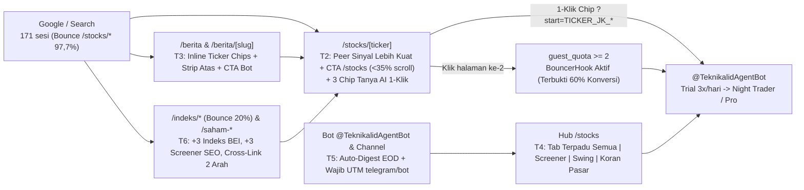

# Plan Eksekusi "FIX TRAFFIC" teknikal.id (T1–T6)

- **Tanggal Plan**: 6 November 2026
- **Sumber Data**: Audit terverifikasi SQL 30 hari (`docs/agent-org/audits/2026-11-06-traffic-behavior-audit.md`)
- **Repo Target**: `/Users/nicholasandriansurjadi/Documents/teknikalidnew` (Next.js 16 App Router, React 19, Prisma, PostgreSQL; container `teknikalidnew-app-1` di `localhost:3000`, DB `teknikalidnew-db-1`)
- **Produk Utama**: Web = **FUNNEL akuisisi & pemanasan** menuju bot berbayar **Telegram `@TeknikalidAgentBot`** (trial gratis 3 turn/hari; Night Trader Rp29.000 / promo bln-1 Rp14.900; Pro Rp79.000 / promo bln-1 Rp29.000).
- **Prinsip Mutlak**: **SEMUA CTA konversi mengarah ke `@TeknikalidAgentBot`**. **DILARANG memasang paywall keras di web**. Setiap fase dirancang agar dieksekusi autopilot oleh worker **AGY Flash dalam 1x dispatch** tanpa keputusan manusia di tengah jalan.

---

## 1. Peta Masalah & Alur Perbaikan Funnel



---

## 2. Benchmark Baseline vs Target 4 Minggu (Acuan Keberhasilan)

| Metrik Funnel | Baseline Audit (7 Okt–6 Nov) | Target 4 Minggu Pasca T1–T6 | Fase Pengungkit |
|---|---:|---:|---|
| Atribusi `AiChatLog` (`anonId`/`userId` terisi, non-eval) | **0%** (`0/203`; `103` baris eval tercampur) | **100%** chat manusia ter-atribusi & terpisah dari eval | **T1** |
| Kebocoran bot Meta `2a03:2880:%` & referrer `teknikal.idundefined` | **~98 PV** bot bocor + **122 PV** referrer rusak | **0%** bocor (`isBot=true`) & **0 PV** referrer `undefined` | **T1** |
| Bounce rate `/stocks/*` dari Search / Google | **97,7%** search (**100%** Google `35/35`) | **< 65%** | **T2, T6** |
| Sesi multi-halaman (`>= 2` PV, pemicu `guest_quota >= 2`) | **11,3%** (`73/648` sesi) | **>= 25%** | **T2, T3, T4** |
| CTR chip/CTA ke `@TeknikalidAgentBot` di halaman saham | **0 chat** di saham dwell 180 dtk (`FORU`, `SQMI`, `IDEA`, `PCAR`, `WAPO`) | **>= 5%** dari pembuka `/stocks/[ticker]` | **T2** |
| Bounce rate `/berita` & `/berita/[slug]` | **92,9%** (median dwell 15 dtk, scroll 29%) | **< 75%** & CTR ke `/stocks/*` atau bot **>= 12%** | **T3** |
| Eksposur fitur `/swing` & `/pasar` | **2 PV** & **9 PV** eksternal / 30 hari | **>= 30 klik tab/minggu** dari hub `/stocks` | **T4** |
| Distribusi `TelegramSent` & sesi ber-UTM `telegram/bot` | **1 pengiriman** / 30 hari; **8 sesi** Telegram (1,2%) | **5x/minggu** otomatis (hari bursa); **>= 100 sesi/30 hr** | **T5** |
| Sesi organik hub SEO (`/indeks*` + `/saham-*`) | **~24 sesi** / 30 hari (`/indeks*` bounce 20%) | **>= 60 sesi / 30 hari** dengan bounce **< 35%** | **T6** |
| Visitor-to-Auth / Bot Start Rate keseluruhan | **1,34%** web signup (`8/598`) | **>= 4,5%** konversi efektif ke Bot / Auth | **T1–T6** |

---

## 3. Kontrak Global Tracking (`EngagementEvent`) & Aturan Autopilot Worker

### 3.1 Kontrak Event Tracking Baru (Wajib Dipatuhi Semua Fase)
Delegasi klik global di `src/components/engagement-instrument.tsx:105-106` otomatis menangkap elemen apa pun yang memiliki atribut `data-engagement="<label>"` dan mengirim `POST /api/public/engagement` (`type: "cta_click"`, `label: z.string().max(64)` di `src/lib/validation.ts:273`). Selain itu, setiap klik `<a href*="t.me/Teknikalid">` otomatis diinjeksi suffix atribusi `__a_<12hex>` oleh `engagement-instrument.tsx:261-274`.

**Aturan penamaan**: WAJIB `camelCase` dengan prefix `funnel_`, `nav_`, atau `chip_` (`<= 64` karakter):

| Fase | Label `data-engagement` Baru | Lokasi & Pemicu |
|---|---|---|
| **T2** | `funnel_peerStrongerCard` | Klik kartu saham se-sektor bersinyal lebih kuat di paruh atas `/stocks/[ticker]` |
| **T2** | `funnel_screenerTopCta` | Klik tombol 1-tap ke `/stocks` di header widget saham sejenis (`<35%` scroll) |
| **T2** | `chip_aiPromptEntry` | Klik chip prompt kontekstual #1 (`Analisa TICKER buat entry hari ini?`) ke bot |
| **T2** | `chip_aiPromptLevel` | Klik chip prompt kontekstual #2 (`Berapa support & target TICKER?`) ke bot |
| **T2** | `chip_aiPromptRisk` | Klik chip prompt kontekstual #3 (`Risiko / koreksi / pantulan TICKER`) ke bot |
| **T3** | `chip_beritaInlineTicker` | Klik pill ticker hasil autolink `rehypeStockLinker` di dalam body artikel `/berita/[slug]` |
| **T3** | `chip_beritaHeaderTicker` | Klik chip saham di strip atas artikel `/berita/[slug]` (`<25%` scroll) |
| **T3** | `funnel_beritaTopBotCta` | Klik CTA `@TeknikalidAgentBot` di strip atas `/berita/[slug]` |
| **T3** | `chip_beritaArchiveTicker` | Klik chip ticker pada kartu daftar arsip di `/berita` |
| **T3** | `chip_beritaHeroMover` | Klik chip top gainer/loser di area hero `/berita` |
| **T3** | `funnel_beritaHeroBotCta` | Klik CTA langganan brief pagi `@TeknikalidAgentBot` di `/berita` |
| **T4** | `nav_stocksTabSemua` | Klik tab `Semua Saham` di segmented bar `/stocks` |
| **T4** | `nav_stocksTabScreener` | Klik tab `Filter Kondisi` di segmented bar `/stocks` |
| **T4** | `nav_stocksTabSwing` | Klik tab `Setup Swing (SL/TP)` di segmented bar `/stocks` |
| **T4** | `nav_stocksTabPasar` | Klik tab `Koran Pasar Live` di segmented bar `/stocks` |
| **T4** | `chip_stocksQuickSwing` | Klik quick-pill `Setup Swing Hari Ini` di atas daftar `/stocks` |
| **T4** | `chip_stocksQuickPasar` | Klik quick-pill `Radar Pasar & Asing` di atas daftar `/stocks` |
| **T4** | `chip_swingSetupTicker` | Klik kartu saham dari dalam panel inline Swing di `/stocks` |
| **T4** | `funnel_swingPanelBotCta` | Klik CTA `@TeknikalidAgentBot` di dalam panel inline Swing `/stocks` |
| **T4** | `funnel_pasarPanelBotCta` | Klik CTA `@TeknikalidAgentBot` di dalam panel inline Koran Pasar `/stocks` |
| **T6** | `funnel_indeksBotCta` | Klik banner CTA `@TeknikalidAgentBot` di halaman `/indeks/[slug]` |
| **T6** | `nav_indeksCrossLink` | Klik kartu indeks lain pada grid cross-link di bawah `/indeks/[slug]` |
| **T6** | `nav_stockToIndeksBadge` | Klik badge keanggotaan indeks (`LQ45`, `IDX30`, dst.) dari `/stocks/[ticker]` |
| **T6** | `funnel_seoHubBotCta` | Klik CTA `@TeknikalidAgentBot` di halaman `/saham-*` (`SignalLandingTemplate`) |
| **T6** | `funnel_askAiCtaBot` | Klik tombol tanya via `@TeknikalidAgentBot` pada komponen `AskAiCta` |
| **T6** | `nav_strategyCrossLink` | Klik kartu lintas strategi pada komponen `SahamStrategyLinks` |

### 3.2 Aturan Kompatibilitas Deeplink Bot `@TeknikalidAgentBot`
Parser Go bot (`parseWebDeeplink` di `/Users/nicholasandriansurjadi/Documents/teknikal-agent/cmd/agentd/handler.go:1049`) membelah parameter `?start=` dengan `_` dan memperlakukan **setiap segmen tepat 4 huruf alfabet (`A-Z`)** sebagai kode ticker IDX (`isIdxTickerCode`).
- **WAJIB**: Jangan pernah memakai kata 4 huruf (`risk`, `chat`, `news`, `open`, `view`) di dalam payload `?start=` selain ticker itu sendiri! Gunakan token `!= 4` huruf seperti `JK` (2), `entry` (5), `level` (5), `risiko` (6), `berita` (6), `web` (3), `swing` (5), `pasar` (5), `indeks` (6).
- **Batas Panjang**: Total payload sebelum injeksi `__a_<12hex>` (16 karakter) maksimal **48 karakter** agar total `<= 64` karakter sesuai batas keras Telegram Bot API.

### 3.3 Protokol Standar Eksekusi Per Fase (Untuk Worker AGY Flash)
1. Bekerja di `/Users/nicholasandriansurjadi/Documents/teknikalidnew`. Jangan menimpa perubahan dirty file di luar daftar file fase.
2. Patuhi aturan **API Reuse = SATU PINTU** (`AGENTS.md`): dilarang menulis rumus perubahan harga, movers, breadth, atau RSI/skor sinyal di luar `marketSnapshotService`, `stockMarketService`, `screenerAnalysisService`, dan `pasarLiveService`.
3. Sebelum mengakhiri dispatch, jalankan verifikasi wajib: `npx prisma validate && npx tsc --noEmit && npm run build` serta unit test terkait via `npx tsx --test <path>`. Jangan me-restart/deploy container produksi kecuali diinstruksikan eksplisit oleh owner.

---

## FASE T1: Hygiene Telemetri 3x (`AiChatLog`, Bot Meta `2a03:2880:%`, Referrer `teknikal.idundefined`)

- **NAMA + GOAL**: Pembersihan Telemetri Inti — Memulihkan atribusi `AiChatLog` dari **0% menjadi 100%** untuk chat manusia (terpisah dari `isEval`), memblokir kebocoran crawler preview Meta `2a03:2880:%` menjadi `isBot = true`, dan menekan bug `referrer = 'https://teknikal.idundefined'` dari **122 PV menjadi 0 PV**.
- **ESTIMASI UKURAN DIFF**: **M (~135 baris)**

### FILE YANG DISENTUH
1. `/Users/nicholasandriansurjadi/Documents/teknikalidnew/prisma/schema.prisma`
2. `/Users/nicholasandriansurjadi/Documents/teknikalidnew/src/components/ai/ask-ai-fab.tsx`
3. `/Users/nicholasandriansurjadi/Documents/teknikalidnew/src/components/stock/stock-ai-modal.tsx`
4. `/Users/nicholasandriansurjadi/Documents/teknikalidnew/src/components/screener/screener-ai-modal.tsx`
5. `/Users/nicholasandriansurjadi/Documents/teknikalidnew/src/app/api/ai/stock/route.ts`
6. `/Users/nicholasandriansurjadi/Documents/teknikalidnew/src/app/api/ai/screener/route.ts`
7. `/Users/nicholasandriansurjadi/Documents/teknikalidnew/src/app/api/ai/eval/route.ts`
8. `/Users/nicholasandriansurjadi/Documents/teknikalidnew/src/app/api/admin/ai-insight/route.ts`
9. `/Users/nicholasandriansurjadi/Documents/teknikalidnew/src/lib/bot-detect.ts`
10. `/Users/nicholasandriansurjadi/Documents/teknikalidnew/src/app/api/track/guest-pass/route.ts`
11. `/Users/nicholasandriansurjadi/Documents/teknikalidnew/src/hooks/use-page-view.ts`
12. `/Users/nicholasandriansurjadi/Documents/teknikalidnew/src/app/api/track/pageview/route.ts`
13. `/Users/nicholasandriansurjadi/Documents/teknikalidnew/src/lib/__tests__/bot-detect-meta.test.ts` *(file test baru)*

### LANGKAH TEKNIS KONKRET
1. **Skema `AiChatLog` (`prisma/schema.prisma:1168`)**:
   - Tambahkan field `isEval Boolean @default(false)` dan `@@index([isEval, createdAt])` pada `model AiChatLog`.
   - Jalankan `npx prisma generate` (dan `npx prisma db push --accept-data-loss=false` hanya untuk kolom additive default `false` pada DB lokal `teknikalidnew-db-1`).
2. **Kirim `anonId` dari 3 Komponen Chat Client**:
   - Di `src/components/ai/ask-ai-fab.tsx` (sekitar L112 & L125), `src/components/stock/stock-ai-modal.tsx` (sekitar L126 & L160), dan `src/components/screener/screener-ai-modal.tsx` (sekitar L99): impor `getAnonIdSafe` dari `@/lib/anon-id-safe` lalu sertakan `anonId: getAnonIdSafe()` di dalam `JSON.stringify({...})` saat memanggil `/api/ai/stock` dan `/api/ai/screener`.
3. **Tangkap `sessionUserId`, `cleanAnonId`, & `isEval` di Server AI Route**:
   - Di `src/app/api/ai/stock/route.ts` (sekitar L156–165 dan L334–363) serta `src/app/api/ai/screener/route.ts` (sekitar L195–204 dan L333–370):
     - Deklarasikan `let sessionUserId: string | null = null;` sebelum blok `try { const sess = await auth(); ... }` dan simpan `sessionUserId = sess?.user?.id ?? null;`. **Hapus** pembacaan `body.userId` (baris L336 / L365 selalu `undefined` dan rawan spoofing).
     - Validasi `const cleanAnonId = typeof body.anonId === "string" && /^[a-f0-9-]{8,36}$/i.test(body.anonId) ? body.anonId : null;`.
     - Deteksi eval internal: `const isEval = Boolean(process.env.CRON_SECRET && req.headers.get("x-ai-eval") === process.env.CRON_SECRET);`.
     - Simpan `{ userId: sessionUserId, anonId: cleanAnonId, isEval, ... }` ke `prisma.aiChatLog.create` baik pada jalur utama Gemini maupun pada jalur fallback MLX (`stock/route.ts:344-363` & `screener/route.ts:333-348`).
4. **Tandai Request Eval & Bersihkan Query Admin Insight**:
   - Di `src/app/api/ai/eval/route.ts:67-72` (`callEndpoint`), tambahkan header `"x-ai-eval": process.env.CRON_SECRET ?? ""` pada `fetch` internal ke `/api/ai/stock` dan `/api/ai/screener`.
   - Di `src/app/api/admin/ai-insight/route.ts:46-65`, tambahkan klausa `AND "isEval" = false` pada kedua query SQL `FROM "AiChatLog"`.
5. **Deteksi Crawler Link-Preview Meta `2a03:2880:%` (`src/lib/bot-detect.ts`)**:
   - Di dalam `detectBot(userAgent, ip)`, setelah pengecekan regex UA bot standar dan sebelum return human default, tambahkan aturan: jika `ip` terisi dan cocok `/^2a03:2880:/i` (blok IPv6 AS32934 Meta) **serta** `userAgent` TIDAK cocok `/Barcelona|Instagram|FBAN|FBAV/i` (in-app browser manusia Threads/IG/FB), kembalikan `{ isBot: true, reason: "meta-preview-crawler", datacenter: true }`.
   - Di `src/app/api/track/guest-pass/route.ts`, panggil `detectBot(req.headers.get("user-agent") ?? "", clientIp)` di awal handler; bila `isBot === true`, langsung return `NextResponse.json({ ok: true, count: 0, capped: false })` tanpa menyentuh tabel `GuestPassUsage`.
   - Buat unit test `src/lib/__tests__/bot-detect-meta.test.ts` yang memverifikasi: (a) `2a03:2880:f122:83::` + UA `Chrome/74.0` → `isBot: true`; (b) `2a03:2880:f122:83::` + UA `Instagram` / `Barcelona` / `FBAN` → `isBot: false`; (c) IP residensial Telkomsel + UA `Chrome/131` → `isBot: false`.
6. **Perbaiki Bug `https://teknikal.idundefined` (`src/hooks/use-page-view.ts:15-26` & `src/app/api/track/pageview/route.ts`)**:
   - Di `src/hooks/use-page-view.ts`: ganti baris `referrer = window.location.origin + document.documentElement.dataset.prevPath || undefined;` dengan membaca `const prevPath = document.documentElement.dataset.prevPath || sessionStorage.getItem("eng_prev_path");` lalu hanya merangkai `window.location.origin + prevPath` jika `prevPath && prevPath.startsWith("/")` (bila tidak, fallback ke `document.referrer || undefined`). Simpan `sessionStorage.setItem("eng_prev_path", pathname)` setelah pengiriman beacon/fetch.
   - Di `src/app/api/track/pageview/route.ts`: sebelum `prisma.pageView.create`, jika `referrer` cocok `/teknikal\.idundefined/i`, paksa bernilai `null` agar tab browser lama yang masih menyimpan bundle JS lawas tidak lagi mengotori DB.

### GUARD (TIDAK BOLEH BERUBAH)
- Kontrak response SSE/JSON `/api/ai/stock`, `/api/ai/screener`, dan `/api/ai/eval` ke client tidak boleh berubah.
- Sanitizer output AI (anti-CJK bocor, ticker hallucination guard, dan limit kuota harian) di `/api/ai/stock` & `/api/ai/screener` wajib tetap utuh.
- In-app browser asli pengguna Meta (`Instagram`, `Barcelona`/Threads, `FBAN`/`FBAV`) dari IP `2a03:2880:%` **DILARANG** ditandai `isBot=true`.

### VERIFIKASI
- Unit test & typecheck: `npx tsx --test src/lib/__tests__/bot-detect-meta.test.ts && npx prisma validate && npx tsc --noEmit && npm run build`
- SQL cek kolom & kebersihan data baru:
  ```sql
  SELECT "isEval", COUNT(*), COUNT("anonId") AS with_anon, COUNT("userId") AS with_user
  FROM "AiChatLog" WHERE "createdAt" >= NOW() - INTERVAL '1 day' GROUP BY 1;

  SELECT COUNT(*) AS bad_ref FROM "PageView"
  WHERE "createdAt" >= NOW() - INTERVAL '1 day' AND referrer LIKE '%undefined%';
  ```

---

## FASE T2: Penyelamatan Entry Google `/stocks/[ticker]` (`<35%` Scroll) & Chip Tanya AI 1-Klik

- **NAMA + GOAL**: Konversi Fold-1 Halaman Saham — Menurunkan bounce rate `/stocks/*` dari Search (**97,7% total / 100% Google**) menjadi **< 65%** lewat widget 3 saham se-sektor bersinyal lebih kuat + CTA `/stocks` di `<35%` scroll (memicu halaman ke-2 → `guest_quota >= 2` → `BouncerHook`) sekaligus memanen dwell 180 detik menjadi **CTR >= 5%** ke `@TeknikalidAgentBot` via 3 chip pertanyaan kontekstual.
- **ESTIMASI UKURAN DIFF**: **M (~165 baris)**

### FILE YANG DISENTUH
1. `/Users/nicholasandriansurjadi/Documents/teknikalidnew/src/components/stock/stronger-peers-strip.tsx` *(komponen SSR baru)*
2. `/Users/nicholasandriansurjadi/Documents/teknikalidnew/src/components/stock/stock-ai-prompt-chips.tsx` *(komponen SSR baru)*
3. `/Users/nicholasandriansurjadi/Documents/teknikalidnew/src/app/(public)/stocks/[ticker]/page.tsx`

### LANGKAH TEKNIS KONKRET
1. **Buat Komponen `StrongerPeersStrip` (`src/components/stock/stronger-peers-strip.tsx`)**:
   - Menerima props `{ currentTicker: string; currentScore: number | null; sectorLabel: string; peers: Array<{ ticker: string; name: string; close: number | null; changePercent: number | null; signalScore: number | null }> }`.
   - Filter `peers` yang `ticker !== currentTicker` dan `signalScore !== null`, urutkan `signalScore` menurun, ambil 3 teratas. Jika ketiganya kosong, jangan render apa pun (`return null`).
   - Judul adaptif: bila `topPeer.signalScore > (currentScore ?? -1)`, tampilkan `"🔥 3 Saham ${sectorLabel} dengan Sinyal Lebih Kuat Hari Ini"`; bila saham saat ini sudah tertinggi di sektornya, tampilkan `"📊 Pembanding Terkuat Sektor ${sectorLabel} Hari Ini"`.
   - Di kanan judul pada bar yang sama, pasang tombol 1-tap `<Link href="/stocks?style=swing-trade" data-engagement="funnel_screenerTopCta" className="text-xs font-semibold text-accent hover:underline">Scan 900+ Saham →</Link>`.
   - Render grid 3 kolom (`grid-cols-1 sm:grid-cols-3 gap-2`): tiap kartu adalah `<Link href={/stocks/${p.ticker}} data-engagement="funnel_peerStrongerCard" className="min-h-11 ...">` berisi kode `stripJk(p.ticker)`, perubahan `%` (`changeColor`), dan badge `signalBadge(p.signalScore)` (`+0,68 · Beli Kuat`).
2. **Buat Komponen `StockAiPromptChips` (`src/components/stock/stock-ai-prompt-chips.tsx`)**:
   - Menerima props `{ ticker: string; rsi14: number | null; signalScore: number | null }`; bentuk `clean = stripJk(ticker)` (contoh `FORU`).
   - Render 3 chip `<a>` (`target="_blank" rel="noopener noreferrer"`, `min-h-9`, horizontal wrap) yang langsung membuka `@TeknikalidAgentBot` dengan payload aman bagi `parseWebDeeplink` (tanpa token 4 huruf selain kode saham):
     - Chip 1: `href="https://t.me/TeknikalidAgentBot?start=${encodeURIComponent(clean + '_JK_entry')}"`, `data-engagement="chip_aiPromptEntry"`, teks `"🎯 Analisa ${clean} buat entry hari ini?"`
     - Chip 2: `href="https://t.me/TeknikalidAgentBot?start=${encodeURIComponent(clean + '_JK_level')}"`, `data-engagement="chip_aiPromptLevel"`, teks `"📐 Berapa support & target ${clean}?"`
     - Chip 3: `href="https://t.me/TeknikalidAgentBot?start=${encodeURIComponent(clean + '_JK_risiko')}"`, `data-engagement="chip_aiPromptRisk"`, teks dinamis: bila `rsi14 !== null && rsi14 >= 65` → `"⚠️ ${clean} rawan koreksi atau lanjut?"`; bila `rsi14 !== null && rsi14 <= 35` → `"🔄 ${clean} sudah siap pantul belum?"`; default → `"🛡️ Cek risiko & aliran asing ${clean}"`.
3. **Integrasi di Paruh Atas `/stocks/[ticker]/page.tsx` (`<35%` Scroll)**:
   - Di blok pengambilan data server `/stocks/[ticker]/page.tsx` (sekitar L250–310), ambil daftar kandidat peer se-sektor (`peers` / `BIG_CAP_ANCHORS`, maks 12 kode) lalu panggil SATU PINTU `stockMarketService.getStockBatchWithIndicators(peerCandidateTickers).catch(() => [])` secara paralel di dalam `Promise.all` yang sudah ada agar tidak menambah latensi serial TTFB.
   - Di dalam kartu **Hero Skor Sinyal** (tepat di bawah tombol `tg_tanya_agent_fold1` pada L801), sisipkan `<StockAiPromptChips ticker={ticker} rsi14={indicators?.rsi14 ?? null} signalScore={indicators?.signalScore ?? null} />`.
   - Tepat **di bawah penutup Hero Skor Sinyal (L832) dan SEBELUM blok `TradingPlanCard` / `LoginGate` (L835)**, sisipkan `<StrongerPeersStrip ... />` agar pengunjung dari Google langsung melihat 3 saham sinyal kuat + CTA `/stocks` sebelum menyentuh batas scroll 31%.

### GUARD (TIDAK BOLEH BERUBAH)
- **DILARANG** memasang paywall keras atau menyembunyikan harga, Skor Sinyal hero, maupun chart 90 hari yang saat ini terbuka bagi guest.
- `BouncerHook` (`src/components/stock/bouncer-hook.tsx`), canonical `/stocks/[ticker]`, dan struktur JSON-LD (`safeJsonLd`) wajib tetap utuh.
- Dilarang menghitung indikator/skor manual di `page.tsx`; wajib memakai `stockMarketService.getStockBatchWithIndicators`.

### VERIFIKASI
- Build & typecheck: `npx tsc --noEmit && npm run build`
- Cek DOM SSR: `curl -s http://localhost:3000/stocks/FORU.JK | rg "funnel_peerStrongerCard|funnel_screenerTopCta|chip_aiPromptEntry"` menghasilkan ketiga atribut di paruh atas HTML.
- SQL evaluasi minggu depan:
  ```sql
  SELECT label, COUNT(*) AS clicks, COUNT(DISTINCT "anonId") AS uniq_users
  FROM "EngagementEvent"
  WHERE label IN ('funnel_peerStrongerCard','funnel_screenerTopCta','chip_aiPromptEntry','chip_aiPromptLevel','chip_aiPromptRisk')
  GROUP BY 1 ORDER BY 2 DESC;
  ```

---

## FASE T3: Penyelamatan `/berita` & `/berita/[slug]` — Inline Chip Ticker + CTA Bot

- **NAMA + GOAL**: Jembatan Konversi Berita ke Saham & Bot — Menurunkan bounce rate `/berita*` dari **92,9% menjadi < 75%** dan menaikkan CTR keluar dari artikel ke `/stocks/TICKER.JK` atau `@TeknikalidAgentBot` hingga **>= 12%** sebelum batas scroll 29%.
- **ESTIMASI UKURAN DIFF**: **M (~170 baris)**

### FILE YANG DISENTUH
1. `/Users/nicholasandriansurjadi/Documents/teknikalidnew/src/lib/rehype-stock-linker.ts`
2. `/Users/nicholasandriansurjadi/Documents/teknikalidnew/src/app/(public)/berita/[slug]/page.tsx`
3. `/Users/nicholasandriansurjadi/Documents/teknikalidnew/src/app/(public)/berita/page.tsx`
4. `/Users/nicholasandriansurjadi/Documents/teknikalidnew/src/components/berita/daily-brief-hero.tsx`

### LANGKAH TEKNIS KONKRET
1. **Upgrade Autolink Inline menjadi Ticker Chip (`src/lib/rehype-stock-linker.ts`)**:
   - Pada pembuatan node `<a>` ke `/stocks/${code}.JK`, ubah styling dari garis bawah tipis menjadi pill chip mudah-tap: `className: "inline-flex items-center rounded-md border border-accent/25 bg-accent/10 px-1.5 py-0.5 font-mono text-[0.85em] font-semibold text-accent no-underline hover:bg-accent/20 transition-colors"` dan tambahkan properti `"data-engagement": "chip_beritaInlineTicker"`. Pertahankan aturan maks 1 autolink per ticker per artikel dan skip di dalam heading/link/code eksisting.
2. **Strip "Saham Terkait Hari Ini" + CTA Bot di Atas Body `/berita/[slug]/page.tsx` (`<25%` Scroll)**:
   - Ekstrak maks 6 ticker valid (cek ke `IDX_STOCK_MAP` dari `@/lib/constants`) dari gabungan `article.tickerTag`, `article.tags`, serta pencocokan `\b[A-Z]{4}\b` pada `article.title`, `article.excerpt`, dan `article.content` (normalisasi ke format `XXXX.JK`).
   - Panggil `stockMarketService.getStockBatchWithIndicators(mentionedTickers).catch(() => [])`.
   - Render blok ringkas tepat **di bawah header/tanggal artikel dan SEBELUM isi `<article>`**:
     - Deret chip `<Link href={/stocks/${s.ticker}} data-engagement="chip_beritaHeaderTicker">` menampilkan `stripJk(s.ticker)`, `% change` berwarna, dan skor sinyal (`+0,54`).
     - Di kanan/bawah deret chip yang sama, tampilkan tombol `<a href={https://t.me/TeknikalidAgentBot?start=${primaryClean ? primaryClean + '_JK_berita' : 'web_berita'}} target="_blank" rel="noopener noreferrer" data-engagement="funnel_beritaTopBotCta">` berlabel `"💬 Tanya dampak berita ini ke AI — gratis 3x"`.
3. **Inline Chip Ticker pada Daftar `/berita/page.tsx` & `DailyBriefHero`**:
   - Di `/berita/page.tsx:84-90`, tambahkan `tickerTag: true, tags: true` pada `select` `prisma.article.findMany` (`briefsArchive`). Buat fungsi kecil `extractArticleTickers(item, max = 3)` yang mencocokkan `tickerTag`, `tags`, `title`, dan `excerpt` terhadap `IDX_STOCK_MAP`.
   - Pada setiap kartu di `briefsArchive` (`/berita/page.tsx`), render daftar chip `<Link href={/stocks/${t}} data-engagement="chip_beritaArchiveTicker">{stripJk(t)}</Link>`. **Perhatian React 19**: pastikan kartu arsip dibungkus `<article>` (bukan `<Link>` pembungkus luar penuh) sehingga `<Link>` judul artikel dan `<Link>` chip ticker menjadi sibling yang sah (0 nested `<a>`).
   - Di bagian atas `/berita/page.tsx` (tepat di bawah `DailyBriefHero` atau di bar masthead, memanfaatkan `overview.gainers` & `overview.losers` yang sudah di-fetch di L94), tampilkan strip 4 saham penggerak hari ini (`data-engagement="chip_beritaHeroMover"`) berdampingan dengan tombol `<a href="https://t.me/TeknikalidAgentBot?start=web_berita" target="_blank" rel="noopener noreferrer" data-engagement="funnel_beritaHeroBotCta">` (`"📲 Kirim Brief Pagi Otomatis ke Telegram"`).

### GUARD (TIDAK BOLEH BERUBAH)
- Sanitizer artikel (`sanitizeGeneratedContent`, filter karakter CJK, dan `article-freshness` auto-noindex untuk berita basi) tidak boleh disentuh.
- Canonical `/berita`, pagination `?page=N`, `rel="prev"/"next"`, dan schema `NewsArticle`/`CollectionPage` wajib tetap sama.
- Jangan membuat nested `<a>` di dalam `<a>` pada `DailyBriefHero` maupun kartu arsip `/berita`.

### VERIFIKASI
- Build & cek HTML: `npx tsc --noEmit && npm run build` lalu `curl -s http://localhost:3000/berita | rg "chip_beritaArchiveTicker|chip_beritaHeroMover|funnel_beritaHeroBotCta"`
- SQL evaluasi klik chip berita:
  ```sql
  SELECT label, COUNT(*) FROM "EngagementEvent"
  WHERE label IN ('chip_beritaInlineTicker','chip_beritaHeaderTicker','funnel_beritaTopBotCta','chip_beritaArchiveTicker','chip_beritaHeroMover','funnel_beritaHeroBotCta')
  GROUP BY 1 ORDER BY 2 DESC;
  ```

---

## FASE T4: Discovery `/swing` & `/pasar` sebagai Tab & Preset Cepat di Hub `/stocks`

- **NAMA + GOAL**: Konsolidasi Discovery di Hub `/stocks` — Mengangkat fitur tersembunyi `/swing` (2 PV) dan `/pasar` (9 PV) menjadi tab instan di `/stocks` (halaman ber-bounce terendah 24,9%) hingga meraih **>= 30 klik tab/minggu** dan menaikkan rasio sesi multi-halaman ke **>= 25%**.
- **ESTIMASI UKURAN DIFF**: **M (~185 baris)**

### FILE YANG DISENTUH
1. `/Users/nicholasandriansurjadi/Documents/teknikalidnew/src/components/stock/saham-view.tsx`
2. `/Users/nicholasandriansurjadi/Documents/teknikalidnew/src/components/stock/stocks-swing-panel.tsx` *(komponen client lazy baru)*
3. `/Users/nicholasandriansurjadi/Documents/teknikalidnew/src/components/stock/stocks-pasar-panel.tsx` *(komponen client lazy baru)*
4. `/Users/nicholasandriansurjadi/Documents/teknikalidnew/src/app/(public)/stocks/page.tsx`

### LANGKAH TEKNIS KONKRET
1. **Perluas Segmented Control `SahamView` (`src/components/stock/saham-view.tsx`) menjadi 4 Tab Cepat**:
   - Perluas tipe mode tampilan dari `"semua" | "screener"` menjadi `"semua" | "screener" | "swing" | "pasar"` berdasarkan query `?view=`. Sinkronkan pergantian tab via `window.history.replaceState` agar instan tanpa reload server penuh.
   - Render 4 tombol tab `min-h-11` (scrollable horizontal rapi di mobile) lengkap dengan atribut tracking:
     1. `Semua Saham` (`data-engagement="nav_stocksTabSemua"`)
     2. `Filter Kondisi` (`data-engagement="nav_stocksTabScreener"`)
     3. `🎯 Setup Swing` (`data-engagement="nav_stocksTabSwing"`, badge kecil `"SL/TP"`)
     4. `⚡ Koran Pasar` (`data-engagement="nav_stocksTabPasar"`, titik indikator hijau)
   - Muat `StocksSwingPanel` dan `StocksPasarPanel` menggunakan `next/dynamic` (`ssr: false`) sehingga ukuran bundle awal `/stocks` untuk tab default tidak bertambah.
2. **Buat `StocksSwingPanel` (`src/components/stock/stocks-swing-panel.tsx`) — Reuse `/api/market/swing`**:
   - Fetch `GET /api/market/swing` (endpoint eksisting, 0 route API baru).
   - Tampilkan hingga 12 kartu kandidat swing teratas (kode saham, skor sinyal, zona Entry, Stop Loss, Take Profit, rasio Risk:Reward) dengan `<Link href={/stocks/${item.ticker}} data-engagement="chip_swingSetupTicker">`.
   - Di bagian atas panel, pasang banner tipis CTA bot: `<a href="https://t.me/TeknikalidAgentBot?start=web_swing" target="_blank" rel="noopener noreferrer" data-engagement="funnel_swingPanelBotCta">` (`"💬 Minta AI pilihkan 1 setup swing terbaik sore ini — gratis 3x"`) serta link sekunder ke `/swing`.
3. **Buat `StocksPasarPanel` (`src/components/stock/stocks-pasar-panel.tsx`) — Reuse `/api/market`**:
   - Fetch `GET /api/market` (endpoint eksisting, SATU PINTU).
   - Tampilkan ringkasan cepat: bar Market Breadth (jumlah saham naik vs turun), Top 5 Gainers & Top 5 Losers (klik menuju `/stocks/TICKER.JK`), diikuti CTA `<a href="https://t.me/TeknikalidAgentBot?start=kopi_pasar" target="_blank" rel="noopener noreferrer" data-engagement="funnel_pasarPanelBotCta">` (`"☕ Tanya arah IHSG & aliran asing hari ini di Bot — gratis 3x"`) serta link `"Buka Koran Saham Live penuh (/pasar) →"`.
4. **Tambah 2 Quick-Pill di Atas Daftar `/stocks/page.tsx`**:
   - Pada bar shortcut cepat di `/stocks/page.tsx`, tambahkan pill `<Link href="/stocks?view=swing" data-engagement="chip_stocksQuickSwing">🎯 Setup Swing (Entry & TP)</Link>` dan `<Link href="/stocks?view=pasar" data-engagement="chip_stocksQuickPasar">⚡ Radar Pasar Live</Link>`.

### GUARD (TIDAK BOLEH BERUBAH)
- Route mandiri `/swing` (`src/app/(public)/swing/page.tsx`) dan `/pasar` (`src/app/(public)/pasar/page.tsx` beserta policy `robots: { index: false, follow: true }`) **TIDAK BOLEH** dihapus atau di-redirect.
- Canonical `/stocks` pada `src/app/(public)/stocks/page.tsx` wajib tetap `/stocks` (parameter `?view=swing|pasar` tidak boleh menciptakan canonical duplikat).
- Dilarang membuat endpoint `/api/*` baru untuk market/swing; wajib reuse `/api/market/swing` dan `/api/market`.

### VERIFIKASI
- Build & typecheck: `npx tsc --noEmit && npm run build`
- Cek HTTP 200 di ketiga rute: `curl -s -o /dev/null -w "%{http_code}\n" http://localhost:3000/stocks http://localhost:3000/swing http://localhost:3000/pasar` (semua `200`).
- SQL evaluasi adopsi tab:
  ```sql
  SELECT label, COUNT(*) AS clicks FROM "EngagementEvent"
  WHERE label IN ('nav_stocksTabSwing','nav_stocksTabPasar','chip_stocksQuickSwing','chip_stocksQuickPasar','chip_swingSetupTicker','funnel_swingPanelBotCta','funnel_pasarPanelBotCta')
  GROUP BY 1 ORDER BY 2 DESC;
  ```

---

## FASE T5: Mesin Distribusi Telegram — Wajib UTM `telegram/bot` & Aktivasi Digest Otomatis Harian

- **NAMA + GOAL**: Reaktivasi Mesin Distribusi Telegram — Mengubah pengiriman `TelegramSent` dari **1x/30 hari menjadi otomatis 5x/minggu** (setiap hari bursa) dan mewajibkan `?utm_source=telegram&utm_medium=bot` di seluruh link keluar bot guna menumbuhkan trafik ter-atribusi Telegram dari **8 sesi menjadi >= 100 sesi / 30 hari**.
- **ESTIMASI UKURAN DIFF**: **M (~195 baris)**

### FILE YANG DISENTUH
1. `/Users/nicholasandriansurjadi/Documents/teknikalidnew/scripts/telegram-bot/utm.mjs` *(helper baru)*
2. `/Users/nicholasandriansurjadi/Documents/teknikalidnew/scripts/telegram-bot/digest.mjs`
3. `/Users/nicholasandriansurjadi/Documents/teknikalidnew/scripts/telegram-bot/notify.mjs`
4. `/Users/nicholasandriansurjadi/Documents/teknikalidnew/scripts/telegram-bot/poll.mjs`
5. `/Users/nicholasandriansurjadi/Documents/teknikalidnew/src/domains/analytics/analytics.service.ts`
6. `/Users/nicholasandriansurjadi/Documents/teknikalidnew/src/domains/telegram/telegram-digest.service.ts` *(service baru)*
7. `/Users/nicholasandriansurjadi/Documents/teknikalidnew/src/app/api/cron/telegram-digest/route.ts` *(cron endpoint baru)*
8. `/Users/nicholasandriansurjadi/Documents/teknikalidnew/src/app/api/cron/generate-articles/route.ts`
9. `/Users/nicholasandriansurjadi/Documents/teknikalidnew/src/app/api/cron/sync-eod/route.ts`
10. `/Users/nicholasandriansurjadi/Documents/teknikalidnew/src/domains/telegram/__tests__/utm-builder.test.ts` *(unit test baru)*

### LANGKAH TEKNIS KONKRET
1. **Standarisasi UTM di Seluruh Link Keluar Bot (`scripts/telegram-bot/utm.mjs` + 3 Script Bot)**:
   - Buat `scripts/telegram-bot/utm.mjs` berisi `export function tgWebUrl(pathOrUrl, campaign = "bot_link")` berbasis `new URL(pathOrUrl, "https://teknikal.id")` yang selalu menyetel `utm_source=telegram`, `utm_medium=bot`, dan `utm_campaign=${campaign}` tanpa merusak query parameter yang sudah ada.
   - Ganti **seluruh** URL hardcode `https://teknikal.id...` di:
     - `scripts/telegram-bot/digest.mjs` (L124 `/berita/${slug}`, L140 `/pasar`, dan link `/stocks/${ticker}`) → `campaign = "daily_digest"`.
     - `scripts/telegram-bot/notify.mjs` (L74 `/stocks/${ticker}`, L94 footer `teknikal.id`) → `campaign = "watchlist_alert"`.
     - `scripts/telegram-bot/poll.mjs` (balasan `/start`, `/pasar`, `/bantuan`, dan daftar pantauan `/stocks/${ticker}`) → `campaign = "bot_command"`.
2. **Normalisasi Bucket UTM di Dashboard Analitik (`src/domains/analytics/analytics.service.ts:218-226`)**:
   - Tambahkan entri `telegram: "Telegram"` pada map `UTM_SOURCE_PLATFORMS` (mendampingi `tg: "Telegram"` yang sudah ada) agar semua sesi `?utm_source=telegram` terkelompok rapi sebagai channel `"Telegram"`.
3. **Bangun `telegramDigestService` Idempoten (`src/domains/telegram/telegram-digest.service.ts`) & Route `/api/cron/telegram-digest`**:
   - Fungsi `runDailyDigest({ force = false } = {})`:
     - Cek `TELEGRAM_BOT_TOKEN`; bila kosong, return `{ ok: false, skipped: "missing_token" }` secara fire-soft (tidak melempar error ke pemanggil).
     - Cek hari kerja WIB (`Senin–Jumat`, kecuali `force === true`). Hitung kunci idempoten harian `kind = "digest:" + wibDayKey(new Date())` (memakai `wibDayKey` dari `@/lib/datetime-wib`).
     - Kumpulkan target penerima: `TELEGRAM_CHANNEL_ID` (bila ada di env) + seluruh baris `prisma.telegramSubscriber.findMany({ where: { isActive: true } })`. Exclude `chatId` yang sudah tercatat di `prisma.telegramSent` untuk `kind` hari ini (`@@unique([chatId, kind])` menjamin 0 kiriman ganda!).
     - Ambil data pasar hari ini via SATU PINTU: `articleRepository.findLatestDailyBrief()`, `stockMarketService.getMarketOverview()`, dan top-3 sinyal dari `pasarLiveService.getYesterdayRecap()`. Jika belum ada data pasar hari ini, skip dengan aman.
     - Susun pesan HTML ringkas (judul brief + breadth naik/turun + 3 mover/sinyal terkuat) di mana **setiap link ke web memakai `?utm_source=telegram&utm_medium=bot&utm_campaign=daily_digest`**, dilengkapi inline keyboard `reply_markup` berisi 2 tombol: `[📊 Buka Radar Saham]` (URL ber-UTM ke `/stocks?view=pasar`) dan `[💬 Tanya AI Sahammu (Gratis 3x)]` (`https://t.me/TeknikalidAgentBot?start=kopi_pasar`).
     - Kirim berurutan dengan throttle `45ms`/pesan (~22 pesan/detik, aman di bawah limit Telegram 30 msg/dtk), catat tiap sukses ke `prisma.telegramSent.create`, dan bila Telegram mengembalikan HTTP `403` (bot diblokir user), update `telegramSubscriber.update({ where: { chatId }, data: { isActive: false } })`.
   - Buat `POST /api/cron/telegram-digest` (`src/app/api/cron/telegram-digest/route.ts`) yang memverifikasi `CRON_SECRET` (pola identik `src/app/api/cron/sync-eod/route.ts`) lalu memanggil `telegramDigestService.runDailyDigest()`.
4. **Kaitkan Otomatis ke Cron Harian yang Sudah Jalan (`generate-articles` & `sync-eod`)**:
   - Di `src/app/api/cron/generate-articles/route.ts` (setelah pembuatan brief harian selesai) dan sebagai fallback di akhir `src/app/api/cron/sync-eod/route.ts`, panggil `await telegramDigestService.runDailyDigest().catch((err) => console.error("[tg-digest]", err))`. Karena terproteksi kunci unik `digest:YYYY-MM-DD` di `TelegramSent`, digest dijamin terkirim otomatis **tepat 1x setiap hari bursa** tanpa perlu mendaftarkan cron/plist host baru.
   - Tulis unit test `src/domains/telegram/__tests__/utm-builder.test.ts` yang menguji pembentukan URL ber-UTM (path biasa, path yang sudah punya `?view=pasar`, dan idempotency key WIB).

### GUARD (TIDAK BOLEH BERUBAH)
- Kegagalan API Telegram (timeout / token kosong di staging) **TIDAK BOLEH** menggagalkan job utama `/api/cron/sync-eod` maupun `/api/cron/generate-articles` (wajib dibungkus `.catch(...)`).
- Kunci dedup `TelegramSent` (`chatId` + `kind`) wajib diperiksa sebelum kirim dan ditulis sesudah kirim — dilarang keras mengirim >1 digest per hari ke subscriber yang sama.
- Jangan menulis kredensial atau bot token hardcode di dalam kode/repo.

### VERIFIKASI
- Unit test & build: `npx tsx --test src/domains/telegram/__tests__/utm-builder.test.ts && npx tsc --noEmit && npm run build`
- Audit kebocoran link non-UTM di script bot: `rg "https://teknikal\.id" scripts/telegram-bot/` (hanya muncul di konstanta dasar `utm.mjs`, 0 link telanjang di `digest.mjs`/`notify.mjs`/`poll.mjs`).
- SQL cek pengiriman & trafik UTM:
  ```sql
  SELECT kind, COUNT(*) AS sent_count, MAX("sentAt") AS last_sent
  FROM "TelegramSent" WHERE "sentAt" >= NOW() - INTERVAL '7 days' GROUP BY 1 ORDER BY 3 DESC;

  SELECT "utmSource", "utmMedium", "utmCampaign", COUNT(DISTINCT "anonId") AS sessions
  FROM "PageView" WHERE "utmSource" = 'telegram' AND "createdAt" >= NOW() - INTERVAL '7 days'
  GROUP BY 1, 2, 3;
  ```

---

## FASE T6: Replikasi Template SEO `/indeks*` & `/saham-golden-cross` + Internal Linking Silang

- **NAMA + GOAL**: Ekspansi Hub Akuisisi Google Ber-Bounce Rendah — Melipatgandakan sesi organik hub SEO dari **~24 menjadi >= 60 sesi / 30 hari** (dengan bounce **< 35%**) melalui penambahan 3 indeks populer BEI, replikasi 3 halaman screener tematik ber-pola `/saham-golden-cross`, serta jaring internal linking dua arah antar `/indeks/*`, `/stocks/[ticker]`, dan `@TeknikalidAgentBot`.
- **ESTIMASI UKURAN DIFF**: **L (~260 baris)**

### FILE YANG DISENTUH
1. `/Users/nicholasandriansurjadi/Documents/teknikalidnew/src/lib/idx-indices.ts`
2. `/Users/nicholasandriansurjadi/Documents/teknikalidnew/src/app/(public)/indeks/[slug]/page.tsx`
3. `/Users/nicholasandriansurjadi/Documents/teknikalidnew/src/app/(public)/stocks/[ticker]/page.tsx`
4. `/Users/nicholasandriansurjadi/Documents/teknikalidnew/src/components/seo/signal-landing-template.tsx` *(komponen template server baru)*
5. `/Users/nicholasandriansurjadi/Documents/teknikalidnew/src/app/(public)/saham-akumulasi/page.tsx` *(rute SEO baru)*
6. `/Users/nicholasandriansurjadi/Documents/teknikalidnew/src/app/(public)/saham-uptrend/page.tsx` *(rute SEO baru)*
7. `/Users/nicholasandriansurjadi/Documents/teknikalidnew/src/app/(public)/saham-di-atas-ma200/page.tsx` *(rute SEO baru)*
8. `/Users/nicholasandriansurjadi/Documents/teknikalidnew/src/components/seo/saham-strategy-links.tsx`
9. `/Users/nicholasandriansurjadi/Documents/teknikalidnew/src/components/seo/ask-ai-cta.tsx`
10. `/Users/nicholasandriansurjadi/Documents/teknikalidnew/src/app/sitemap.ts`

### LANGKAH TEKNIS KONKRET
1. **Tambah 3 Indeks Populer BEI + Helper Reverse-Lookup (`src/lib/idx-indices.ts`)**:
   - Tambahkan 3 objek `IDXIndex` ke array `IDX_INDICES` (otomatis ter-render di `/indeks`, `/indeks/[slug]`, dan masuk `src/app/sitemap.ts:289` tanpa duplikasi):
     - `slug: "idxbumn20"` (**IDX BUMN20** — menarget kueri *"daftar saham BUMN BEI hari ini"*: `BMRI.JK`, `BBRI.JK`, `BBNI.JK`, `BBTN.JK`, `BRIS.JK`, `TLKM.JK`, `MTEL.JK`, `PGAS.JK`, `PTBA.JK`, `ANTM.JK`, `TINS.JK`, `SMGR.JK`, `JSMR.JK`, `ELSA.JK`, `PGEO.JK`, `ADHI.JK`, `PTPP.JK`, `WIKA.JK`).
     - `slug: "idx80"` (**Indeks IDX80** — saham likuid lapis utama & kedua BEI, validasi setiap kode terhadap `IDX_STOCK_MAP`).
     - `slug: "jii70"` (**Jakarta Islamic Index 70** — menarget kueri *"daftar saham syariah BEI terbaru"*, validasi terhadap `IDX_STOCK_MAP`).
   - Ekspor fungsi murni `export function getIndicesForTicker(ticker: string): IDXIndex[]` yang mengembalikan seluruh indeks tempat `ticker` terdaftar.
2. **Perkuat `/indeks/[slug]/page.tsx` (Konstituen Utuh + CTA Bot + Cross-Link Antar-Indeks)**:
   - Di L51, ubah `idx.stocks.slice(0, 30)` menjadi `idx.stocks.slice(0, 80)` supaya indeks besar seperti `LQ45` menampilkan seluruh konstituennya secara utuh.
   - Tepat di bawah blok ringkasan angka indeks (sebelum tabel konstituen), tambahkan kartu ringkas CTA bot: `<a href={https://t.me/TeknikalidAgentBot?start=${encodeURIComponent('web_indeks_' + idx.slug.replace(/-/g, ''))}} target="_blank" rel="noopener noreferrer" data-engagement="funnel_indeksBotCta">` (`"💬 Tanya AI: Saham ${idx.name} mana paling potensial hari ini? — Gratis 3x"`). *(Catatan: `replace(/-/g, '')` + Hindari token 4 huruf — untuk `jii` = 3 huruf, `lq45` = mengandung angka sehingga `isIdxTickerCode` aman; pastikan tidak ada segmen 4 huruf murni A-Z).*
   - Sebelum link kembali `Semua Indeks` di L316, tambahkan section **"Jelajahi Indeks Saham BEI Lainnya"** berupa grid kartu seluruh `IDX_INDICES.filter((i) => i.slug !== idx.slug)` menggunakan `<Link href={/indeks/${other.slug}} data-engagement="nav_indeksCrossLink">` (menampilkan nama indeks + jumlah saham), ditambah `<SahamStrategyLinks compact />`.
3. **Internal Link Balik dari `/stocks/[ticker]/page.tsx` ke `/indeks/[slug]`**:
   - Panggil `const memberIndices = getIndicesForTicker(ticker);` di `/stocks/[ticker]/page.tsx` dan render deret badge `<Link href={/indeks/${m.slug}} data-engagement="nav_stockToIndeksBadge">Indeks {m.name}</Link>` tepat di dekat bar sektor/bridgePeers agar ratusan halaman saham mengalirkan internal link equity ke `/indeks/*`.
4. **Replikasi Template `/saham-golden-cross` untuk 3 Preset High-Intent Baru**:
   - Buat komponen server bersama `src/components/seo/signal-landing-template.tsx` yang merangkum pola teruji `src/app/(public)/saham-golden-cross/page.tsx`: `export const dynamic = "force-dynamic"` di tiap `page.tsx`, `fetchScreenerRows(preset)` (SATU PINTU `VALID_PRESETS` di `indicator.service.ts:40-52`), `getConditionBacktest(preset)` fire-soft, `<meta name="robots" content="noindex" />` saat `failed === true`, JSON-LD `WebPage` + `FAQPage` via `safeJsonLd`, kalimat pembuka dinamis live-count + top-3 skor sinyal (`data-seo-dr="live-count"`), tabel saham + `GuestStar`, CTA `@TeknikalidAgentBot?start=web_screener_tematik` dengan `data-engagement="funnel_seoHubBotCta"`, `AskAiCta`, blok tautan ke `/indeks/lq45` & `/indeks/idxbumn20`, serta `SahamStrategyLinks`.
   - Buat 3 rute baru memakai `SignalLandingTemplate` dengan judul, deskripsi edukatif unik (>=150 kata penjelasan kontekstual + 2 FAQ unik), dan canonical masing-masing:
     - `src/app/(public)/saham-akumulasi/page.tsx` → `preset = "obv_accumulation"`, canonical `"/saham-akumulasi"` (*"Saham Akumulasi Hari Ini — Volume Beli Dominan (OBV)"*)
     - `src/app/(public)/saham-uptrend/page.tsx` → `preset = "supertrend_bullish"`, canonical `"/saham-uptrend"` (*"Saham Uptrend Hari Ini — Sinyal Supertrend Bullish BEI"*)
     - `src/app/(public)/saham-di-atas-ma200/page.tsx` → `preset = "above_sma200"`, canonical `"/saham-di-atas-ma200"` (*"Saham di Atas MA200 Hari Ini — Tren Naik Jangka Panjang"*)
   - Tambahkan ke-3 halaman baru ke `STRATEGY_PAGES` di `src/components/seo/saham-strategy-links.tsx` (pasang `data-engagement="nav_strategyCrossLink"` pada `<Link>` kartu) dan daftarkan di `src/app/sitemap.ts` (tepat setelah `/saham-golden-cross` L329 dengan `changeFrequency: "daily", priority: 0.8`).
   - Di `src/components/seo/ask-ai-cta.tsx`, tambahkan tombol utama ke `https://t.me/TeknikalidAgentBot?start=web_seo_tanya` (`target="_blank" rel="noopener noreferrer"`, `data-engagement="funnel_askAiCtaBot"`, `"💬 Tanya langsung di Telegram AI — gratis 3x"`) berdampingan dengan link screener web agar seluruh landing SEO memiliki jalur 1-klik ke bot.

### GUARD (TIDAK BOLEH BERUBAH)
- Seluruh URL SEO lama (`/indeks`, `/indeks/lq45`, `/indeks/idx30`, `/indeks/jii`, `/indeks/idxhidiv20`, `/indeks/smc-liquid`, `/indeks/idx-quality`, dan 13 rute `/saham-*` eksisting) **DILARANG** diubah slug atau canonical-nya.
- Semua injeksi JSON-LD wajib menggunakan `safeJsonLd()` (`src/lib/safe-json-ld.ts`). Saat `fetchScreenerRows` mengembalikan `failed: true`, halaman wajib merender `<meta name="robots" content="noindex" />` agar Google tidak mengindeks empty-state saat gangguan DB.
- Setiap ticker di `IDX_INDICES` wajib berformat `XXXX.JK` dan terverifikasi aktif di `IDX_STOCKS` (`src/lib/constants.ts`) agar tidak memunculkan link `/stocks/*` yang 404.

### VERIFIKASI
- Build & typecheck: `npx tsc --noEmit && npm run build`
- Cek HTTP 200 & kehadiran elemen SEO/CTA:
  ```bash
  curl -s -o /dev/null -w "%{http_code}\n" \
    http://localhost:3000/indeks/idxbumn20 \
    http://localhost:3000/indeks/idx80 \
    http://localhost:3000/indeks/jii70 \
    http://localhost:3000/saham-akumulasi \
    http://localhost:3000/saham-uptrend \
    http://localhost:3000/saham-di-atas-ma200
  curl -s http://localhost:3000/sitemap.xml | rg "idxbumn20|saham-akumulasi|saham-uptrend|saham-di-atas-ma200"
  ```
- SQL verifikasi minggu depan untuk internal link & konversi SEO:
  ```sql
  SELECT label, COUNT(*) AS clicks, COUNT(DISTINCT "anonId") AS uniq_visitors
  FROM "EngagementEvent"
  WHERE label IN ('funnel_indeksBotCta','nav_indeksCrossLink','nav_stockToIndeksBadge','funnel_seoHubBotCta','funnel_askAiCtaBot','nav_strategyCrossLink')
  GROUP BY 1 ORDER BY 2 DESC;
  ```

---

## 4. Urutan Dispatch Autopilot untuk AGY Flash

| Urutan | Fase | Fokus Utama | Ukuran Diff | Ketergantungan Antar-Fase |
|---:|---|---|---:|---|
| 1 | **FASE T1** | Bug telemetri 3x (`AiChatLog`, bot Meta, referrer `undefined`) | **M** (~135 brs) | Mandiri — **wajib jalan pertama** agar baseline pengukuran T2–T6 bersih |
| 2 | **FASE T2** | Penyelamatan `/stocks/[ticker]` (`<35%` scroll peers + CTA + 3 chip AI bot) | **M** (~165 brs) | Mandiri |
| 3 | **FASE T3** | Konversi `/berita` & `/berita/[slug]` (inline chip ticker + strip atas + bot) | **M** (~170 brs) | Mandiri |
| 4 | **FASE T4** | Tab terpadu `Swing` & `Koran Pasar` di hub `/stocks` | **M** (~185 brs) | Mandiri |
| 5 | **FASE T5** | Wajib UTM `telegram/bot` + aktivasi cron harian `telegram-digest` | **M** (~195 brs) | Mandiri |
| 6 | **FASE T6** | Ekspansi `/indeks*`, 3 rute `/saham-*` baru, & internal linking 2 arah | **L** (~260 brs) | Jalankan setelah **T2** selesai (keduanya menyentuh `/stocks/[ticker]/page.tsx`) |
