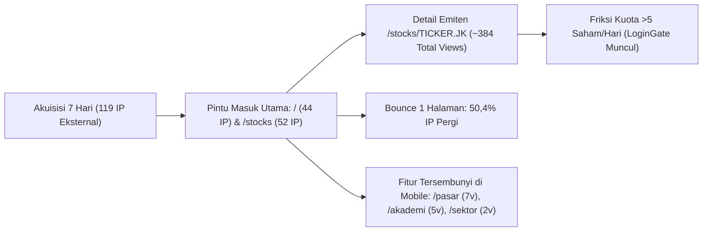

# Audit Menyeluruh teknikal.id — 29 Okt 2026

> **Metodologi & Cakupan Audit:** Kombinasi inspeksi live produksi (`https://teknikal.id` pada 29 Okt 2026 pukul 10:52 WIB saat sesi bursa buka), sampling kode terstruktur pada repositori lokal (`src/app`, `src/components`, `src/domains`), serta query analitik perilaku pengguna nyata 7 hari terakhir (22–29 Okt 2026) langsung dari PostgreSQL produksi/lokal (`127.0.0.1:5433/teknikalid`).
> **Konteks Produk:** Platform analisa teknikal saham IDX bahasa Indonesia untuk investor/trader ritel pemula hingga pengguna aktif. **KPI Utama:** *traffic growth & retention* (bukan registrasi). Identitas utama: **Skor Sinyal 0–1 dengan badge** menggunakan palet token resmi teknikal.id (`--color-accent`, `--color-bullish`, `--color-bearish`, `--color-warning`).

---

## Ringkasan Eksekutif

1. **Menu `Tools` (termasuk `/pasar` Koran Saham Live & `/compare`) tersembunyi total bagi pengunjung mobile anonim (`src/components/layout/header.tsx:228-258`)** → 62,3% trafik pengguna eksternal berasal dari perangkat mobile dan 87,8% pageview eksternal tidak login, sehingga fitur retensi harian utama praktis tak terjangkau dari navigasi mobile (`pasar_live` hanya 7 views eksternal/minggu) → Keluarkan grup `Tools` dari blok kondisional `{session?.user}` di menu mobile dan angkat `Koran Pasar Live` ke bar navigasi utama.
2. **Skala Skor Sinyal terbelah antara `0–1` dan `0–100` disertai copy kontradiktif & jargon Inggris di halaman saham (`src/app/(public)/stocks/[ticker]/page.tsx:688-715` vs `src/app/(public)/pasar/page.tsx:227`)** → Pemula melihat skor `0.66 Strong Bullish` pada saham yang sedang turun `-4,36%` di `/pasar`, lalu melihat skor `20 dari 100` dengan klaim *"Gabungan 12 indikator"* tepat di atas tombol *"Rincian 9 indikator"* di `/stocks/BBCA.JK`, yang merusak kepercayaan dan pemahaman → Standarkan seluruh permukaan publik ke format **Skor Sinyal 0,00–1,00 + badge bahasa Indonesia awam** dengan keterangan waktu hitung (*"Skor penutupan kemarin vs harga live"*).
3. **Paywall login kuota 5 saham/hari (`guestHasQuota`) dan CTA registrasi/simulasi mendominasi halaman publik (`src/app/(public)/stocks/[ticker]/page.tsx:157,848,877` & `src/app/(public)/stocks/page.tsx:198-210`)** → Bertabrakan langsung dengan KPI *traffic growth & retention (bukan register)* karena menghukum pengunjung paling aktif saat membuka saham ke-6 (tercatat pengguna menabrak `guest_quota` hingga saham ke-14 dalam data 7 hari) dan memicu *bounce rate* IP tunggal 50,4% → Longgarkan/hapus gate data fundamental & indikator EOD bagi pengunjung anonim dan ganti dorongan registrasi paksa dengan fitur retensi berbasis `localStorage` + Telegram tanpa login.
4. **Friksi harian operator di Admin Panel akibat tidak adanya editor isi artikel (`content`) dan pencarian di `/admin/articles` (`src/components/admin/article-edit-modal.tsx:22-104`)** → Saat QA pagi menemukan salah angka di artikel AI (seperti kasus fatal angka PBV/MA20 pagi 29 Okt), operator tidak bisa mencari artikel berdasarkan ticker maupun mengedit isi teks artikel dari UI admin karena modal edit hanya memuat judul/ringkasan/tag → Tambahkan pencarian ticker/judul, filter tipe `MOVEMENT_ANALYSIS`, preview isi inline di `/admin/review`, dan editor markdown `content` di `ArticleEditModal`.
5. **Pelanggaran doktrin *Market Data Satu Pintu*, kueri N+1 SSR, dan kebocoran token warna non-brand di kode (`src/app/(public)/page.tsx:139-167`, `src/app/(public)/stocks/[ticker]/page.tsx:277-287`)** → Beranda menghitung `% change` sendiri via raw SQL tanpa filter `NOT LIKE '^%'` & volume `LATERAL`, halaman detail saham mengeksekusi ~15 kueri DB bertingkat + N+1 `foreignFlow`, serta 20+ komponen masih memakai kelas warna di luar token resmi teknikal.id → Pindahkan query *volume leaders* & *foreign flow* ke service terpusat `src/domains/stock/` dan bersihkan seluruh kelas warna liar ke CSS custom properties brand token.

---

## 1. UI/UX Halaman Publik

### A. Temuan Live Produksi (TTFB, Status HTTP & Pengalaman Nyata)

Pengukuran live pada `https://teknikal.id` (29 Okt 2026, 10:52 WIB — jam bursa buka):

| URL Diuji | Status Akhir | TTFB | Ukuran HTML | Catatan UX Live |
| :--- | :--- | :--- | :--- | :--- |
| `/` | `200 OK` | `0.596s` | `193.5 KB` | Cepat, namun kartu hero mengarah ke `/berita/saham-*` yang me-redirect lagi ke `/stocks/*.JK`. |
| `/pasar` | `200 OK` | `0.335s` | `161.1 KB` | Cepat (`60s` snapshot cache), tetapi jam SSR merender `--:-- WIB` di samping `● PASAR BUKA`. |
| `/stocks` | `200 OK` | `0.766s` | `80.8 KB` | Shell ringan, tabel dimuat client-side via `/api/stocks`; ruang atas fold habis oleh banner simulasi. |
| `/screener` | `200` (via redirect `/stocks?view=screener`) | **`1.085s`** | `90.4 KB` | **Paling lambat (>1 detik)** karena redirect hop + render penuh `/stocks`. |
| `/stocks/BBCA.JK` | `200 OK` | `0.407s` | `227.5 KB` | HTML gemuk; ada 2 breadcrumb berbeda bahasa, skor `20 dari 100` (bukan 0–1), dan 7 tombol `?` mikro. |
| `/saham/bbca/kenapa-naik-hari-ini` | `200 OK` | `0.856s` | — | Halaman SEO aktif, tetapi URL induk `/saham/bbca` & `/saham/BBCA` menghasilkan **`404 Not Found`**. |
| `/akademi` | `200 OK` | `0.311s` | `104.5 KB` | Judul artikel ramah pemula (*"1 Lot Saham Itu Berapa Lembar?"*), namun terpotong banner simulasi. |
| `/sektor/perbankan` | `200 OK` | `0.309s` | `61.5 KB` | Hanya menampilkan **5 saham statis** dari puluhan bank BEI; indikator breadth membingungkan. |

### B. Hierarki Informasi, Copy Bahasa Indonesia Awam, Mobile & Empty States

1. **Navigasi Mobile Menyembunyikan `Tools` bagi 98% Pengunjung Anonim (`src/components/layout/header.tsx:228-304`)**
   - **Temuan:** Di desktop (`header.tsx:127-161`), dropdown `Tools` tampil untuk semua pengunjung. Namun di dropdown mobile (`header.tsx:228`), tombol `Tools` beserta seluruh sub-menunya (`/pasar`, `/track-record`, `/trading-plan`, `/market-structure`, `/bottom-fishing`, `/compare`) dibungkus di dalam cabang `{session?.user ? (...) : (...)}`. Pengunjung anonim mobile hanya diberi `Beranda`, `Saham`, `Berita`, `Akademi`, `Masuk`, dan `Daftar`.
   - **Rekomendasi:** Pindahkan blok accordion `Tools` ke luar kondisional `session?.user`, ganti label Inggris *"Tools"*, *"Track Record"*, *"Market Structure"*, *"Bottom Fishing"* menjadi istilah awam (*"Alat Analisa"*, *"Riwayat Akurasi Sinyal"*, *"Arah Tren Pasar"*, *"Radar Saham Diskon"*).

2. **Inkonsistensi Identitas Skor Sinyal (`0–1` vs `0–100`) & Copy Indikator Kontradiktif (`src/app/(public)/stocks/[ticker]/page.tsx:688-716`, `src/components/stock/health-score-badge.tsx:11-58`, `src/app/(public)/pasar/page.tsx:227`)**
   - **Temuan:** Di `/pasar`, Top-20 menampilkan format brand `0.66 Strong Bullish`. Sebaliknya, di `/stocks/BBCA.JK` (`page.tsx:688`) nilai `signalScore` dikonversi melalui `signalToHealthScore()` menjadi **`20 dari 100`** (`Sinyal: Bearish Lemah`), dan pada `StockCard` (`stock-card.tsx:65`) hanya muncul angka bulat `20` di samping panah `▼` tanpa satuan (terlihat seperti saham turun 20 poin/%). Lebih membingungkan lagi, baris `page.tsx:712` menulis *"Gabungan 12 indikator teknikal"* persis di atas akordion `SignalBreakdownDetails` yang bertuliskan *"Rincian 9 indikator ▾"*.
   - **Rekomendasi:** Satukan seluruh komponen ke **Skor Sinyal 0,00–1,00 dengan badge bahasa Indonesia** (mis. `0,66 · Sinyal Kuat`, `0,20 · Tekanan Jual`), dan samakan jumlah indikator antara deskripsi dan rincian (9 indikator aktif dalam pembobotan skor).

3. **Paradoks "Strong Bullish" pada Saham Merah di `/pasar` (`https://teknikal.id/pasar`, `src/app/(public)/pasar/page.tsx:149-162, 227`)**
   - **Temuan:** Saat pasar buka, 3 peringkat teratas *Top-20 Skor Sinyal* di `/pasar` hari ini adalah `MBSS (-4,36% · 0.66 Strong Bullish)`, `POLA (-3,41% · 0.64 Strong Bullish)`, dan `BEKS (-3,70% · 0.64 Strong Bullish)`. Bagi pemula, melihat label Inggris *"Strong Bullish"* bersanding dengan harga anjlok `-4,36%` tanpa penjelasan bahwa skor dihitung dari penutupan sesi sebelumnya (`28 Okt 2026`) terasa seperti sistem rusak. Selain itu, komponen `<WibClock />` merender placeholder `--:-- WIB` pada HTML SSR awal.
   - **Rekomendasi:** Terjemahkan badge ke bahasa Indonesia, tambahkan sub-label eksplisit *"Skor EOD 28 Okt"* vs *"Perubahan Live"*, dan tandai saham berskor tinggi yang sedang terkoreksi intraday dengan konteks awam (*"Tren harian positif, sedang terkoreksi sesi ini"*).

4. **Halaman Detail Saham `/stocks/[ticker]`: Jargon Campur Inggris, Breadcrumb Ganda, Anchor `"AI"` Salah Sasaran & `<title>` Spasi Berlebih (`src/app/(public)/stocks/[ticker]/page.tsx:112, 196, 203, 592-598, 673, 825-843, 862-871`)**
   - **Temuan:**
     - `page.tsx:112`: Template `` `${shortName} ( ${name} ) Harga Saham Hari Ini` `` mencetak spasi ganjil `( BBCA )` di `<title>` seluruh 940 emiten.
     - `page.tsx:196 & 203`: Badge silang merender bahasa Inggris mentah `"Golden Cross detected today"` dan `"EMA Bearish Cross 38d ago"`.
     - `page.tsx:592-598` vs `862-871`: Ada **dua breadcrumb visual** di halaman yang sama — `Stocks > BBCA` (bahasa Inggris) di atas kartu harga, lalu `Beranda > Saham > Keuangan > BBCA` di bawah sticky bar.
     - `page.tsx:827-832`: Tab sticky `"AI"` melompat ke `` di baris `673` (di dalam header harga di atas sticky bar yang hanya berisi tombol modal, bukan seksi halaman), sementara seksi `Aliran Dana Asing`, `Analisa Hari Ini` (`#analisa`), `Fundamental`, dan `Profil/Dividen` tidak ada di sticky nav.
     - Heading seksi masih berbahasa Inggris: `H3: Key Statistics`, `H2: Fundamentals`, serta nama emiten BUMN terpotong tanpa kurung tutup di DB: `Bank Rakyat Indonesia (Persero` & `Bank Syariah Indonesia (Perser`.
   - **Rekomendasi:** Hapus breadcrumb Inggris atas (`592-598`), rapikan `(BBCA)` tanpa spasi, ubah `"38d ago"` menjadi `"38 hari lalu"`, terjemahkan *Key Statistics/Fundamentals* menjadi *Statistik Kunci/ Valuasi & Fundamental*, dan perbaiki anchor sticky nav agar mengarah ke `#analisa`, `#asing`, `#chart`, `#indikator`, `#fundamental`.

5. **Sentuhan Mobile (Touch Target) & Baris Saham Non-Link (`src/components/ui/indicator-tooltip.tsx:19`, `src/components/stock/stock-card.tsx:170-177`)**
   - **Temuan:** Tombol bantuan `?` di sebelah setiap indikator (`IndicatorTooltip`) berukuran `w-3.5 h-3.5` (**14×14 px**), jauh di bawah standar minimum aksesibilitas sentuh mobile (24–44 px) dan berbasis hover tooltip yang sulit dipicu di layar sentuh. Selain itu, daftar saham mobile `StockCardList` (`stock-card.tsx:170`) merender tiap baris sebagai `<button onClick={() => router.push(...)}>` alih-alih `<Link href={...}>`, sehingga pengguna mobile tidak bisa *long-press → buka di tab baru* dan tidak mendapat prefetching tautan.
   - **Rekomendasi:** Ubah wrapper baris `StockCardList` menjadi `<Link>`, dan ubah `IndicatorTooltip` menjadi tombol berarea sentuh minimal `32×32 px` (`-m-2 p-2`) yang membuka *popover/click-toggle* ramah layar sentuh.

6. **Halaman `/sektor/[slug]` Minim Emiten & Simbol Breadth Menyesatkan (`src/app/(public)/sektor/[slug]/page.tsx:52-68, 171-187`)**
   - **Temuan:** `/sektor/perbankan` hanya mengambil 5 ticker statis dari konstanta `SECTORS` (`BMRI, BBCA, BBRI, BBNI, BRIS`), padahal BEI memiliki >40 saham bank aktif. Di kanan atas tertulis `▲ 0 ◆ 2 ▼ 3` (menghitung `signalLabel` Bullish/Netral/Bearish), padahal pada saat yang sama 4 dari 5 saham tersebut sedang hijau naik harga (`BBCA +7,65%`, `BRIS +1,90%`, `BBNI +1,21%`, `BBRI +0,69%`), ditambah label sektor mentah `"Financials"` dan badge papan Inggris di `ListingBoardBadge` (`stock-card.tsx:110-115`: `"Pemantauan Khusus"` malah diubah menjadi `"Special Monitoring"`, `"Pengembangan"` → `"Dev"`). Empty state (`sektor/[slug]/page.tsx:186` & `stock-card.tsx:157-160`) juga hanya berupa teks polos tanpa tombol reset filter atau rekomendasi alternatif.
   - **Rekomendasi:** Query seluruh saham aktif per sektor/sub-sektor dari DB, ganti simbol `▲/◆/▼` dengan chip bertuliskan `"0 Sinyal Bullish · 2 Netral · 3 Bearish"`, pertahankan nama papan BEI bahasa Indonesia (*"Pemantauan Khusus / FCA"*), dan perkaya empty state dengan tombol *"Reset Filter"* + tautan preset populer.

7. **Asimetri URL `/saham/[ticker]` (404) & Redirect Berantai di Beranda (`src/app/(public)/page.tsx:454, 492-496`)**
   - **Temuan:** H1 beranda hanya bertuliskan `TeknikalID` (`page.tsx:493`) dengan subjudul *"Trading tanpa nebak-nebak"* (kurang merangkul investor pemula dibanding bahasa *"Analisa Saham IDX Tanpa Nebak-Nebak"*), serta terdapat duplikasi judul seksi antara fallback/komponen (*"Peta Sektor"*, *"Coba Fitur Analisa"*). Empat kartu `SnapshotCard` di hero beranda menaut ke `/berita/saham-kopi` (`page.tsx:454`) yang tidak memiliki artikel sehingga memicu redirect server 0,26–0,62 detik ke `/stocks/KOPI.JK`. Sementara itu, pengguna yang mengetik `/saham/bbca` (pola alami bahasa Indonesia dari `/saham/bbca/kenapa-naik-hari-ini`) mendapat **404**.
   - **Rekomendasi:** Tautkan `SnapshotCard` hero langsung ke `/stocks/${ticker}` dan tambahkan aturan redirect permanen `308` untuk `/saham/:ticker` → `/stocks/:TICKER.JK`.

---

## 2. UX Admin Panel

### A. Pemetaan Arsitektur & Alur Kerja Operator Harian (`src/app/admin`, `src/components/admin`, `src/domains/dashboard`)

Operator harian menjalankan 4 tugas inti: **(1) Cek kesehatan pipeline EOD/intraday & error pagi**, **(2) QA & koreksi artikel AI harian (~45 artikel/pagi)**, **(3) Pantau trafik/retensi/share pengguna nyata**, dan **(4) Moderasi laporan komunitas & kelola daftar emiten aktif/delisting**.

### B. Temuan Friksi Operator (Apa yang Bikin Lambat & Repot)

1. **Modal Edit Artikel Tidak Bisa Mengedit Isi Artikel (`content`) & Tidak Ada Kotak Pencarian (`src/components/admin/article-edit-modal.tsx:22-104`, `src/app/admin/articles/page.tsx:48-50, 140-164`)**
   - **Friksi:** `ArticleEditModal` hanya menyediakan field `title`, `excerpt`, `tags`, `tickerTag`, dan `isListed` — **sama sekali tidak ada field `content`**. Ketika tim QA pagi menemukan halusinasi angka fundamental/MA20 di isi artikel (seperti temuan fatal QA 29 Okt pada artikel PWON/AADI), operator tidak dapat mengoreksi teks artikel lewat UI admin dan terpaksa menyentuh DB/script langsung. Di `/admin/articles`, juga **tidak ada input pencarian** (judul/slug/ticker), tidak ada paginasi, dan filter tipe (`articles/page.tsx:153`) melupakan `MOVEMENT_ANALYSIS` (*Kenapa Naik*, ratusan artikel) serta `DAILY_SNAPSHOT`.

2. **Antrian Review (`/admin/review`) Memaksa Buka Tab Baru Satu per Satu Tanpa Preview Inline (`src/app/admin/review/page.tsx:65-67, 111-141`)**
   - **Friksi:** Halaman `/admin/review` hanya menampilkan 1 baris judul (`line-clamp-1`) dan 1 baris excerpt (`line-clamp-1`). Untuk memeriksa akurasi angka sebelum klik *Setujui*, editor harus mengklik ikon `ExternalLink` (`target="_blank"`), berpindah tab browser, kembali ke tab admin, lalu jika menolak harus mengetik di `window.prompt()` native browser (`review/page.tsx:66`) yang memblokir thread UI dan tidak memiliki template alasan penolakan cepat (mis. *"Angka tidak sesuai DB"*, *"Emiten tidak relevan"*). Tidak ada pula fitur *batch approve*.

3. **Duplikasi Navigasi "Split-Brain" Antara Tab `/admin` dan Sidebar (`src/app/admin/layout.tsx:73-139` vs `src/app/admin/_components/dashboard-shell.tsx:27-79`)**
   - **Friksi:** Halaman `/admin` memuat `DashboardShell` dengan **9 tab horizontal** (`overview`, `users`, `community`, `stocks`, `predictions`, `auth`, `analytics`, `insight`, `usermgmt`) yang hanya disimpan di `useState` lokal tanpa sinkronisasi URL query (`?tab=`). Pada saat bersamaan, sidebar kiri menyediakan item menu terpisah (`/admin/user-analytics`, `/admin/insight`, `/admin/community`, `/admin/stock-engagement`, `/admin/predictions`, `/admin/auth-health`) yang ternyata hanya file pembungkus 10 baris pemanggil `<DashboardShell initialTab="..." />`! Selain itu:
     - Grup sidebar (`NavGroupWithSubmenu`, `layout.tsx:143`) menggunakan `useState(hasActiveChild)` sehingga saat operator mendarat di `/admin`, **3 dari 4 grup menu tertutup rapat** (butuh klik ekstra setiap pindah domain kerja) dan tidak otomatis terbuka jika navigasi dipicu dari tautan dalam halaman.
     - `PAGE_NAMES` (`layout.tsx:118-139`) lupa mendaftarkan `/admin/insight`, `/admin/announcements`, dan `/admin/social-cards`, sehingga header atas hanya menampilkan teks generik `"Admin"`.
     - Enam file route lama (`cron-monitor`, `eod-logs`, `intraday-logs`, `indicators`, `cron-config`, `queue-monitor`) masih menumpuk di pohon direktori sebagai redirect ke `/admin/pipelines` (`pipelines/page.tsx` sendiri membengkak jadi **1.250 baris** dalam satu file client).

4. **`Share Tracking` Tercemar Log `guest_quota` (`prisma/schema.prisma:1097`, data aktual `ShareEvent`)**
   - **Friksi:** Dari 90 baris `ShareEvent` non-bot selama 7 hari terakhir, **78 baris (86,7%) adalah `target = 'guest_quota'`** (angka hit kuota 1 s.d. 14), sedangkan klik share asli hanya 12 baris (`story: 9`, `copy: 2`, `x: 1`). Menyimpan telemetri kuota tamu di tabel `ShareEvent` merusak pembacaan metrik viralitas/share bagi operator jika tidak difilter ketat di setiap query.

5. **Catatan Domain `src/domains/dashboard/dashboard.service.ts`**
   - **Temuan:** Meskipun bernama `dashboard`, `dashboard.service.ts` sebenarnya **bukan** service admin panel, melainkan ringkasan beranda pengguna login (`PersonalizedBeranda` → `/api/dashboard/summary` untuk saldo paper-trading, 5 mover watchlist, dan streak poin). Penamaan peninggalan route `/dashboard/*` lama (yang kini sudah di-redirect di `src/proxy.ts:394`) berpotensi mengecoh developer/operator yang mencari logika `/admin`.

### C. Quick-Wins Khusus Admin Panel
- Buka semua grup sidebar secara default di desktop (`useState(true)`) dan lengkapi `PAGE_NAMES` di `src/app/admin/layout.tsx:118-143`.
- Tambahkan `<textarea>` edit `content` di `ArticleEditModal`, kotak cari ticker/slug di `/admin/articles`, serta panel *expandable preview* + chip alasan tolak cepat di `/admin/review`.
- Sinkronkan tab `DashboardShell` dengan parameter URL atau hapus duplikasi antara tab `/admin` dan route wrapper sidebar.

---

## 3. Insight Product & Gap Fitur

### A. Data Nyata Perilaku Pengguna 1 Minggu Terakhir (22–29 Okt 2026 via PostgreSQL `teknikalid`)

Query langsung pada tabel `PageView`, `EngagementEvent`, `ShareEvent`, `SignalFeedback`, dan `WaitlistSubscriber` (7 hari terakhir, `isBot = false`):

- **Volume & Pemisahan Trafik Admin vs Eksternal Murni:**
  - Total human views publik (non-`/admin`): **1.154 views** dari **131 IP unik** (`mobile: 675 views / 58,5%`, `desktop: 479 views / 41,5%`).
  - Setelah mengecualikan IP yang pernah mengakses `/admin` atau login sebagai `ADMIN`: trafik **pengunjung eksternal murni adalah 599 pageviews dari 119 IP unik**, dengan **373 views (62,3%) dari mobile** dan **87,8% (526/599 views) dilakukan tanpa login** (`authed_external_views` hanya 73 views).
- **Retensi & Bounce Rate:**
  - Dari 131 IP publik 7 hari terakhir, **66 IP (50,38%) hanya membuka 1 halaman lalu pergi (*single-page bounce*)**, dan **6 IP (4,58% dalam jendela rolling 7 hari ini)** tercatat aktif di ≥2 hari berbeda.
  - Rata-rata waktu baca aktif (`EngagementEvent.dwell_tick`, `n = 854`) cukup sehat di **67,9 detik** dengan rata-rata kedalaman gulir (`scroll_max`, `n = 432`) **52,8%** — artinya **pengunjung yang masuk sebenarnya membaca konten, tetapi setengahnya tidak lanjut ke halaman ke-2**.
- **Distribusi Halaman Eksternal Murni (599 views):**
  - `/stocks` (**184 views**, 52 IP) dan `/` (**97 views**, 44 IP) menyumbang **46,9%** seluruh trafik eksternal, diikuti halaman detail emiten `/stocks/[TICKER].JK` (TPIA 10, FORU 8, PCAR 7, BBCA 7, RUNS 7, MSIN 6, ELIT 6, dll.).
  - Sebaliknya, halaman bernilai tinggi nyaris tidak tersentuh pengguna eksternal: `/pasar` (**7 views**), `/akademi` (**5 views**), `/community` (**5 views**), `/paper-trading` (**5 views**), `/berita` indeks (**4 views**), `/compare` (**≤3 views**), `/saham/[t]/kenapa-naik-hari-ini` (**3 views**), `/sektor/*` (**2 views**).
  - Anomali path: `/landing` masuk 10 besar human `PageView` keseluruhan (**11 views**) padahal live URL `https://teknikal.id/landing` mengembalikan **HTTP 404**.
- **Sumber Akuisisi (`referrer`) & Konversi Mikro:**
  - `(direct/none)`: 709 views (63 IP), internal `teknikal.id`: 305 views, **Bing organik (`www.bing.com`): 56 views (29 IP)**, **Threads (`l.threads.com`): 22 views (10 IP)**, **Google organik (`www.google.com`): baru 11 views (11 IP)**, Yahoo Search: 10 views.
  - `WaitlistSubscriber` baru 7 hari terakhir: **0 pendaftar**. `SignalFeedback` (👍/👎 akurasi sinyal): hanya **2 klik** (1 akurat, 1 tidak). Klik share asli (`ShareEvent` non-`guest_quota`): **12 klik** (9 Story, 2 Copy berita, 1 X).

### B. Apa yang KURANG vs Kebutuhan Pemula Saham IDX

1. **Konteks Uang Nyata BEI ("Minimal 1 Lot = 100 Lembar = Rp Berapa?"):** Pemula Indonesia sering mengira harga `BBCA Rp5.275` berarti bisa dibeli dengan uang Rp5.275. Meski sudah ada artikel `/akademi` tentang 1 lot, halaman `/stocks/[ticker]` belum menampilkan baris sederhana **`1 Lot (100 lbr) = Rp527.500`** di kartu harga utama.
2. **Penerjemah Angka Indikator ke Kalimat Kontekstual Saham Tersebut:** Pemula tidak paham bedanya `RSI 28` vs `RSI 55` atau `OBV Bearish` vs `VWAP`. Saat ini indikator hanya menampilkan label satu kata (*Bearish/Bullish/Netral*) dan tooltip kamus umum `14×14 px`, belum menjawab *"Apa artinya angka ini untuk saham ini hari ini dan apa risikonya?"*.
3. **Peringatan Risiko Khas Bursa Indonesia yang Utuh (FCA / Papan Pemantauan Khusus, Suspensi/Saham Tidur, Dividend Trap):** Badge `Gorengan` dan `HSC` sudah sangat bagus, tetapi status `Pemantauan Khusus` (Full Call Auction / FCA BEI) justru tersembunyi atau berubah menjadi label Inggris `"Special Monitoring"` di tabel, dan kalender dividen lintas pasar belum tersedia sebagai halaman tujuan.
4. **Jembatan Pencarian Nama Sehari-hari & Tanpa `.JK`:** Pemula mengenal merek (*"Indofood"*, *"Bank Syariah"*, *"Emas Antam"*, *"Telkom"*) dan mengetik URL `/saham/bbca`, bukan `/stocks/BBCA.JK`.
5. ** Memori Kunjungan Tanpa Akun (No-Login Retention Loop):** Karena 87,8% aktivitas eksternal bersifat anonim, ketiadaan ringkasan *"Saham yang terakhir Anda cek & perubahan Skor Sinyalnya hari ini"* secara mencolok di atas fold beranda anonim membuat pengunjung tidak punya alasan kuat untuk kembali besok pagi.

### C. Apa yang BERLEBIHAN (Over-Engineered / Mengganggu Fokus Pemula)

1. **Gate Kuota 5 Saham/Hari (`guestHasQuota` + `LoginGate` + `GuestOverlimitBanner` + `RegistrationInlinePrompt` + `RegisterCtaBar`):** Ketika KPI adalah *traffic growth & retention (bukan register)*, membatasi pengunjung anonim hanya 5 saham per hari sebelum menyembunyikan fundamental & detail indikator (`stocks/[ticker]/page.tsx:157, 882-917`) langsung mematikan sesi eksplorasi pengunjung aktif dan bertentangan dengan pertumbuhan SEO/retensi.
2. **Promosi Simulasi / Fitur Sekunder di Atas Fold Halaman Inti (`/stocks` & `/akademi`):** Banner kontras gelap di atas daftar saham (`src/app/(public)/stocks/page.tsx:198-210`) mendorong pengunjung keluar dari alur riset saham, padahal data 7 hari menunjukkan hanya 5 views eksternal yang tertarik.
3. **Kepadatan Vertikal Halaman `/stocks/[ticker]` (16+ Blok Berurutan, File 1.412 Baris):** Dalam satu halaman saham terdapat: Header Harga → Skor 0–100 → Rincian 9 Indikator → OHLC/52mgg → Cross Badges → Share Bar → Sticky Nav → Breadcrumb ke-2 → Guest Tracker → Aliran Dana Asing → CTA Telegram → Chart → Posisi Simulasi → Brief Pasar → Link Kenapa Naik → Analisa Harian → Panel Indikator → Key Statistics → Kalkulator Plan → Fundamental → Tab Profil/Direksi/Komisaris/Pemegang Saham/Anak Usaha/Dividen → Sentimen & Diskusi Komunitas (kosong di mayoritas saham) → FAQ. Di layar HP 375px, halaman menjadi sangat panjang dan melelahkan pemula; seksi diskusi kosong (`5 views` komunitas seminggu) sebaiknya dilipat (*collapsed*) bila belum ada komentar.
4. **Fitur Gamifikasi Login (`ClaimStreakButton`, Reputasi, Tesis, Komunitas, `/waitlist` 0 pendaftar, `/billing`):** Memakan kompleksitas kode & ruang pemeliharaan tinggi sementara pengguna login harian hanya 2–4 akun. Fokuskan energi produk sepenuhnya pada kualitas halaman publik tanpa login.

---

## 4. Code Quality

### A. Konsistensi Arsitektur & Pelanggaran Doktrin *API Reuse Rule*

1. **Raw SQL & Hitung `% Change` Langsung di Halaman Beranda (`src/app/(public)/page.tsx:139-177`)**
   - Melanggar aturan `AGENTS.md` (*"Compute change/breadth/movers DI LUAR snapshot service = DILARANG"*). `FeaturedStocksSection` menjalankan `prisma.$queryRaw` langsung di komponen halaman, menghitung `((v.close - v.prev) / v.prev) * 100` lokal, **tidak memfilter `s.ticker NOT LIKE '^%'`**, dan subquery `LATERAL` (`page.tsx:148-152`) lupa menyertakan syarat `AND volume > 0` pada sesi pembanding `prev`.
   - Query identik penghitung `oversoldCount` juga diduplikasi tiga kali secara inline di `src/app/(public)/page.tsx:373-388` dan `src/app/(public)/pasar/page.tsx:58-73, 118-133` alih-alih menjadi field standar di `marketSnapshotService`.

2. **Kebocoran Kelas Warna Non-Token Brand di 20+ File (`src/components/` & `src/app/`)**
   - Walaupun `src/app/globals.css:7-28` sudah mendefinisikan token resmi teknikal.id (`--color-accent: #0369a1`, `--color-bullish: #0d9488`, `--color-bearish: #dc2626`, `--color-warning: #b45309`), masih banyak komponen publik & admin yang menulis kelas Tailwind warna terlarang di luar sistem token, antara lain:
     - Publik: `src/components/screener/screener-types.ts:102-107`, `src/components/seo/ask-ai-cta.tsx:11,23`, `src/components/chart/candlestick-chart.tsx:632,640`, `src/components/stock/bottom-fishing-radar.tsx:133`, `src/components/article/article-feed.tsx:9`, `src/components/faq/stock-faq-widget.tsx:23`, `src/components/home/personalized-beranda.tsx:29,33`.
     - Admin: `src/app/admin/articles/page.tsx:134`, `src/app/admin/agent-hub/page.tsx:153,217,308`, `src/app/admin/_components/analytics-tab.tsx:102,537,687,713,1013`, `src/app/admin/pipelines/page.tsx:501,601,963,1226`.
   - **Perbaikan:** Ganti seluruh kelas warna non-standar tersebut dengan utilitas token resmi (`text-accent`, `bg-accent-muted`, `border-accent/30`, `text-bullish`, `text-warning`).

### B. Performa SSR & Pola Query N+1

1. **Waterfall 6 Tahap + N+1 `ForeignFlow` di `/stocks/[ticker]` (`src/app/(public)/stocks/[ticker]/page.tsx:144-288, 311, 1009`)**
   - Setiap request SSR `/stocks/[ticker]` mengeksekusi query berurutan: `findStockByTicker` (`:144`) → `auth()` (`:153`) → `guestHasQuota()` (`:157`) → `getStockDetailForPage` (`:162`) → `getStockBatchWithIndicators` (`:232`) → `Promise.all` 10 query (`:236`) → `foreignFlow.findMany` (`:271`) → **N+1 `Promise.all(foreignRows.map(... prisma.stockPrice.findUnique ...))` (`:277-286`)** (padahal array `prices` sudah di-fetch di `detail.prices`!) → `getMarketLatestPriceDate` (`:311`) → `findLatestBriefMentioning` (`:1009`).
2. **N+1 Query di Admin Reports (`src/app/admin/reports/page.tsx:26-36, 97-107`)**
   - Melakukan `prisma.post.findUnique` dan `prisma.comment.findUnique` satu per satu di dalam loop laporan, bukannya batch `findMany({ where: { id: { in: ids } } })`.

### C. Aksesibilitas (a11y) & Validitas HTML

1. **Elemen Interaktif Bersarang `<button>` di dalam `<Link>` (`<a>`) (`src/components/stock/stock-card.tsx:47-100`)**
   - Tombol `<button aria-label="Analisa AI ...">` (`:90`) dirender di dalam `<Link href="/stocks/...">` (`:47`). Spesifikasi HTML5 melarang `<button>` di dalam `<a>` karena merusak pembaca layar (*screen reader*) dan fokus keyboard. Letakkan `<button>` sebagai sibling absolut di luar `<Link>` (di dalam `
` baris `:46`).
2. **Modal Custom Tanpa Semantik Dialog, Focus Trap & Tombol `Escape` (`src/components/admin/article-edit-modal.tsx:68-104`, `src/components/community/share-modal.tsx:79`, `src/components/community/post-card.tsx:210`)**
   - Dibuat dengan `
` tanpa `role="dialog"`, `aria-modal="true"`, handler tombol `Escape`, maupun atribut `htmlFor`/`id` pada `<label>` form.
3. **Navigasi Side-Effect saat Render di React 19 (`src/app/admin/layout.tsx:219-222`)**
   - Memanggil `router.replace("/admin/login?error=access_denied")` langsung di badan fungsi render komponen (bukan di dalam `useEffect` atau server guard).

### D. Error Handling & Dead Code

1. **184 Blok Empty `catch {}` Tanpa Pencatatan Telemetri**
   - Tersebar di 184 titik (`src/app/(public)/sektor/[slug]/page.tsx:56`, `src/domains/faq/faq.service.ts:138,210`, `src/domains/article/ai-provider.ts:59,271`, dll.). *Fail-soft* pada UI publik memang baik agar halaman tidak `500`, tetapi menelan error DB tanpa `logger.warn`/`Sentry` membuat kegagalan query (mis. halaman sektor kosong karena timeout) tidak terdeteksi di `/admin/errors`.
   - Selain itu, hanya `/stocks/[ticker]/error.tsx` dan root `src/app/error.tsx` yang memiliki error boundary; route berat seperti `/pasar`, `/stocks`, `/akademi`, dan `/admin/*` belum memiliki `error.tsx` kontekstual.
2. **Dead Code & Unused Imports Terverifikasi**
   - `src/components/PaymentButton.tsx`: **0 import** di seluruh kode sumber (`src/`).
   - `src/components/stock/stock-ai-panel.tsx` (`StockAiPanel`): **0 import** di seluruh `src/`.
   - `src/components/stock/health-score-detail.tsx` (`HealthScoreDetail`): di-import di `src/app/(public)/stocks/[ticker]/page.tsx:40` tetapi **tidak pernah dipakai** di JSX halaman tersebut (sudah digantikan `SignalBreakdownDetails`).
   - File backup liar di repo (`docs/agent-org/*.bak-*` — puluhan file backup JSON/MD menumpuk di working tree).

---

## 5. Ide Fitur Baru

1. **Kalender Dividen & Jadwal Cum-Date BEI** — Halaman publik `/kalender-dividen` berbasis tabel `StockDividend` yang menyajikan jadwal cum-date/ex-date 30 hari ke depan lengkap dengan estimasi yield, badge Skor Sinyal 0–1, dan edukasi singkat risiko penurunan harga saat ex-date. — impact pemula: TINGGI — effort: KECIL
2. **Kalkulator Modal Minimal 1 Lot (100 Lembar)** — Baris informasi instan dan kalkulator sederhana di header `/stocks/[ticker]` yang menerjemahkan harga lembar saham menjadi modal riil minimal `1 lot = 100 lembar` (mis. `BBCA Rp5.275 → Rp527.500/lot`) agar pemula langsung paham keterjangkauan modalnya. — impact pemula: TINGGI — effort: KECIL
3. **Bottom-Sheet Kamus Indikator Kontekstual 1-Tap** — Mengganti tooltip `?` mikro dengan panel bawah ramah jempol di mobile yang menerjemahkan angka aktual saham tersebut ke bahasa awam (mis. *"RSI 28 pada saham ini berarti tekanan jual sudah jenuh, namun cek arah tren SMA sebelum mengambil keputusan"*) beserta tautan ke artikel `/akademi`. — impact pemula: TINGGI — effort: KECIL
4. **Garis Waktu Riwayat Skor Sinyal 0–1 (30 Hari Terakhir)** — Visualisasi ringkas di halaman saham yang menampilkan kapan badge Skor Sinyal 0–1 berubah status dalam sebulan terakhir beserta harga penutupan saat itu untuk membuktikan konsistensi sinyal kepada pemula. — impact pemula: TINGGI — effort: SEDANG
5. **Kartu Peringatan Risiko Pemula Terpadu (FCA, Saham Tidur, Gorengan, HSC)** — Panel ringkas bahasa Indonesia awam di atas fold saham berisiko yang menyatukan status papan *Pemantauan Khusus (FCA)*, ketiadaan transaksi sesi terakhir (`latestStale`), volatilitas tidak wajar (`isGorengan`), dan konsentrasi kepemilikan (`HSC`). — impact pemula: TINGGI — effort: KECIL
6. **Pantauan Lokal Tanpa Login + Ringkasan Delta Harian di Beranda** — Menyimpan saham yang dibintangi pengunjung di `localStorage` tanpa paksa daftar akun, lalu menampilkan kartu *"Perubahan Saham Pantauan Anda Sejak Kunjungan Terakhir"* (selisih harga & perubahan Skor Sinyal 0–1) paling atas saat mereka kembali ke beranda. — impact pemula: TINGGI — effort: SEDANG
7. **Tolok Ukur "Saham Ini vs Median Sektornya"** — Komparasi otomatis 1 baris di `/stocks/[ticker]` yang membandingkan Skor Sinyal 0–1, PER, PBV, dan perubahan harga 1 bulan emiten terhadap nilai tengah seluruh saham aktif di sektor BEI yang sama. — impact pemula: SEDANG — effort: KECIL
8. **Pencarian Alias Merek Konsumen & Bahasa Sehari-hari** — Memperkaya kotak pencarian beranda dan `/stocks` dengan kamus merek/produk populer Indonesia (mis. ketik *"Indomie"* → `ICBP`/`INDF`, *"BCA"* → `BBCA`, *"batu bara"* → daftar emiten batu bara) agar pemula yang belum hafal kode 4 huruf BEI langsung menemukan sahamnya. — impact pemula: TINGGI — effort: KECIL
9. **Halaman Indeks Harian "Rekap Sinyal EOD Pasar Tutup" untuk SEO Malam/Pagi** — Halaman ringkasan terindeks berbasis `marketSnapshotService` yang menyajikan perubahan breadth pasar, 10 saham likuid non-gorengan dengan lonjakan Skor Sinyal 0–1 baru, dan aliran dana asing bersih untuk menangkap trafik pencarian malam hingga pra-pembukaan bursa. — impact pemula: SEDANG — effort: SEDANG
10. **Kartu Gambar Bagikan WhatsApp "Rapor Sinyal 0–1" (Rasio 1:1)** — Generator kartu gambar ringkas berdesain token resmi teknikal.id yang merangkum harga penutupan, badge Skor Sinyal 0–1, posisi harga 52-minggu, dan label risiko untuk dibagikan 1-klik ke grup WhatsApp/Telegram ritel Indonesia. — impact pemula: SEDANG — effort: KECIL

---

## 6. Quick Wins ≤1 hari

1. **Buka Akses Menu `Tools` di Navigasi Mobile Anonim (`src/components/layout/header.tsx:228-258`)**
   - Pindahkan render tombol & daftar `toolLinks` (`/pasar`, `/compare`, `/track-record`, `/bottom-fishing`) keluar dari blok `{session?.user ? ...}` dan terjemahkan label Inggrisnya ke bahasa Indonesia awam agar 62% trafik mobile eksternal dapat menjangkau Koran Pasar Live. *(Estimasi: 20 menit)*
2. **Redirect `/saham/[ticker]` → `/stocks/[TICKER].JK` & Hapus Hop Redirect Kartu Hero Beranda (`src/proxy.ts` + `src/app/(public)/page.tsx:454`)**
   - Tambahkan `308 Permanent Redirect` untuk `/saham/:ticker` (saat ini `404`) ke `/stocks/:TICKER.JK`, redirect `/landing` (11 views 404 minggu ini) ke `/`, dan arahkan `SnapshotCard` di beranda langsung ke `/stocks/${ticker}` tanpa memutar lewat `/berita/saham-*`. *(Estimasi: 30 menit)*
3. **Seragamkan Skor Sinyal `0–1` + Badge Bahasa Indonesia & Bersihkan Copy/Breadcrumb Ganda di `/stocks/[ticker]` (`src/app/(public)/stocks/[ticker]/page.tsx:112, 196, 203, 592-598, 688-715`)**
   - Tampilkan Skor Sinyal skala `0,00–1,00` dengan badge bahasa Indonesia (konsisten dengan `/pasar`), samakan teks *"Gabungan 9 indikator"* dengan rinciannya, hapus spasi `( BBCA )` di `<title>`, ubah *"38d ago"* → *"38 hari lalu"*, dan hapus breadcrumb Inggris ganda `Stocks > BBCA`. *(Estimasi: 2 jam)*
4. **Tambahkan Editor Isi `content` & Pencarian Ticker/Judul di Admin Artikel (`src/components/admin/article-edit-modal.tsx:22-104` + `src/app/admin/articles/page.tsx:48-164`)**
   - Tambahkan `<textarea>` markdown `content` pada `ArticleEditModal`, input filter teks judul/ticker, serta opsi filter `MOVEMENT_ANALYSIS` & `DAILY_SNAPSHOT` agar operator bisa memperbaiki temuan QA artikel pagi dalam hitungan detik tanpa akses DB manual. *(Estimasi: 2,5 jam)*
5. **Perbesar Area Sentuh `?` Tooltip Mobile, Perbaiki HTML `<button>` di dalam `<Link>`, dan Hapus Gate Kuota 5 Saham Anonim (`src/components/ui/indicator-tooltip.tsx:19`, `src/components/stock/stock-card.tsx:47-101`, `src/app/(public)/stocks/[ticker]/page.tsx:157`)**
   - Perbesar tombol `?` indikator dari `14×14 px` menjadi minimal `32×32 px`, keluarkan `<button>` AI dari dalam tag `<Link>` pada `StockCard`, dan buka akses baca indikator/fundamental EOD tanpa batas 5 ticker/hari selaras KPI *traffic growth & retention*. *(Estimasi: 2 jam)*
