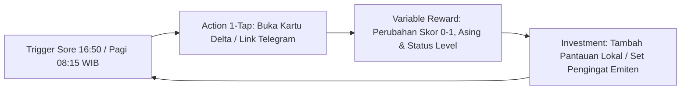
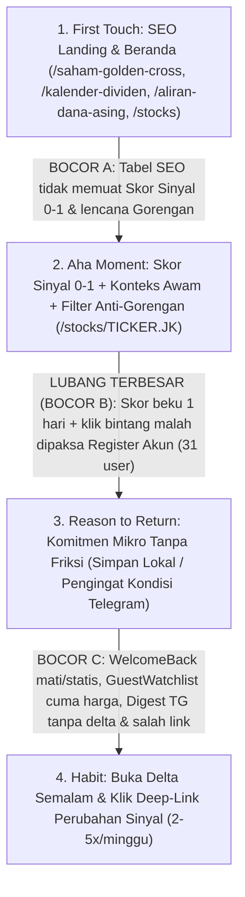

# Riset Mendalam & Audit Strategi Retensi teknikal.id — Apa yang Kita Kurang

- **Tanggal Dokumen:** 30 Oktober 2026
- **Peran Audit:** Retention Strategist & Senior Product Auditor
- **Target Pengguna:** Investor saham IDX pemula–menengah Indonesia, *mobile-first*, anti-gorengan, bahasa Indonesia awam
- **Prinsip Eksekusi:** 100% berbasis data deterministik yang sudah tersedia di PostgreSQL internal (`Stock`, `StockPrice`, `StockIndicator`, `StockFundamental`, `StockDividend`, `ForeignFlow`, `Article`, `TelegramWatch`, `EngagementEvent`, `PageView`) + `localStorage` perangkat tanpa bergantung pada fitur spekulatif baru.

---

## Ringkasan Baseline Data (30 Hari Terakhir, Non-Bot)

| Metrik Utama | Angka Aktual 30 Hari | Implikasi Retensi Langsung |
| :--- | :--- | :--- |
| **Total Pageview (PV)** | `3.859 PV` | `79%` tanpa `userId` — mayoritas mutlak interaksi terjadi di jalur anonim (tanpa login). |
| **Weekly Returning Devices (≥2 PV/minggu)** | `14 → 38 → 34 → 63 → 31` *(minggu berjalan)* | Ada sinyal awal pengguna kembali, tetapi fluktuatif dan belum menumpuk menjadi *compounding cohort*. |
| **Distribusi Frekuensi Kunjungan 30d** | `1x` dominan; `2–3x` tipis; `4–10x = 2` device; `10+ = 7` device | Jurang tajam (*bimodal cliff*): pengunjung berhenti di kunjungan pertama atau menjadi segelintir *power user* (`9 device` ≥4x). Jembatan tengah (`2x → 5x`) nyaris kosong. |
| **Registered User Total** | `31 akun` | Konversi akun sangat kecil (<1% dari PV). Strategi retensi yang mewajibkan login otomatis gagal menyentuh ~80%+ audiens. |
| **Engagement & Share** | `2.787` EngagementEvent · `213` ShareEvent | Rasio `EngagementEvent / PV` tinggi (`0,72` event/PV) — pengunjung yang masuk **benar-benar membaca/menggulir**, bukan sekadar salah klik. |
| **Top Path** | `/stocks` (`1.218`), `/` (`673`), `/stocks/BBCA.JK` (`114`), `/saham-golden-cross` (`63`), `/berita` (`42`) | `49%` seluruh PV terkonsentrasi di `/stocks` dan `/`. Halaman preset SEO (`/saham-golden-cross`) terbukti mulai menarik minat, sedangkan `/berita` (`42 PV`) belum menjadi kebiasaan baca harian. |
| **Kebijakan Kuota Tamu** | `25 saham/hari` tanpa login *(naik dari 5)* | Penghalang baca sesi pertama sudah dibuka, namun mekanisme "alasan kembali besok" tanpa login belum menggantikan fungsi *gate* lama. |
| **Baseline Akuisisi Organik (GSC 28d)** | `5 klik` · `885 impresi` · posisi rata-rata `67,9` | Pipa SEO baru mulai ditanam (perbaikan title/H1 + 3 landing baru `/kalender-dividen`, `/aliran-dana-asing`, `/indeks` baru saja tayang). |

> **Catatan Verifikasi Fitur Eksisting (`koreksi/simulasi` & ekosistem):** Inspeksi kode mengonfirmasi platform sudah memiliki `/bottom-fishing` (*Radar Saham Oversold RSI < 30 ber-volume*), `/trading-plan` (*Kalkulator Entry/TP/Stop Loss berbasis Pivot & ATR + probabilitas jalur historis Monte Carlo* yang saat ini masih me-redirect user non-login ke `/auth/signin`), `morningDeltaService` (pendeteksi perubahan sinyal/crossover semalam yang saat ini dikunci khusus user login), `GuestWatchlistPanel` (`localStorage` di `/stocks`), serta bot `@TeknikalidBot` (`scripts/telegram-bot/{poll,digest,notify}.mjs`). Audit di bawah tidak mengusulkan ulang fitur-fitur tersebut, melainkan membedah **mengapa fitur yang sudah kaya ini belum menghasilkan retensi**.

---

## 1. Diagnosa 3 Akar Masalah Terbesar Kenapa User TIDAK Kembali

### Pra-Diagnosa Wajib: Apakah "Device Tracking Lemah (79% PV Tanpa `userId`)" Itu Akar Masalah #1 atau Sekadar Gejala?

**Putusan Audit: "79% PV tanpa `userId`" adalah GEJALA alami platform data finansial publik, sedangkan lemahnya pelacakan perangkat di tabel `PageView` adalah CACAT INSTRUMEN PENGUKURAN (*Measurement Blindness*) — bukan penyebab user pergi, melainkan kacamata buram yang mendistorsi angka retensi kita.**

* **Data & Bukti Kode Pendukung:**
  1. Pada `prisma/schema.prisma` (`model PageView`, baris `1074–1093`) dan `src/hooks/use-page-view.ts` (baris `9–79`), beacon pageview **sama sekali tidak mengirimkan identifier perangkat anonim**. Sebaliknya, `model EngagementEvent` (`prisma/schema.prisma:1117–1130`) dan `src/components/engagement-instrument.tsx` (baris `36–46`) **sudah** membangkitkan UUID `localStorage` persisten bernama `eng_anon` (`anonId`)!
  2. Akibat ketiadaan `anonId` di `PageView`, `src/lib/retention.service.ts` (baris `111–117`) menghitung perangkat kembali (*Weekly Returning Devices*) murni menggunakan `SELECT ip, count(DISTINCT date) FROM "PageView" GROUP BY ip`, sementara tabel cohort D1/D7 (`baris 119–144`) hanya menghitung `User` terdaftar (`n = 31`).
  3. Di jaringan mobile Indonesia (mayoritas trafik ritel), operator seluler merotasi alamat IP CGNAT (`180.247.*`, `114.12.*`, `182.3.*`, `2404:c0:*` — sebagaimana tercatat sendiri di `src/lib/access-limit.ts:29`) setiap kali pengguna berpindah antara Wi-Fi rumah, Wi-Fi kantor, dan jaringan 4G/5G di perjalanan.
  4. **Distorsi Dua Arah:** Seorang investor mobile anonim yang rajin kembali 4 pagi berturut-turut dengan 4 IP seluler berbeda akan tercatat di DB sebagai **4 pengunjung `1x` (one-shot)** (*false negative*). Sebaliknya, 2 orang berbeda di balik 1 menara CGNAT di hari yang sama/berbeda bisa tergabung menjadi 1 IP (*false positive*).
* **Kesimpulan Jujur:** Kita **setengah buta dalam mengukur retensi cohort anonim**, dan ini wajib ditambal lebih dulu agar kita tidak menyetir di malam hari tanpa lampu. **NAMUN**, bahkan setelah bias CGNAT diperhitungkan, kosongnya kelompok kunjungan menengah (`4–10x = hanya 2 device`) dan tipisnya trafik ke halaman ritual harian membuktikan bahwa **kebocoran retensi produknya benar-benar nyata**.
* **Rekomendasi Konkret:** Satukan `eng_anon` (`localStorage`) dari `src/components/engagement-instrument.tsx` ke dalam `src/hooks/use-page-view.ts` → `src/app/api/track/pageview/route.ts` → kolom baru `PageView.anonId`, lalu ubah kunci pengelompokan di `src/lib/retention.service.ts:112` menjadi `COALESCE(pv."userId", pv."anonId", pv.ip)`. *(Rincian teknis ada di Quick Win #1).*

---

### Akar Masalah Produk #1: "Amnesia Kunjungan & Delta" pada 79% Pengunjung Anonim (Fitur Retensi Terbaik Justru Dikunci untuk 31 User Login)

* **Data Pendukung:**
  - `79%` dari `3.859 PV` tidak memiliki `userId`; total akun terdaftar hanya `31`.
  - `49%` seluruh pageview menumpuk di `/stocks` (`1.218 PV`) dan `/` (`673 PV`), diikuti pengecekan emiten utama seperti `/stocks/BBCA.JK` (`114 PV`).
* **Diagnosa Perilaku Fin-Platform & Bukti Kode:**
  - Investor ritel pemula–menengah Indonesia umumnya hanya mengincar atau memegang **3 sampai 8 saham yang sama** selama berminggu-minggu. Di platform finansial, retensi hari ke-2 tercipta ketika platform memiliki **memori kontekstual**: *"Sejak terakhir kamu mengecek BBCA kemarin, apa yang berubah?"*
  - Ironisnya, `teknikal.id` **sudah memiliki mesin komparasi perubahan semalam yang sangat kuat** di `src/domains/stock/morning-delta.service.ts` (baris `41–140`): mendeteksi *verdict flip* (mis. Sinyal Netral → Bullish), *Golden/Death Cross*, *EMA/MACD cross*, dan lonjakan harga `≥3%`. **Namun**, fitur ini dikunci rapat di balik `requireAuth()` pada `src/app/api/me/morning-delta/route.ts` (baris `8`), sehingga 79% pengguna tidak pernah melihatnya!
  - Apa yang dilihat 79% pengunjung anonim saat mereka kembali keesokan harinya?
    1. Di Beranda `/` (`src/app/(public)/page.tsx:588`), komponen `<WelcomeBackBanner />` diletakkan **jauh di bawah fold** (setelah Hero, MarketBreathStrip, DailyBrief, dan TickerTape) serta hanya menampilkan teks statis tanpa perubahan data: *"Selamat datang kembali! Terakhir Anda melihat BBCA"* (`src/components/ui/welcome-back-banner.tsx:67–68`). Lebih fatal lagi, jika tombol `✕` pernah diketuk sekali saja (`localStorage.setItem("teknikal:welcome_dismissed", "1")` di baris `89`), banner ini **mati permanen selamanya** tanpa masa kedaluwarsa.
    2. Di `/stocks` (`src/components/stock/guest-watchlist-panel.tsx:28, 94–101`), `GuestWatchlistPanel` hanya memanggil `/api/live-quotes` yang merender **harga + persentase perubahan harian** — tanpa Skor Sinyal 0–1, tanpa status perubahan sinyal, dan tanpa informasi asing/dividen. Padahal untuk sekadar melihat harga + `%`, pengguna sudah selesai di Google OneBox tanpa perlu kembali ke `teknikal.id`.
* **Rekomendasi Konkret:**
  - Buka kapabilitas `morningDeltaService` bagi daftar ticker `localStorage` (`guest_watchlist` digabung otomatis dengan 5 saham terakhir di `teknikal:visitor.lastVisitedTickers`) dan angkat kartu **"Perubahan Sejak Kunjungan Terakhirmu"** ke atas fold `/` (`src/app/(public)/page.tsx`) serta perkaya `GuestWatchlistPanel` (`src/components/stock/guest-watchlist-panel.tsx`) dengan Skor Sinyal 0–1 + lencana perubahan sinyal.

---

### Akar Masalah Produk #2: Salah Timing Komitmen — Meminta "Registrasi Akun" di Kunjungan Pertama, Sementara Kanal Tanpa-Login (`@TeknikalidBot` & Simpan Lokal) Terputus atau Pasif

* **Data Pendukung:**
  - Distribusi kunjungan 30d: **`1x` mendominasi mutlak**, `4–10x = 2 device`, `31` user terdaftar total, `2.787` EngagementEvent.
  - `/saham-golden-cross` menjadi halaman strategi terpopuler (`63 PV`), `/stocks/BBCA.JK` (`114 PV`), `/berita` (`42 PV`).
* **Diagnosa Perilaku Fin-Platform & Bukti Kode:**
  - Pengunjung baru dari pencarian organik/sosial berada pada mode *skeptis & berburu jawaban cepat*. Meminta mereka membuat akun (email/OAuth + username) sebelum mereka merasakan manfaat berulang selama beberapa hari menghasilkan penolakan >99% (terbukti baru 31 akun).
  - Namun di kode saat ini, hampir setiap titik konversi mikro justru menabrakkan user anonim ke tembok registrasi, sementara jembatan tanpa-login terputus:
    1. **Saat user klik bintang pertama kali** (`src/hooks/use-guest-watchlist.ts:47` → `src/components/ui/registration-bottom-sheet.tsx:58–78`): Sistem langsung memunculkan *bottom sheet* penutup layar *"Jaga simpanan Anda — daftar gratis"*. Alih-alih merayakan simpanan pertama dan menawarkan pengingat Telegram 1-klik tanpa login, user merasa ditekan mendaftar.
    2. **Nudge simpan pantauan terlambat terpicu:** `RepeatVisitHint` (`src/components/stock/repeat-visit-hint.tsx:19–20`) disetel `TRIGGER_AT = 3` (baru muncul di kunjungan ke-3 ke saham yang sama!) dan menghilang otomatis dalam `8 detik` (`AUTO_HIDE_MS = 8000`). Karena mayoritas mutlak user gugur setelah kunjungan **ke-1**, >90% pengunjung tidak pernah melihat ajakan menyimpan pantauan ini.
    3. **Halaman SEO & Fitur Baru Buta Pengingat Tanpa-Login:** Di `/saham-golden-cross` (`src/app/(public)/saham-golden-cross/page.tsx:148`), CTA di bawah tabel hanyalah `<RegisterCta />` (*"Daftar gratis untuk alert golden cross"*), tanpa tombol `⭐` per saham dan tanpa CTA Telegram. Di `/kalender-dividen`, `/aliran-dana-asing`, `/indeks/[slug]`, dan `/saham/[ticker]/kenapa-naik-hari-ini` (`baris 450–475`), **tidak ada satu pun tombol `⭐ Pantau` maupun `TelegramSubscribeCta`**.
    4. **Digest Bot Telegram Belum Menciptakan "Pull Back" ke Web:** Pada `scripts/telegram-bot/digest.mjs` (baris `26–49`), pesan pukul 16:50 WIB hanya mengirim `🟢 BBCA 5.275 (+1.20%) · Neutral` tanpa menyebutkan **apa yang berubah hari ini** (apakah sinyal baru berbalik? asing akumulasi? cum-date dekat?), menghitung perubahan harga dengan `LIMIT 2` tanpa filter `volume > 0`, dan menautkan user ke `teknikal.id/berita` secara generik — bukan deep-link ke `/stocks/BBCA.JK`.
* **Rekomendasi Konkret:**
  - Jadikan **Simpan Lokal (`localStorage`) + Langganan `@TeknikalidBot` 1-Tap** sebagai komitmen utama kunjungan ke-1 dan ke-2 di seluruh halaman saham & SEO landing (`src/components/stock/repeat-visit-hint.tsx`, `src/hooks/use-guest-watchlist.ts`, `src/app/(public)/saham-*/page.tsx`, `/kalender-dividen`, `/aliran-dana-asing`), tunda `RegistrationBottomSheet` hingga user memiliki ≥3 saham tersimpan, dan upgrade `scripts/telegram-bot/digest.mjs` menjadi pesan ber-delta dengan deep-link langsung ke halaman sahamnya.

---

### Akar Masalah Produk #3: Friksi Pemahaman & Ketersembunyian Ritual Harian bagi Pemula Mobile (Sinyal Statis Tanpa Konteks Sejarah & Menu Harian Terkunci di Mobile)

* **Data Pendukung:**
  - Audiens utama *mobile-first*, pemula–menengah, bahasa Indonesia awam; hampir separuh trafik berhenti di `/stocks` (`1.218 PV`) dan `/` (`673 PV`), sedangkan halaman bacaan/konteks harian seperti `/berita` baru `42 PV`.
* **Diagnosa Perilaku Fin-Platform & Bukti Kode:**
  - Bagi investor pemula anti-gorengan, **kepercayaan (*trust*) dan kejelasan makna angka adalah syarat mutlak retensi**. Bila pemula bingung sekali saja membaca sinyal, mereka menganggap platform terlalu rumit untuk level mereka dan tidak kembali.
  - Tiga friksi pemahaman & penemuan yang saat ini memutus kebiasaan harian pemula:
    1. **Menu Fitur Harian Tersembunyi bagi Pengunjung Mobile Anonim:** Sebagaimana terverifikasi pada struktur navigasi `src/components/layout/header.tsx`, kelompok menu alat analisa harian (seperti `/pasar` Koran Pasar Live, `/compare`, `/bottom-fishing`) tersembunyi di balik cabang login `{session?.user}` pada tampilan mobile, sementara halaman baru bernilai tinggi (`/kalender-dividen`, `/aliran-dana-asing`, `/indeks`) belum terangkat jelas di jalur navigasi jempol mobile.
    2. **Skor Sinyal 0–1 Tampil sebagai Angka Beku Tanpa Arah Perubahan (*No Trajectory*):** Di `/stocks/[ticker]/page.tsx` (`baris 707–729`), pemula melihat skor `0,66` atau `0,20`, tetapi tidak tahu apakah `0,66` itu **baru saja naik tajam dari `0,35` kemarin (momentum segar)** atau **sedang melorot dari `0,85` minggu lalu (momentum melemah)**. Tanpa arah perubahan, user tidak merasa perlu mengecek ulang perkembangan skor tersebut besok sore.
    3. **Konteks Sesi EOD vs Harga Berjalan & Alat Level Harga Terkunci Login:** Saat harga bergerak turun di sesi berjalan sementara skor EOD kemarin masih *Bullish*, ketiadaan kalimat jembatan awam memicu kebingungan. Selain itu, halaman `/trading-plan` (`src/app/(public)/trading-plan/page.tsx:70–71`) yang justru menyajikan angka level *Support/Entry* dan *Cut Loss* paling mudah dipahami pemula masih terkunci `if (!session?.user?.id) redirect("/auth/signin")`.
* **Rekomendasi Konkret:**
  - Buka penuh navigasi mobile untuk seluruh pengunjung tanpa login di `src/components/layout/header.tsx` dengan istilah Indonesia awam, tampilkan riwayat ringkas arah Skor Sinyal 5 sesi terakhir di kartu utama `/stocks/[ticker]/page.tsx`, dan buka akses publik `/trading-plan/page.tsx` selaras dengan kebijakan kuota tamu 25 saham/hari.

---

## 2. Habit Loop: Alasan KOMPEL Kembali Besok (Selain Harga) & 3 Kandidat Loop Deterministik

### Mengapa User Kembali Besok Kalau Bukan Harga? (Doktrin Anti-OneBox)

Harga saham adalah komoditas 1 detik di Google OneBox. Investor pemula–menengah Indonesia kembali ke `teknikal.id` hanya jika kita menjawab **3 kecemasan harian yang tidak pernah dijawab OneBox**:
1. **"Apakah status keamanan / sinyal saham incaranku berubah semalam?"** *(Perubahan fase indikator & arus dana asing, bukan sekadar naik/turun Rp25).*
2. **"Apakah hari ini sudah masuk jendela tindakanku?"** *(Saham incaran akhirnya turun menyentuh area Support/Entry sehat, atau H-2 menjelang Cum-Date dividen dengan tren yang masih aman dari jebakan ex-date).*
3. **"Dari 950+ saham BEI, saham non-gorengan mana yang baru pindah gigi hari ini?"** *(Saringan delta harian sore/pagi dalam 90 detik tanpa pusing melihat ratusan saham tidur/gorengan).*

---

### Kandidat Habit Loop #1: "Delta Semalam Pantauanmu" (Memori Perangkat Tanpa Login + Sinkronisasi 1-Tap ke Telegram)

Loop ini mengubah setiap kunjungan beranda `/` dan `/stocks` dari etalase umum yang statis menjadi **dasbor perubahan pribadi sejak kunjungan terakhir**, bahkan untuk pengunjung yang belum punya akun.

* **Data DB yang Dipakai:** `StockPrice` (LATERAL `volume > 0`), `StockIndicator` (2–5 sesi terakhir: `signalScore`, `signalLabel`, `smaCrossSignal`, `emaCrossSignal`, `macdHist`, `rsi14`, `isGorengan`), `ForeignFlow` (net buy/sell sesi terakhir), `StockDividend` (`cumDate` ≤ 14 hari), dipadukan dengan `localStorage` (`guest_watchlist` + `teknikal:visitor.lastVisitedTickers` + snapshot `lastSeenScore`).
* **1. Trigger (Pemicu):**
  - *Internal Trigger:* Rasa penasaran pagi hari sebelum bursa buka (08:00–09:00 WIB) atau sore sepulang kerja (16:30–20:00 WIB): *"Bagaimana nasib saham yang kemarin saya riset?"*
  - *External Trigger:* Lencana indikator perubahan pada header situs (`Pantauan • 2 berubah`) + opsi 1-tap meneruskan pantauan lokal tersebut ke digest sore `@TeknikalidBot` (`?start=watch_BBCA_BMRI_TLKM`).
* **2. Action (Tindakan Termudah):**
  - Membuka `teknikal.id` (atau `/stocks`) di browser HP yang sama — **0 login, 0 ketik ulang kode saham**. Sistem otomatis menggabungkan saham yang dibintangi (`guest_watchlist`) dan hingga 5 saham yang baru saja dibaca >30 detik (`lastVisitedTickers`).
* **3. Variable Reward (Imbalan Bervariasi):**
  - Kartu paling atas fold menyajikan maksimal **3 perubahan paling signifikan** sejak tanggal kunjungan terakhir user (memperluas logika `src/domains/stock/morning-delta.service.ts`):
    - *Contoh Hari A:* `"⚡ BBCA: Skor Sinyal melonjak 0,44 → 0,68 (Bullish) · Asing akumulasi bersih +Rp142 M sesi terakhir."`
    - *Contoh Hari B:* `"⚠️ ASII: Muncul sinyal EMA Bearish Cross semalam · Waspadai tekanan jual jangka pendek."`
    - *Contoh Hari C:* `"📅 PTBA: H-3 menjelang Cum-Date Dividen (est. yield 6,4%) · Tren harga masih di atas SMA50."`
    - *Saat tidak ada perubahan besar:* `"✅ 4 saham pantauanmu belum berubah fase sinyal sejak kemarin — tidak perlu terburu-buru."` *(Ketenangan anti-FOMO juga merupakan reward psikologis kuat bagi pemula!).*
* **4. Investment (Investasi Usaha User & Tim):**
  - *Effort User:* Sangat rendah. Cukup membaca halaman saham seperti biasa (otomatis tercatat sebagai *terakhir dilihat*) atau mengetuk `⭐` untuk mengunci daftar pantauan. Makin banyak saham incaran yang dikurasi (3–8 emiten), makin relevan kartu delta esok pagi (*stored value*).
  - *Effort Engineering:* **Kecil–Sedang (~0,5–1 hari kerja).** Mesin intinya sudah ada di `src/domains/stock/morning-delta.service.ts` (`findStocksWithIndicatorHistoryLateral`); cukup buka jalur parameter query `tickers` tervalidasi (maks 15 ticker, cache pendek per ticker) dan render komponen delta di atas fold `/` serta di `GuestWatchlistPanel` `/stocks`.
* **5. Risiko & Mitigasi:**
  - *Risiko 1:* `localStorage` hilang jika user membuka dari in-app browser sementara (mis. WebView aplikasi chat) atau mode penyamaran. **Mitigasi:** Tampilkan tombol pendamping 1-tap `"Simpan daftar ini ke Telegram saya"` yang mengirim seluruh array ticker ke `@TeknikalidBot` tanpa perlu buat akun web.
  - *Risiko 2:* Pasar sedang lesu sehingga tidak ada sinyal flip selama beberapa hari. **Mitigasi:** Tambahkan delta sekunder deterministik berupa perubahan skor `Δ ≥ ±0,08`, akumulasi/distribusi asing 3 sesi beruntun, atau jarak persentase ke batas Support terdekat.

---

### Kandidat Habit Loop #2: "Asisten Jaga Kondisi & Tenggat BEI" via `@TeknikalidBot` (Alert EOD Berbasis Perubahan Fase, Level Support, & H-2 Cum-Date)

Mengubah bot Telegram yang sudah ada (`scripts/telegram-bot/`) dari *pengirim daftar harga sore yang seragam* menjadi **penjaga kondisi spesifik yang menarik user kembali ke halaman saham tepat saat ada keputusan penting**.

* **Data DB yang Dipakai:** `TelegramWatch` (diperluas kolom opsional `alertMode` / `targetLevel` atau evaluasi otomatis multi-kondisi), `StockPrice` (`close`, `low`), `StockIndicator` (`signalScore`, `signalLabel`, `rsi14`, `sma20`, `sma50`, `atr`, `isGorengan`), `StockDividend` (`cumDate`, `exDate`, `amount`), `ForeignFlow`, dan `Article` (`MOVEMENT_ANALYSIS` / `STOCK_ANALYSIS`).
* **1. Trigger (Pemicu):**
  - *External Trigger:* Notifikasi Telegram pukul **16:50 WIB** (sesaat setelah data EOD & indikator harian selesai dihitung) yang **hanya menonjolkan peristiwa penting** pada saham pilihan user:
    - `[SINYAL BERUBAH] BMRI naik ke Skor 0,71 (Sinyal Kuat) + Asing beli bersih Rp95 M.`
    - `[MASUK ZONA SUPPORT] TLKM ditutup di Rp2.780 (menyentuh area batas bawah/support Rp2.760–2.800, RSI 31).`
    - `[INGAT CUM-DATE H-2] ADRO cum-date dividen lusa (Rp135/lbr · yield ~4,1%). Cek apakah skor sinyal aman dari jebakan ex-date.`
  - *Internal Trigger:* Saat user melihat saham yang belum layak beli hari ini (*"Wait & See"* di `/stocks/[ticker]` atau cum-date masih 2 minggu lagi di `/kalender-dividen`), muncul dorongan alami: *"Saya tidak mau mantengin tiap hari, tolong kabari saya kalau waktunya tiba."*
* **2. Action (Tindakan Termudah):**
  - Saat pertama mendaftar: 1 ketukan pada tombol kontekstual di web (mis. `"🔔 Ingatkan H-2 Cum-Date di Telegram"` di `/kalender-dividen` atau `"🔔 Kabari jika Sinyal Berubah / Sentuh Support"` di `/stocks/[ticker]`) → membuka Telegram dengan parameter `/start` terisi otomatis → klik **Start**.
  - Saat notifikasi tiba: 1 ketukan pada tautan spesifik di pesan Telegram yang langsung membuka `/stocks/BMRI.JK#indikator` atau `/saham/bmri/kenapa-naik-hari-ini`.
* **3. Variable Reward (Imbalan Bervariasi):**
  - Di halaman tujuan, user langsung mendapatkan penjelasan deterministik lengkap (**"Kenapa sinyal ini berubah hari ini?"** dari `explainMove` / rincian 9 indikator + posisi aliran dana asing 5 sesi + batas risiko ATR) tepat pada momen mereka paling membutuhkannya.
* **4. Investment (Investasi Usaha User & Tim):**
  - *Effort User:* 1 kali klik `Start` di Telegram per emiten (atau sekali untuk *batch* pantauan); pengguna bisa mengatur daftar pantauan lewat perintah sederhana `/list`, `/start KODE`, `/stop KODE`.
  - *Effort Engineering:* **Sedang (~1–1,5 hari kerja).** Bot polling (`poll.mjs`), cron digest (`digest.mjs`), dan tabel `TelegramWatch` **sudah berjalan di produksi**. Kita tinggal memperkaya query SQL di `digest.mjs` agar mengevaluasi 4 kondisi deterministik (flip `signalLabel`, jarak `close` ke `support`/Pivot ≤ 1,5%, `rsi14 < 30`, dan `cumDate - today IN (1, 2, 3)`) serta mengganti link generik `/berita` menjadi deep-link per emiten ber-UTM (`?utm_source=tg_alert`).
* **5. Risiko & Mitigasi:**
  - *Risiko 1:* *Notification fatigue* (user me-*mute* bot jika setiap sore dikirimi pesan panjang padahal 5 sahamnya tidak bergerak). **Mitigasi:** Terapkan format **"Prioritas Perubahan"**: taruh saham yang mengalami perubahan sinyal/level/dividen di bagian atas dengan ikon `⚡`, sedangkan saham yang stagnan cukup diringkas padat dalam 1 baris tenang di bawah (*"Stagnan/fase tetap: BBCA (0,52), ICBP (0,61)"*).
  - *Risiko 2:* Ekspektasi keliru bahwa notifikasi dikirim detik-demi-detik saat jam bursa berlangsung. **Mitigasi:** Tulis eksplisit di pesan pembuka bot: *"Evaluasi penutupan harian setiap hari bursa pukul 16:50 WIB — dirancang untuk investor tenang, bukan pemantauan layar terus-menerus."*

---

### Kandidat Habit Loop #3: "Ritual 90-Detik Pergeseran Pasar Anti-Gorengan" (Kurasi Emiten yang Baru Pindah Fase Hari Ini + Rekap Akhir Pekan Pantauan)

Jika Loop #1 dan #2 mengikat user yang **sudah punya saham incaran**, Loop #3 mengikat pemula pencari peluang yang datang ke `/stocks` (`1.218 PV`) atau `/saham-golden-cross` (`63 PV`) namun bingung harus mengecek apa besok.

* **Data DB yang Dipakai:** `StockIndicator` (perbandingan `date` terbaru vs `prev date`: `signalScore`, `signalLabel`, `isGorengan = false`, `smaCrossDate = latestDate`, `rsi14`), `StockPrice` (`volume > 0`), `ForeignFlow` (akumulasi bersih beruntun), `StockFundamental` (`marketCap` / papan Utama & Pengembangan non-FCA).
* **1. Trigger (Pemicu):**
  - *Internal Trigger:* Kebiasaan rutin minum kopi pagi (08:15 WIB) atau penutupan bursa (16:30 WIB): *"Ada saham sehat (bukan gorengan) yang baru mulai menguat atau justru patah tren hari ini?"*
  - *External Trigger:* Ringkasan 1 pesan harian di Channel Telegram publik (`t.me/teknikalid`) & kartu strip di atas `/pasar` + `/stocks` bertajuk **"Pergeseran Fase Hari Ini (Non-Gorengan)"**.
* **2. Action (Tindakan Termudah):**
  - Membuka strip/tab **"Baru Berubah Hari Ini"** di `/pasar` atau `/stocks` (waktu pindai ≤ 90 detik di layar HP).
* **3. Variable Reward (Imbalan Bervariasi):**
  - Berbeda dari daftar *Top Gainers* biasa yang sering dipenuhi saham gorengan liar atau tabel screener statis yang isinya sama berhari-hari, daftar ini **pasti segar setiap hari bursa** karena hanya memuat saham dengan `isGorengan = false` yang mengalami **transisi status pada sesi terakhir**:
    1. **3–5 Saham Baru Masuk Fase Sinyal Kuat** (`signalScore` menembus `≥ 0,60` hari ini dari `< 0,60` kemarin + didukung `ForeignFlow` beli bersih).
    2. **3–5 Saham Likuid Masuk Area Jenuh Jual Baru** (`rsi14` baru turun ke `< 30` hari ini pada emiten berfundamental/likuid).
    3. **Peringatan Patah Tren Hari Ini** (saham populer/indeks LQ45 yang baru saja mengalami *Death Cross* atau skor jatuh ke `< 0,30` — sangat bernilai bagi pemula untuk menghindari beli di pucuk).
* **4. Investment (Investasi Usaha User & Tim):**
  - *Effort User:* Mengetuk `⭐ Pantau` pada 1–2 saham hasil temuan hari itu (yang langsung menyuapi **Habit Loop #1 & #2**!), ditambah penghitung ringan di `localStorage` (*"3/5 hari bursa minggu ini kamu memantau pergeseran pasar — buka Rekap Mingguan Sabtu di `/laporan-pasar`"*).
  - *Effort Engineering:* **Sedang (~1 hari kerja).** Query SQL berbasis `LATERAL` 2 baris terakhir `StockIndicator` + filter `isGorengan = false` dan `volume > 0`, disimpan di service terpusat `src/domains/stock/` (mematuhi *API Reuse Rule*, dengan TTL cache standar service) sehingga bisa dipakai serentak oleh `/`, `/pasar`, `/stocks`, dan `/laporan-pasar`.
* **5. Risiko & Mitigasi:**
  - *Risiko 1:* Pada hari pasar sangat datar (*choppy/sideways*), jumlah saham yang baru menembus ambang `0,60` bisa 0 atau hanya 1. **Mitigasi:** Gunakan *fallback* deterministik yang jujur: *"Hari ini 0 saham non-gorengan baru menembus Skor 0,60 (pasar sedang konsolidasi). Berikut 3 saham dengan kenaikan skor harian terbesar hari ini."* Kejujuran bahwa pasar sedang sepi justru membangun kredibilitas tinggi di mata investor anti-gorengan.

---

### Perbandingan Ringkas 3 Kandidat Habit Loop

| Dimensi | Loop #1: Delta Semalam Pantauanmu | Loop #2: Asisten Jaga Kondisi Telegram | Loop #3: Ritual 90-Detik Pergeseran Fase |
| :--- | :--- | :--- | :--- |
| **Target Segmen Utama** | Pengunjung kembali anonim (`79% PV`) yang punya 1–8 saham incaran | Pengunjung mobile yang butuh *push trigger* keluar browser | Pencari ide pemula di `/stocks` (`1.218 PV`) & preset SEO |
| **Ketergantungan Login** | **Nol** (`localStorage` + API delta publik) | **Nol** (`@TeknikalidBot` `chatId`) | **Nol** (halaman publik + progres lokal) |
| **Kekuatan Pemicu Balik** | Sedang–Tinggi (kuat saat user buka browser) | **Sangat Tinggi** (*external push* langsung ke layar kunci HP) | Sedang (butuh distribusi channel / kebiasaan jam bursa) |
| **Estimasi Effort Build** | **0,5–1 hari** (reuse `morningDeltaService`) | **1–1,5 hari** (upgrade `scripts/telegram-bot/digest.mjs`) | **1 hari** (extend service domain `src/domains/stock/`) |
| **Urutan Prioritas Eksekusi** | **Prioritas #1** (tutup bocor beranda/`/stocks`) | **Prioritas #2** (mesin penarik D1/D7 terkuat) | **Prioritas #3** (pengisi amunisi daftar pantauan baru) |

---

## 3. Audit Funnel Retensi: Apa yang MISSING dari First Touch → Habit

### Peta Kebocoran Funnel Aktual di Kode Produksi

### Bedah Detail Apa yang MISSING di Tiap Tahap

1. **Transisi 1 (`First Touch → Aha Moment`) — Identitas Utama Hilang di Halaman Pintu Masuk SEO:**
   - **Bukti Kode:** Di `/saham-golden-cross/page.tsx` (`baris 106–144`, `63 PV`), tabel hanya menampilkan `Ticker | Nama | Harga | Perubahan`. Di `/aliran-dana-asing/page.tsx` (`baris 121–139`), meski deskripsi meta menjanjikan *"dikonfirmasi skor sinyal teknikal"*, tabelnya hanya menampilkan `# | Emiten | Net Beli Asing` **tanpa kolom Skor Sinyal 0–1**! Hal yang sama terjadi di `/kalender-dividen/page.tsx` (`baris 172–201`): nasihat di atas tabel menyuruh pemula mengecek skor sinyal agar tidak kena *dividend trap*, tetapi kolom Skor Sinyal 0–1 tidak disajikan di baris tabel.
   - **Akibat:** Pengunjung dari Google belum sempat merasakan *Aha Moment* pembeda `teknikal.id` (Skor Sinyal 0–1 + deteksi anti-gorengan) di halaman tempat mereka mendarat. Jika mereka tidak mengklik salah satu ticker, mereka mengira `teknikal.id` hanyalah tabel harga biasa lalu pergi.

2. **Transisi 2 (`Aha Moment → Reason to Return`) — LUBANG TERBESAR DI SELURUH FUNNEL (*The Commitment Crater*):**
   - **Data Bukti:** `2.787 EngagementEvent` berbanding `3.859 PV` membuktikan bahwa pengunjung yang masuk ke halaman saham **sudah terlibat aktif membaca**. Namun dari ribuan interaksi tersebut, hanya tercipta **`31` akun terdaftar** dan hanya **`9` perangkat** yang kembali `≥4x` dalam sebulan!
   - **Mengapa Ini Lubang Terbesar:** Tepat setelah user mengalami *Aha Moment* membaca Skor Sinyal `0,66` dan ringkasan modal 1 lot + support/resistance di `/stocks/[ticker]/page.tsx` (`baris 696–744`), **tidak ada jembatan komitmen tanpa-login di titik perhatian tersebut**:
     - Kartu Skor Sinyal tidak menunjukkan *arah gerak* (apakah skor ini sedang membaik atau memburuk dalam 5 hari terakhir), sehingga tidak memicu rasa *"saya harus cek kelanjutannya besok"*.
     - Tidak ada tombol `🔔 Kabari jika sinyal berubah` di kartu skor tersebut (CTA Telegram baru muncul ratusan piksel di bawah pada `baris 1012`).
     - Di seluruh halaman SEO (`/saham-*`, `/kalender-dividen`, `/aliran-dana-asing`, `/saham/[ticker]/kenapa-naik-hari-ini`), **tidak ada tombol `⭐` maupun CTA Telegram**; yang dipasang justru `<RegisterCta />` (`Daftar Gratis`), yang ditolak oleh >99% pengunjung dingin.
     - Bahkan ketika pengunjung di `/stocks` atau `/stocks/[ticker]` berinisiatif mengetuk bintang `⭐`, `useGuestWatchlist` (`baris 47`) langsung memicu `RegistrationBottomSheet` yang menginterupsi pengalaman, sementara `RepeatVisitHint` (`TRIGGER_AT = 3`) baru muncul di kunjungan ke-3 yang tak pernah dicapai mayoritas pengunjung `1x`.

3. **Transisi 3 (`Reason to Return → Habit`) — Putusnya Umpan Balik saat User Mencoba Kembali:**
   - Bagi sebagian kecil user yang *sudah* menyimpan bintang lokal atau *sudah* subscribe `@TeknikalidBot`, umpan balik di hari berikutnya belum menutup siklus kebiasaan: `GuestWatchlistPanel` hanya menampilkan harga & `%` (sama seperti Google OneBox), `WelcomeBackBanner` tersembunyi di bawah fold tanpa delta perubahan, dan `digest.mjs` Telegram mengarahkan klik ke `/berita` alih-alih halaman saham yang dipantau.

### Perbaikan Tercepat untuk Menutup Lubang Terbesar (*Fastest High-Leverage Fix*)

**Pasang "Jembatan Komitmen Tanpa-Login 2-Lapis" langsung di Kartu Skor Sinyal & Tabel Landing SEO (Total Effort ≤ 1 Hari Kerja):**
1. **Lapis Pasif (Otomatis untuk 100% Pembaca Detail Saham):** Saat pengunjung membaca `/stocks/[ticker]` ≥15 detik, simpan `{ ticker, seenScore, seenPrice, seenDate }` di `localStorage`. Saat besok mereka membuka `/` atau `/stocks`, langsung tampilkan **Kartu Delta Semalam** paling atas fold (*"Sejak kemarin kamu lihat BBCA: Skor Sinyal 0,20 → 0,34"*).
2. **Lapis Aktif (1-Tap Tanpa Login di Momen Aha):** Tambahkan baris aksi mikro tepat di kaki kartu Skor Sinyal 0–1 (`/stocks/[ticker]/page.tsx:728`) dan di bawah tabel `/saham-*`, `/kalender-dividen`, `/aliran-dana-asing`, serta `/saham/[t]/kenapa-naik-hari-ini`:
   - `[⭐ Simpan di HP Ini]` *(tanpa memunculkan sheet paksa register pada simpanan ke-1 & ke-2)*
   - `[🔔 Kirim Perubahan Sinyal ke Telegram — Gratis Tanpa Login]` *(deep-link `@TeknikalidBot`)*

---

## 4. 10 Quick Wins Retensi (≤½ Hari Kerja Each), Diurutkan Berdasarkan Impact / Effort

Seluruh quick win di bawah berdurasi **≤ 4 jam kerja per item**, mematuhi doktrin **Market Data Satu Pintu** (`AGENTS.md`), bebas fitur terlarang, dan langsung menyentuh kode/data yang sudah ada di repositori.

| Rank | Quick Win | Estimasi Effort | Impact Retensi | File / Komponen Utama |
| :---: | :--- | :---: | :---: | :--- |
| **#1** | Satukan `anonId` (`eng_anon`) ke `PageView` & hitung cohort retensi per perangkat | `1,5 jam` | Sangat Tinggi *(Fondasi ukur)* | `prisma/schema.prisma`, `src/hooks/use-page-view.ts`, `src/app/api/track/pageview/route.ts`, `src/lib/retention.service.ts` |
| **#2** | Buka `morningDeltaService` untuk anonim & naikkan Kartu Delta ke atas fold `/` dan `/stocks` | `3,5 jam` | Sangat Tinggi | `src/app/api/me/morning-delta/route.ts`, `src/components/ui/welcome-back-banner.tsx`, `src/components/stock/guest-watchlist-panel.tsx`, `src/app/(public)/page.tsx` |
| **#3** | Upgrade `digest.mjs` Telegram: tambah delta skor, asing, H-3 dividen, query `volume > 0` & deep-link saham | `2,5 jam` | Sangat Tinggi | `scripts/telegram-bot/digest.mjs` |
| **#4** | Tunda `RegistrationBottomSheet` ke bintang ke-3 & ganti bintang ke-1 dengan toast sync batch Telegram | `2 jam` | Tinggi | `src/hooks/use-guest-watchlist.ts`, `src/components/ui/registration-bottom-sheet.tsx`, `scripts/telegram-bot/poll.mjs` |
| **#5** | Tampilkan kolom Skor Sinyal 0–1 + `⭐ Pantau` + CTA Telegram di tabel SEO (`/saham-*`, dividen, asing) | `3,5 jam` | Tinggi | `src/app/(public)/saham-golden-cross/page.tsx` (+ preset sejenis), `src/app/(public)/kalender-dividen/page.tsx`, `src/app/(public)/aliran-dana-asing/page.tsx` |
| **#6** | Buka menu fitur harian di navigasi mobile anonim & turunkan banner sekunder di `/stocks` | `1,5 jam` | Tinggi | `src/components/layout/header.tsx`, `src/app/(public)/stocks/page.tsx` |
| **#7** | Tambah "Arah Skor 5 Sesi Terakhir" + tombol komitmen mikro langsung di dalam Kartu Skor `/stocks/[ticker]` | `2,5 jam` | Tinggi | `src/app/(public)/stocks/[ticker]/page.tsx` |
| **#8** | Ubah `RepeatVisitHint` dari kunjungan ke-3 (auto-hide 8d) menjadi dwell 45d kunjungan ke-1 + simpan 1-klik | `1,5 jam` | Sedang–Tinggi | `src/components/stock/repeat-visit-hint.tsx` |
| **#9** | Buka `/trading-plan` tanpa paksa login + redirect `308` `/saham/[ticker]` → `/stocks/[TICKER].JK` | `2 jam` | Sedang–Tinggi | `src/app/(public)/trading-plan/page.tsx`, `src/proxy.ts` |
| **#10** | Pasang blok "Pantau Kelanjutan Besok" di `/saham/[t]/kenapa-naik-hari-ini` & semua artikel `/berita/[slug]` | `2 jam` | Sedang | `src/app/(public)/saham/[ticker]/kenapa-naik-hari-ini/page.tsx`, `src/app/(public)/berita/[slug]/page.tsx` |

---

### Rincian Eksekusi Tiap Quick Win

#### QW-1: Satukan `anonId` (`eng_anon`) ke `PageView` & Hitung Retensi per Perangkat (Effort: ~1,5 Jam)
* **Data Pendukung:** `79%` dari `3.859 PV` tanpa `userId`, sedangkan `EngagementEvent` (`2.787` baris) sudah menyimpan UUID `eng_anon` di `localStorage`. Saat ini `retention.service.ts` mengelompokkan pengunjung murni berdasarkan `ip` yang bias CGNAT seluler.
* **Rekomendasi Konkret:**
  1. Ekstrak fungsi `getAnonId()` dari `src/components/engagement-instrument.tsx:36–46` ke helper bersama (mis. `src/lib/anon-id.ts` dengan key `localStorage` tetap `"eng_anon"` agar 100% kompatibel dengan histori `EngagementEvent`).
  2. Tambah kolom opsional `anonId String? @db.VarChar(36)` + `@@index([anonId, createdAt])` pada `model PageView` di `prisma/schema.prisma:1074`.
  3. Sertakan `anonId` pada payload beacon di `src/hooks/use-page-view.ts:33` & simpan di `src/app/api/track/pageview/route.ts:141`.
  4. Di `src/lib/retention.service.ts:112`, ubah `GROUP BY ip` menjadi `GROUP BY COALESCE(pv."userId", pv."anonId", pv.ip)` dan tambahkan metrik cohort D1/D7 berbasis `anonId` sehingga retensi 79% pengunjung anonim langsung terukur akurat mulai hari yang sama.

#### QW-2: Buka `morningDeltaService` untuk Pengunjung Anonim & Naikkan Kartu Delta ke Atas Fold `/` dan `/stocks` (Effort: ~3,5 Jam)
* **Data Pendukung:** `/` (`673 PV`) + `/stocks` (`1.218 PV`) menyumbang `49%` trafik total, namun `GuestWatchlistPanel` hanya menampilkan harga/`%` dan `WelcomeBackBanner` di bawah fold tidak memuat perubahan sinyal serta mati selamanya jika pernah ditutup sekali.
* **Rekomendasi Konkret:**
  1. Pada `src/app/api/me/morning-delta/route.ts`, izinkan mode publik tanpa membuat jalur hitung baru (*API Reuse Rule*): bila user tidak login, baca query `?tickers=BBCA.JK,BMRI.JK` (validasi format ticker BEI, batasi maks `15` ticker), lalu panggil fungsi logika perubahan yang sama di `src/domains/stock/morning-delta.service.ts`.
  2. Perluas `GuestWatchlistPanel` (`src/components/stock/guest-watchlist-panel.tsx`) agar menampilkan badge **Skor Sinyal 0–1** + bullet perubahan sinyal/crossover di atas daftar chip saham pantauan.
  3. Di `src/app/(public)/page.tsx:588`, pindahkan `WelcomeBackBanner` ke tepat di bawah kotak pencarian hero/strip pasar, gabungkan sumber tickernya dari `guest_watchlist` + `lastVisitedTickers`, tampilkan perubahan skor sinyal nyatanya, dan ubah `DISMISSED_KEY` (`src/components/ui/welcome-back-banner.tsx:18, 89`) dari blokir permanen menjadi *snooze* sampai sesi bursa berikutnya (`dismissedDate !== wibToday()`).

#### QW-3: Upgrade Pesan Harian `@TeknikalidBot` (`digest.mjs`) Menjadi Ber-Delta + Deep-Link ke Halaman Saham (Effort: ~2,5 Jam)
* **Data Pendukung:** Bot Telegram sudah live tanpa login, tetapi `scripts/telegram-bot/digest.mjs:26–49` masih menghitung perubahan dari `LIMIT 2` tanpa filter `volume > 0`, hanya menulis label statis, dan melempar semua pembaca ke `teknikal.id/berita` (`42 PV`), bukan halaman saham yang mereka pantau.
* **Rekomendasi Konkret:**
  1. Di `scripts/telegram-bot/digest.mjs:26–35`, perbaiki query harga pembanding memakai `LATERAL` dengan syarat `volume > 0` (selaras doktrin harga platform) dan ambil **2 baris terakhir** `StockIndicator` (`signalScore`, `signalLabel`, `rsi14`), 1 baris `ForeignFlow` terbaru, serta `StockDividend` dengan `cumDate` dalam 7 hari ke depan.
  2. Tandai baris saham yang mengalami perubahan sinyal atau skor `|Δ| ≥ 0,08` di urutan paling atas pesan: `⚡ BBCA 5.275 (+1,20%) · Skor 0,48 → 0,66 (Bullish) · Asing +Rp85M`.
  3. Ubah setiap kode saham di pesan HTML Telegram menjadi tautan langsung `<a href="https://teknikal.id/stocks/BBCA.JK?utm_source=tg_digest">BBCA</a>` agar 1 ketukan membawa mereka kembali ke halaman detail saham.

#### QW-4: Tunda `RegistrationBottomSheet` ke Simpanan ke-3 & Jadikan Simpanan ke-1 Jembatan Sync ke Telegram (Effort: ~2 Jam)
* **Data Pendukung:** Total user register `31`, sementara interupsi sheet registrasi menyala tepat saat pengunjung anonim mengetuk bintang pertama (`src/hooks/use-guest-watchlist.ts:47`).
* **Rekomendasi Konkret:**
  1. Di `src/hooks/use-guest-watchlist.ts:46–48`, hanya pancarkan `REGISTER_PROMPT_EVENT` jika `result.list.length >= 3` (saat user sudah punya minimal 3 emiten yang sayang bila hilang).
  2. Saat user mengetuk bintang ke-1 atau ke-2, tampilkan toast ringan (Sonner) berisi: *"BBCA disimpan di perangkat ini · [🔔 Kirim update sore ke Telegram]"*.
  3. Di `scripts/telegram-bot/poll.mjs:24–32`, tambahkan dukungan multi-ticker pada parameter `/start` (mis. `/start watch_BBCA_BMRI_TLKM`, pecah per `_`, maks 10 ticker valid) sehingga pengunjung yang sudah punya beberapa bintang di `localStorage` dapat menyinkronkan seluruh pantauannya ke Telegram dalam **1 ketukan** tanpa registrasi akun.

#### QW-5: Suntikkan Kolom Skor Sinyal 0–1, Status Anti-Gorengan, `⭐ Pantau`, & CTA Telegram di Halaman Landing SEO (Effort: ~3,5 Jam)
* **Data Pendukung:** `/saham-golden-cross` sudah menjadi top path #4 (`63 PV`), disusul 3 landing baru (`/kalender-dividen`, `/aliran-dana-asing`, `/indeks`) yang live malam ini untuk menangkap kueri organik baru.
* **Rekomendasi Konkret:**
  1. Di `src/app/(public)/saham-golden-cross/page.tsx:104–149` (dan template preset `/saham-*` lainnya), tambahkan kolom **Skor Sinyal (0–1)**, keterangan **Kapan Cross Terjadi** (`smaCrossDate` → *"Hari ini"* / *"3 hari lalu"*), peringatan bila `isGorengan = true`, serta tombol `<GuestStar />` di tiap baris*(data sudah ditarik dari `fetchScreenerRows`, tanpa query baru)*.
  2. Di `src/app/(public)/kalender-dividen/page.tsx:172–202` dan `src/app/(public)/aliran-dana-asing/page.tsx:120–170`, sertakan badge **Skor Sinyal 0–1** (memenuhi janji copy di kedua halaman tersebut!) + tombol `<GuestStar />`.
  3. Di bagian bawah tabel halaman-halaman di atas, pasang `<TelegramSubscribeCta />` sebagai opsi utama tanpa login berdampingan atau menggantikan `<RegisterCta />`.

#### QW-6: Buka Menu Fitur Harian di Navigasi Mobile Anonim & Bersihkan Fold Pertama `/stocks` (Effort: ~1,5 Jam)
* **Data Pendukung:** `/stocks` adalah halaman #1 platform (`1.218 PV`), mayoritas user mobile & non-login (`79%`), namun menu alat analisa harian di mobile tersembunyi di dalam kondisional `{session?.user}` (`src/components/layout/header.tsx:228–258`).
* **Rekomendasi Konkret:**
  1. Di `src/components/layout/header.tsx`, pindahkan daftar tautan fitur harian ke luar blok `{session?.user}` pada drawer mobile, tambahkan tautan ke 3 aset baru (`/kalender-dividen`, `/aliran-dana-asing`, `/indeks`) serta `/pasar`, dan gunakan label bahasa Indonesia awam (*Koran Pasar Live*, *Aliran Dana Asing*, *Kalender Dividen*, *Radar Saham Diskon*, *Bandingkan Saham*).
  2. Di `src/app/(public)/stocks/page.tsx:198–210`, pindahkan banner promosi fitur sekunder ke bawah area screener utama agar di layar HP 375px pengunjung langsung melihat `GuestWatchlistPanel` (`#pantauan`) dan filter sinyal.

#### QW-7: Tambahkan "Trajektori Skor 5 Sesi" & Baris Aksi Mikro Tepat di Kartu Skor `/stocks/[ticker]` (Effort: ~2,5 Jam)
* **Data Pendukung:** Halaman detail saham seperti `/stocks/BBCA.JK` (`114 PV`) punya waktu baca baik, tetapi Kartu Skor Sinyal (`src/app/(public)/stocks/[ticker]/page.tsx:707–729`) menampilkan angka statis 1 hari dan terpisah jauh dari CTA pengingat (`baris 1012`).
* **Rekomendasi Konkret:**
  1. Ambil 5 nilai `signalScore` harian terakhir dari histori indikator saham tersebut (reuse query detail yang sudah ada) dan tampilkan baris konteks awam di dalam kartu skor: *"Arah 5 sesi: 0,41 → 0,66 (menguat +0,25)"* disertai keterangan jelas *"Dihitung dari penutupan sesi terakhir"*.
  2. Letakkan footer tipis di dalam kartu skor yang sama berisi 2 tombol *tap-target* ≥44px: `⭐ Simpan ke Pantauan` dan `🔔 Kabari di Telegram jika sinyal berubah`.

#### QW-8: Ubah `RepeatVisitHint` agar Terpicu di Kunjungan Pertama (Dwell ≥45 Detik) & Simpan Langsung 1-Klik (Effort: ~1,5 Jam)
* **Data Pendukung:** Mayoritas perangkat di distribusi 30d hanya berkunjung `1x`, sedangkan `src/components/stock/repeat-visit-hint.tsx:19–20` menunggu `TRIGGER_AT = 3` dan hilang dalam `8 detik`.
* **Rekomendasi Konkret:**
  1. Di `src/components/stock/repeat-visit-hint.tsx`, tambahkan pemicu timer `45.000 ms` pada kunjungan **pertama** (saat user terbukti serius membaca saham tersebut) ATAU munculkan seketika pada kunjungan **ke-2** (`n >= 2`).
  2. Hapus `AUTO_HIDE_MS` 8 detik agar chip tidak lenyap saat user sedang membaca chart, ganti warna chip ke token brand resmi (`bg-accent/10 border-accent/25 text-accent`), dan ubah `handleStar` agar **langsung memanggil `toggleGuestWatchlistTicker(ticker)`** dalam 1 ketukan (bukan sekadar menggulir layar ke tombol lain).

#### QW-9: Buka Akses Publik `/trading-plan` (Level Support/Entry & Stop Loss) + Redirect `/saham/[ticker]` (Effort: ~2 Jam)
* **Data Pendukung:** Guest quota sudah dinaikkan menjadi `25 saham/hari` (`src/lib/guest-pass.ts:24`), tetapi `src/app/(public)/trading-plan/page.tsx:70–71` masih memblokir 100% pengunjung non-login dengan `redirect("/auth/signin")`, dan pola URL alami `/saham/bbca` masih menghasilkan `404`.
* **Rekomendasi Konkret:**
  1. Hapus `if (!session?.user?.id) redirect("/auth/signin")` di `src/app/(public)/trading-plan/page.tsx:70–71` agar pemula anonim bisa mengecek apakah saham incarannya berstatus *"Layak"* atau *"Tunggu (Harga belum di zona entry)"*, lalu tambahkan tombol `"🔔 Pantau di Telegram sampai masuk zona entry"` pada kartu saham berstatus *"Tunggu"*.
  2. Tambahkan `308 Permanent Redirect` di `src/proxy.ts` untuk `/saham/:ticker` (1 segmen tanpa `/kenapa-naik-hari-ini`) menuju `/stocks/:TICKER.JK` agar pengunjung yang mengetik URL langsung di browser HP tidak terlempar ke halaman error.

#### QW-10: Pasang Kait "Kelanjutan Besok" di Akhir 3 Tipe Artikel Harian (`/berita/[slug]` & `/saham/[t]/kenapa-naik-hari-ini`) (Effort: ~2 Jam)
* **Data Pendukung:** `/berita` (`42 PV`) dan halaman artikel pergerakan `/saham/[ticker]/kenapa-naik-hari-ini` menjawab apa yang terjadi *hari ini*, namun keduanya belum mengubah pembaca artikel menjadi pemantau *besok*.
* **Rekomendasi Konkret:**
  1. Di `src/app/(public)/saham/[ticker]/kenapa-naik-hari-ini/page.tsx:451–464`, perkaya kartu CTA bawah menjadi **"Apakah gerak ${tickerClean} berlanjut di sesi berikutnya?"** dengan 3 aksi sejajar: `[Lihat Chart & Skor Lengkap]`, `[⭐ Simpan ke Pantauan HP]`, dan `[🔔 Update Besok Sore di Telegram]`.
  2. Di `src/app/(public)/berita/[slug]/page.tsx:348–352`, lepas syarat `{article.tickerTag && ...}` pada `<TelegramSubscribeCta />`: jika artikel bertipe `DAILY_SNAPSHOT` (Brief Pasar tanpa ticker tunggal), arahkan CTA untuk mengikuti ringkasan pasar harian di Telegram sehingga ketiga tipe artikel harian semuanya memiliki pintu retensi keluar.

---

## 5. Kejujuran Strategis: Apa yang TIDAK Bisa Diperbaiki Tanpa Traffic Lebih Dulu vs Apa yang Bisa Jalan Sekarang

Dengan baseline **`3.859 PV / 30 hari` (~128 PV/hari total), GSC `5 klik / 28 hari` (posisi rata-rata `67,9`), dan `31` user terdaftar**, kesalahan paling berbahaya bagi tim produk adalah menghabiskan waktu pada fitur retensi yang secara matematis mustahil bekerja pada ukuran sampel kecil (`n` kecil).

### A. Apa yang TIDAK Bisa Diperbaiki / Divalidasi Sekarang (Wajib Menunggu SEO & Traffic Naik)

1. **A/B Testing UI/Copy & Kesimpulan Persentase Cohort Mikro:**
   - *Fakta Matematika:* Dengan trafik organik/eksternal murni yang masih puluhan pengunjung unik per hari, mendeteksi kenaikan retensi D7 dari `6%` ke `9%` pada tingkat signifikansi statistik 95% membutuhkan `~1.200 pengunjung unik per varian` (`2.400` user = berbulan-bulan untuk satu tes tombol!).
   - *Sikap Jujur:* Jangan membangun infrastruktur A/B test dan jangan terkecoh oleh lonjakan mingguan kecil (mis. `34 → 63 → 31` device bisa bergeser drastis hanya karena 1 tautan dibagikan di grup chat). Gunakan evaluasi deterministik (*apakah alurnya jalan tanpa buntu? apakah banyak klik nyata pada event `star_add` & `tg_subscribe_click`?*), bukan uji hipotesis persentase mikro.
2. **Retensi Berbasis Komunitas, Diskusi Emiten, Polling, & Social Proof (`/community`, komentar saham, leaderboard):**
   - *Fakta Matematika:* Dengan `31` akun terdaftar sepanjang masa yang tersebar di `950+` kode saham BEI, peluang dua investor ritel berdiskusi alami di halaman emiten yang sama pada hari yang sama mendekati **nol**.
   - *Sikap Jujur:* Kotak diskusi kosong di halaman saham justru menciptakan efek *"kota hantu"* (*negative social proof*) yang merusak kredibilitas platform di mata pemula. Jangan menyentuh pengembangan fitur komunitas baru; lipat (*collapse*) seksi komentar kosong hingga trafik harian mencapai skala ribuan pengunjung aktif.
3. **Crowdsourced Signal Validation (`SignalFeedback` 👍/👎) & Rekomendasi Kolaboratif:**
   - Voting akurasi sinyal oleh pengunjung membutuhkan ratusan klik per emiten agar bebas noise. Sebelum trafik membesar, buktikan kredibilitas sinyal lewat **data historis deterministik DB sendiri** (`/track-record` & trajektori skor 5–30 sesi), bukan lewat jumlah vote pengguna.
4. **Optimasi Retensi Khusus User Login (`retention-email.service.ts` Email Day-2, `ScreenerAlert` akun):**
   - Pipa `retention-email.service.ts` sebenarnya sudah tertulis rapi di kode, tetapi dengan pertambahan user baru `< 1 akun/hari`, mengutak-atik *subject line* email Day-2 minggu ini hanya berdampak pada `0–2 orang`. Biarkan cron-nya tetap berjalan apa adanya; jangan alokasikan jam engineering baru ke jalur khusus login sampai akuisisi membesar.
5. **Menilai Retensi Sejati dari Pengunjung Pencarian Ber-Intent Tinggi:**
   - Posisi rata-rata GSC `67,9` (`5 klik`) berarti kita **belum menerima arus pengunjung organik halaman 1 Google** (mis. investor yang secara aktif mencari *"jadwal cum date dividen bulan ini"* atau *"aliran dana asing BBCA"*). Pengunjung dari *social share* sesaat memang memiliki karakter *bounce* jauh lebih tinggi dibanding pencari kata kunci spesifik. Kualitas retensi organik sejati baru bisa dinilai adil ketika impresi GSC mulai terkonversi menjadi minimal puluhan klik harian.

### B. Apa yang BISA dan WAJIB Jalan Sekarang ("Pasang Ember Sebelum Hujan SEO Turun")

Sebaliknya, **mekanisme retensi 1-on-1 berbasis data deterministik (`User ↔ PostgreSQL`) sama sekali tidak membutuhkan efek jaringan atau `n` besar untuk berfungsi sempurna.** Jika 3 halaman landing baru yang tayang malam ini ditambah perbaikan title/H1 mulai mengangkat posisi GSC dalam 3–8 minggu ke depan, mengalirkan trafik SEO baru ke dalam ember yang masih bocor (tanpa `anonId`, tanpa delta lokal, tanpa kait Telegram di tabel SEO) hanya akan membuang klik organik yang susah payah dimenangkan.

### Matriks Keputusan Eksekusi: Jalan Sekarang vs Tahan Dulu

| Kategori Inisiatif | Status Eksekusi | Ambang Buka Kunci (*Unlock Threshold*) | Alasan Tegas |
| :--- | :--- | :--- | :--- |
| **Instrumen `anonId` di `PageView` (QW-1)** | **JALAN SEKARANG (Minggu Ini)** | Segera (`n` saat ini sudah cukup untuk uji teknis) | Tanpa ini kita tidak akan tahu halaman SEO mana yang menghasilkan pengunjung kembali saat trafik mulai naik. |
| **Habit Loop #1 (Delta Semalam Lokal di `/` & `/stocks`)** | **JALAN SEKARANG (Minggu Ini)** | Segera (`49%` PV sudah ada di `/` & `/stocks`) | Langsung melayani pengunjung yang sudah datang hari ini tanpa butuh user lain; memanfaatkan `morningDeltaService` yang sudah jadi. |
| **Habit Loop #2 (`@TeknikalidBot` Ber-Delta + Kait di Tabel SEO)** | **JALAN SEKARANG (Minggu Ini)** | Segera (bot sudah live, tinggal upgrade isi & titik masuk) | Setiap 1 pelanggan Telegram yang tertangkap dari 20 klik SEO awal adalah aset *returning user* permanen bebas algoritma pencari. |
| **Hygiene Kepercayaan & Mobile Nav (QW-5, 6, 7, 8, 9, 10)** | **JALAN SEKARANG (Bertahap 1–2 Minggu)** | Segera | Memperbaiki jalan buntu UX deterministik tidak butuh tunggu trafik; membuat halaman lebih kuat sekaligus untuk pembaca & perayap SEO. |
| **Habit Loop #3 (Kurasi Harian Pergeseran Fase Non-Gorengan)** | **JALAN SETELAH QW 1–6 BERES** | Setelah pipa tangkap pantauan (`⭐` & Telegram) terpasang rapat | Supaya ide saham harian yang ditemukan pemula langsung bisa disimpan ke pipa Habit Loop #1 dan #2. |
| **Optimasi Funnel Register → Email Day-2 / ScreenerAlert Login** | **TAHAN DULU** | `≥ 300 UV/hari` atau `≥ 10` user simpan `≥3` bintang lokal/hari | Baru layak dioptimasi ketika populasi pengguna dengan *stored value* di `localStorage` sudah cukup banyak untuk dikonversi ke akun. |
| **A/B Testing Kuantitatif Copy & Layout** | **TAHAN DULU** | `≥ 500–1.000 UV/hari` (GSC `≥ 150 klik/hari`) | Di bawah angka ini, hasil A/B test didominasi *random noise* dan membuang waktu engineering. |
| **Aktivasi Fitur Komunitas / Diskusi per Emiten / Voting Publik** | **TAHAN DULU** | `≥ 1.500 UV/hari` & `≥ 300` akun aktif mingguan | Mencegah efek *ghost town* di 950+ halaman saham; fokuskan 100% energi pada ketajaman data deterministik. |

---

### Urutan Langkah 5 Hari ke Depan (Rekomendasi Rencana Taktis)

1. **Hari 1 (Ukur & Buka Pintu Mobile):** Eksekusi **QW-1** (`anonId` ke `PageView` + `retention.service.ts`) dan **QW-6** (buka menu harian di mobile anonim + bersihkan fold atas `/stocks`).
2. **Hari 2 (Hidupkan Memori Kunjungan):** Eksekusi **QW-2** (buka delta perubahan sinyal semalam untuk `localStorage` di atas fold `/` & `GuestWatchlistPanel` `/stocks`) dan **QW-8** (`RepeatVisitHint` aktif sejak dwell 45 detik kunjungan pertama).
3. **Hari 3 (Tajamkan Mesin Push Tanpa-Login):** Eksekusi **QW-3** (upgrade `digest.mjs` Telegram dengan delta skor, aliran asing, H-3 dividen, filter `volume > 0`, dan deep-link ke `/stocks/[TICKER].JK`) + **QW-4** (tunda sheet paksa register ke bintang ke-3 & dukung sync batch pantauan ke Telegram).
4. **Hari 4–5 (Tutup Kebocoran Landing SEO & Detail Saham):** Eksekusi **QW-5** (kolom Skor Sinyal 0–1 + `⭐` + CTA Telegram di `/saham-*`, `/kalender-dividen`, `/aliran-dana-asing`), **QW-7** (arah skor 5 sesi di kartu utama `/stocks/[ticker]`), **QW-9** (buka `/trading-plan` publik + redirect `/saham/[ticker]`), dan **QW-10** (kait kelanjutan besok di semua artikel harian).

---

## EKSEKUSI (2026-10-29/30, owner "Lakukan semua sisanya") — SEMUA 10 QW LIVE

Commit `5a39d60` (build REAL_EXIT=0, hot-swap v3, bot runtime synced + restart launchd):

| QW | Status | Verify |
|---|---|---|
| QW-1 anonId PageView | ✅ LIVE | beacon browser nyata → DB: `/stocks/BBCA.JK` + anonId `919ad6ba…` masuk; retention.service COALESCE aktif |
| QW-2 delta anonim atas fold | ✅ LIVE | route publik ?tickers= (maks 15) + banner snooze harian |
| QW-3 digest TG ber-delta | ✅ SYNCED | query LATERAL tested prod (BBCA skor -0,36←-0,04, asing -Rp11,7jt); deep-link per ticker; volume>0 |
| QW-4 sheet tunda bintang-3 | ✅ LIVE | + /start watch_T1_T2_T3 batch sync |
| QW-5 Skor+⭐ di landing | ✅ LIVE | kalender-dividen & golden-cross verified browser (headers Ticker..Skor Pantau) + modal-100rb + asing |
| QW-6 nav +3 tool | ✅ LIVE | dropdown "Alat Analisa": Kalender Dividen / Aliran Dana Asing / Indeks LQ45 & JII |
| QW-7 arah 5 sesi | ✅ LIVE | BBCA page: "Arah 5 sesi terakhir" + 2 tombol mikro (44px) PASS |
| QW-8 nudge dwell 45s | ✅ LIVE | trigger kunjungan-1 45s / kunjungan-2 langsung; 1-ketuk simpan |
| QW-9 /trading-plan publik | ✅ LIVE | HTTP 200 tanpa login |
| QW-10 kait artikel | ✅ LIVE | 3 pintu retensi di kenapa-naik + CTA Brief Pasar |

Catatan verify: MISS semu "nav di homepage HTML" = dropdown tools render on-open (client) — setelah klik "Alat Analisa" ketiganya muncul; bukan bug.

Next (dari matriks riset): HABIT LOOP #3 (ritual 90-detik pergeseran fase) SETELAH pipa tangkap pantauan terpasang rapat — semua QW hari ini adalah pipanya.
