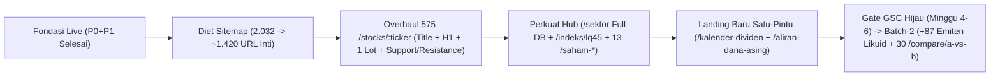

# CEO Deep-Research: SEO Growth teknikal.id (29 Okt 2026)

> **Konteks & Metodologi Riset (29 Okt 2026):**
> - **Baseline GSC (28 Hari):** `5 klik` · `885 impresi` · `CTR 0,6%` · `posisi rata-rata 67,9`.
> - **Baseline Akuisisi Eksternal (7 Hari Nyata):** `599 pageviews` eksternal murni (`62,3% mobile`, `87,8% anonim`), di mana **Google organik baru menyumbang `11 views`** (vs Bing `56`, Direct `709`).
> - **Status Fondasi Live Hari Ini:** Audit P0+P1 telah live di produksi (`2.032 URL` di `sitemap.xml`, `7 URL` di `sitemap-news.xml`, universe `940` baris aktif [`939` ekuitas + `^JKSE`], internal link 575 saham → `kenapa-naik-hari-ini`, SSR `CompanyDataTabs`, redirect `308` kanonik, serta JSON-LD `@graph` & `Dataset`).
> - **Metode Verifikasi:** Inspeksi HTTP & DOM SSR langsung pada `https://teknikal.id` (sampling lintas seluruh 12 kohort URL sitemap + komparasi penuh `/api/stocks` terhadap `sitemap.xml`), dipadukan dengan riset SERP Google Indonesia nyata pada 12 kueri saham IDX.

---

## Ringkasan Eksekutif (5 poin)

1. **Akar Masalah Posisi 67,9 & CTR 0,6% Bukan Lagi Render Teknis, Melainkan Salah Medan Tempur `<title>`/`<h1>` & Dilusi Crawl Budget:** Fondasi SSR `teknikal.id` pasca-P0+P1 sudah melampaui kompetitor CSR, tetapi seluruh `575` halaman `/stocks/:ticker` masih menembak head-term paling berdarah lewat `<title>` `"{Nama} ({TICKER}) Harga Saham Hari Ini"` dan `<h1>` yang hanya berisi 4 huruf `"{TICKER}"`. Pola ini menabrak dinding *Google Finance OneBox* + raksasa DR 75+ (Stockbit, Investing, TradingView, Ajaib) sambil membuang kata kunci yang justru dicari pemula dan minim lawan (`Analisa Teknikal`, `Support & Resistance`, `Skor Sinyal`, `Modal 1 Lot`).
2. **Strategi Menang 90 Hari = "Flanking Lapis Dua + Verdict-First Bahasa Awam":** Jangan bertarung frontal di kata kunci harga saham LQ45 atau berita rekomendasi pagi media nasional. Hasil *live SERP browsing* membuktikan bahwa begitu keluar dari 45 saham LQ45 menuju **emiten lapis dua ramai ritel (peringkat likuiditas #50–#580 seperti `DEWA`, `CPRO`, `SOSS`, `DVLA`, `ENRG`, `TINS`)**, media bisnis dan analis sekuritas absen; SERP hanya menyisakan tabel mesin `id.investing.com` yang penuh iklan dan tanpa penjelasan awam.
3. **5 Kolam Long-Tail Pemula Bernilai Tinggi Belum Punya Landing Page (Padahal Datanya Sudah Ada di PostgreSQL):** Pemeriksaan live membuktikan `/pasar` sengaja `noindex`, `/compare` hanya shell kosong `52 kata`, `/indeks/lq45` menghasilkan `HTTP 404`, `/sektor/:slug` hanya merender 2–5 saham statis (`128–145 kata`), dan `/saham-dividen` belum memuat tanggal `cumDate`. Akibatnya, 5 pola kueri emas pemula — **Kalender Cum-Date Dividen, Saham Modal Rp100 Ribu (1 Lot), Aliran Dana Asing Harian, Perbandingan Saham `A vs B`, serta Indeks LQ45/Syariah & Papan Pemantauan Khusus (FCA)** — belum tergarap sama sekali meski tabel `StockDividend`, `ForeignFlow`, `StockFundamental`, dan `Stock.listingBoard` sudah tersinkronisasi harian.
4. **Audit Sitemap 2.032 URL Mengungkap 37,1% URL Tipis/Beban Crawl & Aturan Ketat Batch-2:** Dari `2.032 URL` aktif, sebanyak **`753 URL (37,1%)`** berisiko mendilusi otoritas domain muda: `575` halaman `/stocks/:ticker/indikator` (`~9.800 kata` tabel kalimat berulang untuk kueri ber-volume nyaris nol, menyedot **28,3% total sitemap**), `60` halaman glosarium (`82–86 kata`), `115` halaman tanya-jawab pendek (`122–158 kata`), dan `/compare` (`52 kata`). Dari `364` ekuitas aktif di luar sitemap, **hanya `~87` saham likuid non-FCA (transaksi ≥Rp100 juta/hari seperti `KOPI`, `RANS`, `WBSA`, `LTLS`) yang layak naik Batch-2** setelah gate GSC 2–4 minggu; **`148` saham zombie/gocap/FCA tidur (transaksi Rp5.000–Rp35.000/hari seperti `KBRI`, `IIKP`, `HOTL`) wajib ditahan permanen** agar tidak memicu penalti *Scaled Thin Content*.
5. **5 Quick Wins Deterministik (<3 Hari/Aksi, Satu Pintu Data) Menargetkan Lonjakan >70× Klik Organik dalam 90 Hari:** Eksekusi berurutan pada (1) Overhaul `<title>`/`<h1>`/Answer Block 1 Lot & Support-Resistance di 575 halaman saham, (2) Diet sitemap `2.032 → ~1.420 URL` fokus + auto-`noindex` halaman datar/gocap, (3) Perbaikan full-query `/sektor/:slug` + peluncuran `/indeks/lq45` & `jii`, (4) Peluncuran `/kalender-dividen` & `/aliran-dana-asing` tanpa login, serta (5) Peluncuran `/saham-modal-100-ribu`, 30 rute `/compare/[a]-vs-[b]`, dan ekspansi Batch-2 `+87` saham likuid.

---

## 1. Peta Keyword IDX (tabel: keyword, vol, diff, intent, verdict)

*Catatan kalibrasi: Estimasi volume pencarian bulanan merupakan agregasi klaster kueri bahasa Indonesia di Google.co.id; tingkat kesulitan dinilai berdasarkan kekuatan domain yang menduduki Top-5 SERP aktual pada 29 Oktober 2026 terhadap otoritas domain `teknikal.id` saat ini (posisi rata-rata 67,9).*

| # | Keyword / Pola Klaster Bahasa Indonesia | Est. Vol / Bulan | Kesulitan (SERP Nyata) | Intent Pemula IDX | Aset URL `teknikal.id` | Verdict 90 Hari |
| :-: | :--- | :---: | :---: | :--- | :--- | :--- |
| 1 | **`analisa teknikal saham [TICKER] hari ini`** & **`support resistance saham [TICKER]`** *(fokus lapis dua rank #50–#580: mis. DEWA, CPRO, ENRG, TINS, KLBF)* | 25.000 – 45.000 *(agregat 500+ emiten)* | **Rendah–Sedang** *(KD 18–32 di luar LQ45)* | Mencari angka batas bawah (*support*), batas atas (*resistance*), dan arah sinyal sebelum beli/jual | `/stocks/[TICKER].JK` *(butuh revisi Title/H1 & Answer Block)* | **MENANG 90 HARI (Prioritas #1)** — Di luar LQ45, media & analis sekuritas absen; lawan hanya tabel mesin `id.investing.com`. |
| 2 | **`kenapa saham [TICKER] naik hari ini`** / **`kenapa saham [TICKER] turun`** | 15.000 – 30.000 *(melonjak saat ARA/ARB/spike)* | **Rendah** *(KD 12–25 di mid-cap)* | Diagnostik cepat saat melihat saham bergerak tajam >3% dalam sehari | `/saham/[ticker]/kenapa-naik-hari-ini` *(575 URL + `@graph` live)* | **MENANG 90 HARI (Prioritas #2)** — Menangkap ribuan lonjakan saham lapis dua yang luput dari liputan wartawan berita harian. |
| 3 | **`saham oversold hari ini`** / **`saham golden cross hari ini`** *(klaster penyaring sinyal harian)* | 3.500 – 6.500 | **Rendah–Sedang** *(KD 22–35)* | Mencari daftar saham jenuh jual (diskon) atau awal tren naik siap pantau tanpa setel rumus rumit | `/saham-oversold`, `/saham-golden-cross`, `/saham-volume-spike` *(13 rute live)* | **MENANG 90 HARI (Prioritas #3)** — Kompetitor hanya memberi tool kosong (TradingView) atau artikel tutorial tanpa daftar saham hari ini. |
| 4 | **`jadwal dividen saham 2026`** / **`cum date dividen saham terbaru`** | 12.000 – 22.000 *(puncak musim RUPS & interim Okt–Nov)* | **Sedang** *(KD 30–42)* | Mencari tanggal terakhir berhak dividen (*cum date*), besaran Rp/lembar, & cek keamanan tren harga | **Belum ada** *(`/saham-dividen` belum memuat `cumDate`)* | **MENANG 90 HARI (Prioritas #4)** — Berita Kontan/CNBC basi dalam 3 hari; halaman evergreen otomatis dari `StockDividend` belum punya lawan bebas login. |
| 5 | **`1 lot saham [TICKER] berapa rupiah`** & **`saham modal 100 ribu untuk pemula`** | 9.000 – 18.000 | **Rendah–Sedang** *(KD 20–34)* | Menghitung kecukupan uang riil (`100 lembar`) & mencari saham terjangkau yang bukan saham tidur/gorengan | **Belum ada** *(belum ada baris 1 lot di saham & belum ada landing modal)* | **MENANG 90 HARI (Prioritas #5)** — Artikel blog sekuritas statis dan memuat harga tahun lalu yang sudah kedaluwarsa. |
| 6 | **`saham net foreign buy hari ini`** / **`akumulasi asing saham BEI`** | 4.500 – 8.500 | **Sedang** *(KD 28–38)* | Memvalidasi saham apa yang sedang dibeli bersih oleh institusi asing di BEI | **Belum ada hub** *(data `ForeignFlow` baru tampil per saham)* | **MENANG 90 HARI (Prioritas #6)** — Kompetitor mengunci data asing di balik login aplikasi sekuritas atau PDF tabel mentah BEI. |
| 7 | **`daftar saham LQ45 terbaru`** / **`daftar saham sektor [perbankan/energi] BEI`** / **`daftar saham syariah JII`** | 14.000 – 25.000 | **Sedang** *(KD 30–44)* | Pemula mencari keranjang saham unggulan, sektoral, atau syariah yang aman dipelajari | `/sektor/[slug]` *(cacat 2–5 saham)* & `/indeks/[slug]` *(`lq45` masih 404)* | **MENANG 90 HARI (Bersyarat)** — Layak tembus Halaman 1 segera setelah bug full-query sektor & indeks `lq45`/`jii` dibereskan. |
| 8 | **`perbandingan saham [A] vs [B]`** *(mis. `BBCA vs BBRI`, `BMRI vs BBRI`, `ADRO vs PTBA`)* | 4.000 – 7.500 | **Sedang** *(KD 32–45)* | Memilih satu dari dua saham populer di sektor yang sama berdasarkan dividen, valuasi, & momentum | `/compare` *(masih CSR kosong 52 kata, belum ada URL pasangan)* | **MENANG HARI KE-60–90** — Artikel blog/YouTube bersifat opini statis; halaman komparasi data live 30 pasangan utama sangat kompetitif. |
| 9 | **`harga saham BBCA hari ini`** *(serta head-term harga murni LQ45: BBRI, BMRI, TLKM, ANTM)* | 350.000 – 600.000+ | **Sangat Berat** *(KD 78–92 + Zero-Click >65%)* | Cek angka harga kilat 2 detik di layar hasil pencarian | `/stocks/[TICKER].JK` | **JANGAN TABRAK FRONTAL** — Dikunci *Google Finance OneBox* di posisi #0 + Stockbit, Investing, TradingView, Ajaib. Fokuskan halaman ke kueri taktis (#1). |
| 10 | **`rekomendasi saham hari ini`** & **`belajar saham pemula` / `cara beli saham`** | 90.000 – 150.000 | **Sangat Berat** *(KD 72–88 + Top Stories Media/OJK)* | Mencari berita pilihan analis pagi atau panduan buka rekening efek dari nol | `/berita` & `/akademi` | **JANGAN TABRAK FRONTAL** — Dikunci karusel *Top Stories* media nasional (Kontan, Kompas, CNBC) & sekuritas besar. Jadikan pendukung internal link saja. |

---

## 2. Long-tail Untapped (URL+H1+struktur utk masing2)

Verifikasi browsing live pada `https://teknikal.id` (29 Okt 2026) memastikan kelima pola kueri di bawah ini **belum tercover** oleh rute yang ada:
- `/saham/:ticker/kenapa-naik-hari-ini` hanya membahas pergerakan harian 1 saham.
- `/sektor/:slug` baru menampilkan 2–5 emiten statis (`128–145 kata`).
- `/screener` me-redirect ke `/stocks?view=screener` dengan canonical kembali ke `/stocks` (filter tidak terindeks sebagai landing page).
- `/pasar` dipasang `robots: noindex, follow`.
- `/akademi` berisi panduan konsep umum tanpa tabel data pasar harian.
- `/indeks/lq45` menghasilkan `404 Not Found` dan `/compare` hanya berisi `52 kata` shell kosong.

Seluruh usulan di bawah **100% me-reuse tabel & service existing** sesuai *API Reuse Rule* (`StockDividend`, `ForeignFlow`, `StockFundamental`, `Stock.listingBoard`, `stockMarketService`, `screenerAnalysisService`) tanpa kalkulasi harga liar di luar service utama dan tanpa fitur AI berbayar.

### Pola 1: Kalender Dividen & Jadwal Cum-Date Aktif
- **Contoh Kueri Target:** `jadwal dividen saham 2026`, `kalender dividen saham BEI terbaru`, `cum date dividen saham bulan ini`, `dividen saham yield tinggi minggu ini`.
- **Celah Coverage Saat Ini:** `/saham-dividen` hanya mengurutkan 20 saham ber-yield historis tertinggi tanpa satu pun tanggal `cumDate`/`exDate`/`paymentDate`, padahal tabel `StockDividend` di DB sudah menyimpan jadwal lengkap.
- **Usulan URL:** `/kalender-dividen`
- **Usulan `<title>`:** `Kalender Dividen Saham BEI 2026 Terbaru — Jadwal Cum Date & Yield | TeknikalID`
- **Usulan `<h1>`:** `Kalender Dividen Saham BEI Terbaru: Jadwal Cum Date, Estimasi Yield & Sinyal Teknikal`
- **Struktur Konten SSR:**
  1. **Blok Jawaban Instan (50–60 kata):** Ringkasan otomatis jumlah emiten yang menjadwalkan pembagian dividen dalam 30 hari terakhir/mendatang, emiten dengan estimasi *dividend yield* tertinggi, dan tanggal pembaruan data bursa.
  2. **Tabel `Jadwal Cum Date Mendatang & Terbaru`:** Kolom Kode & Nama Emiten (tautan ke `/stocks/:ticker`), Dividen/Lembar (`Rp`), Harga Saham Terakhir & Modal 1 Lot, Estimasi Yield (`%`), Tanggal `Cum Date`, `Ex Date`, `Payment Date`, serta **Skor Sinyal 0,00–1,00** (penanda apakah tren harga sedang sehat atau rawan jebakan penurunan *ex-date*).
  3. **Panduan Ringkas Pemula ("Cara Menghindari Jebakan Ex-Date"):** Penjelasan bahasa awam perbedaan *Cum Date* vs *Ex Date* dengan contoh hitungan 1 lot (`100 lembar`) + tautan ke `/saham-dividen`.
  4. **Schema JSON-LD:** `@graph` berisi `CollectionPage`, `Dataset`, `BreadcrumbList`, dan `FAQPage` (3 tanya-jawab aturan hak dividen BEI).

### Pola 2: Saham Sesuai Modal Kantong Pemula (`1 Lot ≤ Rp100.000`)
- **Contoh Kueri Target:** `saham modal 100 ribu untuk pemula`, `daftar saham bagus dibawah 1000`, `saham murah fundamental bagus BEI`, `beli saham 100 ribu dapat apa`.
- **Celah Coverage Saat Ini:** Pemula mencari saham berdasarkan uang di dompet (`1 lot = 100 lembar × harga`), bukan rasio PBV semata. Belum ada halaman terindeks berdasarkan keterjangkauan nominal per lot yang sudah disaring dari risiko saham gocap/FCA.
- **Usulan URL:** `/saham-modal-100-ribu`
- **Usulan `<title>`:** `Daftar Saham Modal Rp100 Ribu Terbaik di BEI Hari Ini (1 Lot ≤ Rp100.000) | TeknikalID`
- **Usulan `<h1>`:** `Daftar Saham Modal Rp100 Ribu untuk Pemula — Harga 1 Lot Terjangkau & Tersaring Risiko`
- **Struktur Konten SSR:**
  1. **Blok Jawaban & Rumus 1 Lot:** Penjelasan langsung `1 Lot = 100 Lembar` beserta jumlah emiten aktif BEI hari ini yang harga 1 lot-nya `≤ Rp100.000` (harga lembar `Rp60 – Rp1.000`) **setelah mengecualikan saham tidur Rp50, Papan Pemantauan Khusus (FCA), dan `isGorengan = true`**.
  2. **Tabel Utama `Saham Likuid Modal ≤ Rp100.000 / Lot`:** Kolom Emiten, Harga per Lembar, **Modal 1 Lot (`Rp`)**, Perubahan Harian (`%`), **Skor Sinyal 0,00–1,00** + badge bahasa Indonesia, PER, Dividend Yield, dan Papan Pencatatan (`Utama` / `Pengembangan`).
  3. **Tabel Pendamping `Saham Unggulan (IDX30/IDX40) Modal di Bawah Rp500 Ribu / Lot`:** Menjembatani pemula yang sanggup menabung Rp300–500 ribu untuk emiten utama (seperti `BBRI`, `TLKM`, `ANTM`, `BRIS`, `PGAS`).
  4. **Kotak Edukasi Risiko ("Murah Rupiah Belum Tentu Murah Valuasi")** + `FAQPage` JSON-LD.

### Pola 3: Radar Akumulasi & Aliran Dana Asing Resmi BEI
- **Contoh Kueri Target:** `saham net foreign buy hari ini`, `akumulasi asing saham BEI hari ini`, `daftar saham diborong asing minggu ini`, `aliran dana asing IHSG hari ini`.
- **Celah Coverage Saat Ini:** Data `ForeignFlow` (beli/jual asing resmi dari IDX TradingSummary) sudah tampil per emiten di `/stocks/:ticker`, namun belum punya halaman rekap pasar yang bisa diindeks Google.
- **Usulan URL:** `/aliran-dana-asing`
- **Usulan `<title>`:** `Saham Net Foreign Buy Terbesar Hari Ini — Data Aliran Dana Asing BEI | TeknikalID`
- **Usulan `<h1>`:** `Aliran Dana Asing Saham BEI Hari Ini: Daftar Net Foreign Buy, Net Sell & Tren 5 Hari`
- **Struktur Konten SSR:**
  1. **Ringkasan Sesi Terakhir:** Tanggal bursa terakhir, jumlah emiten yang mencatatkan beli bersih asing (*Net Foreign Buy*) vs jual bersih (*Net Foreign Sell*), dan 3 saham dengan nilai beli bersih asing terbesar.
  2. **3 Tabel Peringkat SSR:**
     - *Top 15 Saham Net Foreign Buy Hari Ini* (Volume bersih, estimasi nilai transaksi `Rp`, perubahan harga `%`, dan Skor Sinyal 0–1).
     - *Top 15 Saham Akumulasi Asing Konsisten (5 Hari Bursa)* — memadukan aliran modal asing dengan konfirmasi indikator teknikal.
     - *Top 15 Saham Net Foreign Sell Hari Ini* (waspada tekanan distribusi).
  3. **Penjelasan Metodologi Data Resmi BEI:** Edukasi jernih bagi pemula mengenai sumber data ringkasan perdagangan harian Bursa Efek Indonesia dan mengapa aliran dana asing perlu dikonfirmasi dengan tren harga (SMA/RSI), bukan diikuti buta.
  4. **Schema JSON-LD:** `@graph` (`Dataset` + `CollectionPage` + `BreadcrumbList` + `FAQPage`).

### Pola 4: Perbandingan Saham Head-to-Head Satu Sektor (`[A] vs [B]`)
- **Contoh Kueri Target:** `perbandingan saham BBCA vs BBRI`, `saham BMRI vs BBRI bagus mana`, `ADRO vs PTBA vs ITMG`, `ICBP vs INDF untuk jangka panjang`.
- **Celah Coverage Saat Ini:** `/compare` hanya merender 52 kata komponen klien kosong; tidak ada URL statis per pasangan saham yang dapat merangking kueri perbandingan populer.
- **Usulan URL:** `/compare/[pair]` *(dibatasi ketat pada **30 pasangan saham likuid satu sektor** dengan urutan slug alfabetis kanonik, mis. `/compare/bbca-vs-bbri`, `/compare/adro-vs-ptba`, `/compare/icbp-vs-indf`, `/compare/tlkm-vs-isat`)*
- **Usulan `<title>`:** `Perbandingan Saham {A} vs {B} Hari Ini: Skor Sinyal, Dividen & Valuasi | TeknikalID`
- **Usulan `<h1>`:** `Perbandingan Saham {NamaA} ({A}) vs {NamaB} ({B}) — Data Teknikal, Dividen & Valuasi`
- **Struktur Konten SSR:**
  1. **Kartu Kesimpulan Objektif (Verdict-First):** 3 kalimat ringkas berbasis angka DB hari ini — siapa unggul pada **Momentum Teknikal (Skor Sinyal 0–1 & posisi terhadap SMA50)**, siapa lebih rendah pada **Valuasi (PER & PBV)**, dan siapa lebih tinggi pada **Dividend Yield & keterjangkauan Modal 1 Lot**.
  2. **Tabel Komparasi Berdampingan (12 Baris Data SSR via `stockMarketService`):** Harga Penutupan, Modal 1 Lot (`Rp`), Perubahan Harian & Rentang 52 Minggu, Skor Sinyal 0–1, RSI-14, Status Tren MA, Aliran Dana Asing 5 Hari, PER, PBV, EPS, Dividend Yield, Kapitalisasi Pasar.
  3. **Tautan Lanjutan:** Link langsung ke halaman penuh `/stocks/{A}.JK`, `/stocks/{B}.JK`, halaman `/sektor/{slug}` terkait, dan tombol *"Bandingkan dengan Saham Lain"* ke mode interaktif `/compare`.

### Pola 5: Indeks Saham Utama Hilang (`LQ45` / `JII` Syariah / `IDXHIDIV20`) & Daftar Papan Pemantauan Khusus (`FCA`)
- **Contoh Kueri Target:** `daftar saham LQ45 terbaru 2026`, `daftar saham syariah terbaik JII ISSI 2026`, `daftar saham pemantauan khusus FCA BEI terbaru`.
- **Celah Coverage Saat Ini:** `/indeks` baru memiliki 3 halaman (`smc-liquid`, `idx30`, `idx-quality`) sedangkan `/indeks/lq45` **`404`**; halaman saham syariah **0 URL**; dan `57` emiten aktif berstatus `listingBoard = 'Pemantauan Khusus'` di DB belum punya halaman daftar publik padahal reformasi aturan FCA BEI (efektif 28 Sep 2026) sedang banyak dicari investor ritel.
- **Usulan URL:** `/indeks/lq45`, `/indeks/jii`, `/indeks/idxhidiv20`, serta `/saham-pemantauan-khusus`
- **Usulan `<title>` & `<h1>`:**
  - Indeks: Title `Daftar Saham LQ45 Terbaru Hari Ini — Harga, Modal 1 Lot & Sinyal Teknikal | TeknikalID` · H1 `Daftar 45 Saham Indeks LQ45 BEI Hari Ini: Performa, Valuasi & Skor Sinyal`
  - FCA: Title `Daftar Saham Pemantauan Khusus (FCA) BEI Terbaru Hari Ini & Penjelasan Risiko | TeknikalID` · H1 `Daftar Saham Papan Pemantauan Khusus (Full Call Auction) BEI Hari Ini`
- **Struktur Konten SSR:**
  1. **Ringkasan Breadth Kelompok:** Jumlah anggota yang sedang berstatus *Sinyal Positif / Netral / Tekanan Jual*, top mover harian, dan median PER/Yield konstituen.
  2. **Tabel Lengkap Seluruh Konstituen (SSR):** Kode & Nama Emiten, Sektor bahasa Indonesia, Harga, Modal 1 Lot, Perubahan `%`, Skor Sinyal 0–1, RSI-14, dan Dividend Yield.
  3. **Konteks Aturan Bursa (Khusus Pemula):** Jadwal evaluasi berkala indeks BEI (Mei/November untuk JII, kuartalan untuk LQ45) atau penjelasan mekanisme lelang berkala *Full Call Auction (FCA)* agar pemula tidak terjebak likuiditas terkunci.

---

## 3. Landscape SERP kompetitor

Analisa di bawah disarikan dari pemeriksaan SERP aktual bahasa Indonesia pada **29 Oktober 2026** untuk 3 klaster kata kunci prioritas:

### A. Keyword Prioritas 1: `"analisa teknikal saham BBCA hari ini"` vs `"analisa teknikal saham DEWA support resistance hari ini"`
- **Siapa yang Ranking di SERP Nyata:**
  - **Pada Big-Cap (`BBCA`):** Halaman 1 dipadati media nasional & sekuritas besar — `kompas.com` (artikel rekomendasi harian analis), `ajaib.co.id` (berita/halaman saham), `id.investing.com` (`/equities/bank-central-asia-technical`), dan `id.tradingview.com` (`/symbols/IDX-BBCA/technicals/`).
  - **Pada Mid-Cap Ramai Ritel (`DEWA`):** Media bisnis dan blog sekuritas **hilang dari hasil teratas**; SERP praktis hanya menampilkan `id.investing.com` (`/equities/darma-henwa-technical`) dengan tabel angka Pivot Point (`R1–R3`, `S1–S3`) dan status MA/RSI otomatis.
- **Format Konten yang Menang:**
  - Google memprioritaskan halaman yang **mencetak angka level harga konkret di dalam teks HTML** (angka *Support*, *Resistance*, posisi terhadap MA20/MA200, dan nilai RSI) disertai skenario pendek (*jika bertahan di atas support X berpeluang menguji resistance Y*). Halaman yang hanya memuat canvas grafik JavaScript tanpa teks penjelasan kalah untuk kueri `"analisa teknikal … hari ini"`.
- **Celah Angle `teknikal.id`:**
  - `Investing.com` menggunakan terjemahan mesin kaku, berat iklan, dan tidak memberi konteks risiko khas BEI; `TradingView` menyembunyikan gauge di balik widget JS tanpa kalimat naratif; `Stockbit` menutup fitur analisis detail di balik dinding login; `Ajaib` & `Kompas` menulis manual sehingga hanya sanggup mengulas 5–10 saham besar per hari (dan URL beritanya basi keesokan hari).
  - **`teknikal.id` menang telak di ~535 saham non-LQ45** karena memiliki **Skor Sinyal 0–1 (Verdict-First) + narasi otomatis 9 indikator + data aliran asing & fundamental SSR untuk 940 emiten + gratis tanpa login**. Syarat pembukanya: masukkan kata `"Analisa Teknikal"` & `"Sinyal"` ke `<title>`/`<h1>` `/stocks/:ticker` serta ekspos level *Support/Resistance* & *Modal 1 Lot* di paragraf pembuka SSR.

### B. Keyword Prioritas 2: `"saham oversold hari ini BEI RSI dibawah 30"` & `"screener saham gratis Indonesia RSI oversold golden cross"`
- **Siapa yang Ranking di SERP Nyata:**
  - `id.tradingview.com/screener/`, `id.investing.com/stock-screener/`, `carisaham.com`, `stockbit.com` (artikel blog panduan cara pakai fitur screener di aplikasi), `brights.id` (artikel edukasi BRI Danareksa Sekuritas), dan `idx.co.id` (halaman pengenalan aplikasi IDX Mobile).
- **Format Konten yang Menang:**
  - Terjadi **mismatch intent besar di SERP**: pemula mencari *daftar saham yang hari ini sedang oversold*, tetapi hasil yang muncul justru **aplikasi screener kosong** (yang memaksa pemula menyetel filter teknis sendiri) atau **artikel blog tutorial panjang** yang tidak memuat satu pun tabel saham hari ini. Hanya `carisaham.com` yang menyajikan daftar terprogram, namun berupa tabel mentah tanpa konteks kualitas emiten.
- **Celah Angle `teknikal.id`:**
  - Halaman `/saham-oversold` dan `/saham-golden-cross` di `teknikal.id` langsung menjawab intent dalam 3 detik: **daftar saham aktif BEI hari ini yang lolos kriteria, sudah disaring dari saham gorengan, lengkap dengan Skor Sinyal 0–1, tanpa daftar akun/unduh aplikasi**. Menambahkan kalimat ringkasan dinamis di paragraf pertama (*"Per 29 Okt 2026, terdapat N saham BEI di zona jenuh jual RSI < 30..."*) akan membuat cuplikan SERP `teknikal.id` jauh lebih unggul dari seluruh kompetitor di atas.

### C. Keyword Prioritas 3: `"daftar saham dividen tinggi 2026 BEI jadwal cum date"` & `"saham net foreign buy hari ini akumulasi asing BEI"`
- **Siapa yang Ranking di SERP Nyata:**
  - **Dividen & Cum Date:** `idx.co.id` (pengumuman PDF & halaman indeks IDXHIDIV20), `kontan.co.id` & `cnbcindonesia.com` (artikel berita daftar 4–5 emiten cum date pekan ini seperti DMAS, TSPC, SCMA, AXIO, SIDO), `stockbit.com`, `ajaib.co.id`, dan blog finansial `mikirduit.com`.
  - **Net Foreign Buy:** `idx.co.id` (statistik harian mentah), `stockbit.com` / `ajaib.co.id` / `bions.id` (halaman arahan untuk membuka menu *Foreign Flow* di dalam aplikasi sekuritas masing-masing), serta `cnbcindonesia.com` & `idnfinancials.com` (berita rekap harian 5–10 saham).
- **Format Konten yang Menang:**
  - Artikel berita berangka aktual (menyebut kode ticker + nominal Rp dividen/tanggal cum date atau daftar 10 saham net buy asing) mengalahkan panduan teori umum. Namun berita media memiliki kelemahan struktural: **URL selalu berganti setiap hari**, sehingga tidak ada satu URL kanonik yang terus mengumpulkan *backlink* dan histori klik.
- **Celah Angle `teknikal.id`:**
  - Membangun **URL Evergreen Kanonik** (`/kalender-dividen` dan `/aliran-dana-asing`) yang isinya otomatis ter-update setiap hari bursa dari DB, gratis tanpa login RDN sekuritas, dan **mengawinkan jadwal dividen / aliran dana asing dengan Skor Sinyal Teknikal 0–1** (sehingga pemula tidak sekadar melihat dividen tinggi, tetapi langsung tahu apakah tren harganya aman atau berisiko *dividend trap*).

---

## 4. Programmatic: thin-content audit + batch-2 rekomendasi

### A. Audit Komposisi & Rasio Thin-Content Sitemap Live (`2.032 URL`)

Pemindaian langsung `https://teknikal.id/sitemap.xml` dan pengukuran kata bersih (*body text* tanpa `script/style/svg/nav/header/footer`) pada 29 Oktober 2026 memetakan seluruh `2.032 URL` tanpa sisa:

| Kohort URL di `sitemap.xml` | Jumlah URL | % Sitemap | Rata-rata Kata Body SSR | Status Kualitas SEO | Diagnosa & Tindakan |
| :--- | :---: | :---: | :---: | :---: | :--- |
| `/stocks/[TICKER].JK` *(likuid aktif bergerak)* | **485** | 23,9% | `1.160 – 1.360` kata | **UNIK & KUAT** | Kaya data SSR (OHLC, Skor 0–1, 9 indikator, aliran asing, profil, direksi, pemegang saham, dividen). Perlu perbaikan Title/H1. |
| `/saham/[t]/kenapa-naik-hari-ini` *(bergerak `\|chg\| > 0,5%`)* | **482** | 23,7% | `380 – 527` kata | **UNIK & KUAT** | Judul, arah, pemicu sinyal, posisi 52-minggu, dan peer sektor bervariasi nyata. Pertahankan. |
| `/berita/[slug]` + `/akademi/[slug]` | **81** *(61 + 20)* | 4,0% | `502 – 928` kata | **UNIK & KUAT** | Artikel editorial/analisa harian & panduan mendalam; aset otoritas organik terbaik. |
| Screener `/saham-*`, `/indeks/*`, Hub utama aktif | **36** | 1,8% | `303 – 1.171` kata | **UNIK & KUAT** | Halaman hub berintent tinggi (kecuali `/saham-overbought` saat pasar merah yang turun ke `139` kata). |
| `/stocks/[TICKER].JK` *(gocap ≤Rp55 di dalam shortlist)* | **90** | 4,4% | `1.100 – 1.200` kata | **ZONA KUNING** | Profil perusahaan tetap unik, namun harga beku membuat bagian analisa harian jarang berubah. Biarkan halaman sahamnya, tetapi tahan sub-halamannya. |
| `/saham/[t]/kenapa-naik-hari-ini` *(saham `Datar` / `chg = 0%` atau `null`)* | **93** | 4,6% | `282 – 355` kata | **ZONA KUNING (Semi-Tipis)** | Kalimat pembuka berulang (*"bergerak relatif datar hari ini tanpa perubahan sinyal..."*). Pasang `noindex, follow` kondisional bila saham tidur >5 sesi. |
| `/sektor/[slug]` + `/laporan-pasar/minggu-*` + `/harga-saham-hari-ini` | **20** *(11 + 8 + 1)* | 1,0% | `128 – 299` kata | **ZONA KUNING (Tipis karena Bug)** | `/sektor/[slug]` hanya `128–145` kata akibat bug 2–5 ticker hardcoded (sembuh saat full-query DB); `/harga-saham-hari-ini` (`197` kata) kanibal dengan `/stocks`. |
| **`/stocks/[TICKER].JK/indikator`** | **575** | **28,3%** | `203 – 10.130` kata | **MERAH (Crawl-Budget Trap / Boilerplate)** | Merender ratusan baris tanggal yang mengulang 3–4 template kalimat `summarizeVerdict()` tanpa angka detail (angka dikunci CTA), untuk keyword `riwayat indikator [X]` ber-volume ~0. **Pangkas ke 40 saham IDX40 saja di sitemap!** |
| **`/akademi/glosarium/[term]`** | **60** | 3,0% | **`82 – 86` kata** | **MERAH (Thin Content)** | Terlalu tipis (<100 kata) untuk berdiri sebagai 60 URL terpisah. Keluarkan dari sitemap / `noindex` sampai diperkaya ≥300 kata + contoh saham IDX live. |
| **`/akademi/tanya/[slug]`** | **115** | 5,7% | **`122 – 158` kata** | **MERAH (Thin Q&A)** | Jawaban pendek 1 paragraf (sebagian slug ber-hash acak seperti `-l4aepa`). Promosikan ke sitemap hanya entri `≥ 250 kata` yang dikurasi; sisanya gabung ke FAQ topik/saham. |
| `/compare` + `/disclaimer` + `/privacy` + `/terms` | **4** | 0,2% | `52` kata *(compare)* | **MERAH (Shell / Legal)** | `/compare` kosong tanpa SSR; 3 halaman legal tidak perlu dipromosikan di `sitemap.xml`. |

> **Ringkasan Rasio Audit Sitemap (`2.032 URL`):**
> - **Konten Unik & Sehat:** `1.084 URL` (**53,3%**)
> - **Zona Kuning (Perlu Pengayaan / Perbaikan Query):** `203 URL` (**10,0%**)
> - **Risiko Thin Content & Pemborosan Crawl Budget:** `745 URL` (**36,7%** — didominasi 535 URL `/indikator` non-IDX40 + 175 URL glosarium/tanya tipis + URL shell/legal).

### B. Audit Pool Batch-2 (`364 Ekuitas Aktif di Luar Sitemap`) & Rekomendasi Ekspansi

Komparasi penuh data live `/api/stocks` (`939` ekuitas aktif + `^JKSE` = `940` baris) terhadap `575` ticker di `sitemap.xml` menunjukkan karakteristik `364` ekuitas yang belum masuk sitemap:
- **Distribusi Papan:** `Pengembangan: 234` · `Utama: 67` · **`Pemantauan Khusus (FCA): 51`** · `Akselerasi: 12`.
- **Kesehatan Likuiditas & Harga Hari Ini:** **`148 emiten` (40,7%)** bervolume `< 500 lot/hari`; **`134 emiten`** tidak berubah harga (`0%` / `null`, di mana `88` di antaranya `changePercent = null` / tidak aktif diperdagangkan); **`55 emiten`** terkunci di harga **Rp50–Rp55 (gocap)**; dan **`6 emiten`** bahkan belum memiliki `rsi14`.

Berdasarkan fakta tersebut, mempromosikan seluruh 364 saham sekaligus ke sitemap adalah **kesalahan fatal**. Gunakan pemilahan 3 lapis berikut setelah **Gate GSC 2–4 Minggu terpenuhi** *(syarat gate: impresi 28h ≥ 3.000, posisi rata-rata < 45, dan rasio `Indexed/Submitted` di GSC ≥ 65%)*:

1. **BATCH-2 LAYAK NAIK (`~85–88 Emiten Likuid Tertinggal` → Tambah `+87` URL `/stocks/:ticker`):**
   - **Kriteria Filter Deterministik di `sitemap.ts`:** `isActive = true` AND `listingBoard != 'Pemantauan Khusus'` AND rata-rata nilai transaksi 20 hari **≥ Rp100.000.000/hari** (atau masuk lonjakan transaksi aktif ≥ Rp500 juta) AND `close > 55` AND `rsi14 IS NOT NULL`.
   - **Bukti Emiten Berkualitas yang Saat Ini Tertinggal di Luar Sitemap:** `WBSA.JK` (transaksi hari ini Rp5,04 miliar), `RANS.JK` (Rp5,01 miliar — merek populer yang sering dicari pemula), `JECX.JK` (Rp3,30 miliar), `KOPI.JK` (Rp2,83 miliar, naik `+26,17%`), `BACH.JK` (Rp1,75 miliar), `TRIO.JK` (Rp1,19 miliar), `BSWD.JK` (Rp1,07 miliar), `INPS.JK` (Rp1,01 miliar), `CITY.JK` (Rp885 juta), `LTLS.JK` (Lautan Luas, Rp745 juta, `+11,1%`), `EMMI.JK` (Rp720 juta).
   - **Aturan Sub-Halaman Batch-2:** Masukkan `/stocks/:ticker` terlebih dahulu; masukkan `/saham/:ticker/kenapa-naik-hari-ini` hanya untuk emiten yang bergerak aktif (`changePercent != null`), dan **jangan** masukkan `/stocks/:ticker/indikator`.
2. **TAHAN DI LUAR SITEMAP / CRAWL VIA SEKTOR SAJA (`~128 Emiten Likuiditas Tipis Rp10–100 Juta/Hari`):**
   - Halaman tetap `200 OK` dan tertaut rapi dari halaman `/sektor/:slug` penuh sehingga pengguna maupun Googlebot tetap dapat menemukannya secara alami, tetapi tidak membebani kuota prioritas `sitemap.xml` pada 90 hari pertama.
3. **BAHAYA THIN-CONTENT PENALTY — BLOKIR DARI SITEMAP PERMANEN (`~148 Emiten Zombie / Gocap Rp50 / FCA Tidur`):**
   - **Contoh Nyata Live Hari Ini:** `KBRI.JK` (Rp50, transaksi harian hanya **Rp5.000** / 1 lot; halaman `kenapa-naik` merosot ke `282 kata` datar dan `/indikator` hanya `203 kata`), `IIKP.JK` (Rp50, Rp10.000/hari), `HOTL.JK` (Rp50, Rp10.000/hari), `RIMO.JK` (Rp50, Rp25.000/hari), `HKMU.JK` (Rp50, Rp25.000/hari), `MAGP.JK` (Rp50, Rp35.000/hari), serta 51 saham Papan Pemantauan Khusus yang tidak bergerak.
   - **Risiko:** Menjejalkan `148 × 3 = 444 URL` saham tidur yang setiap hari menghasilkan teks kembar 100% (*"bergerak relatif datar hari ini tanpa perubahan sinyal teknikal yang berarti"*) akan memicu sinyal *Scaled Low-Value Content* di Google dan menghambat pengindeksan 575+87 saham utama. Pasang `robots: noindex, follow` otomatis pada rute `/saham/:ticker/kenapa-naik-hari-ini` dan `/stocks/:ticker/indikator` untuk seluruh kelompok ini.

---

## 5. Roadmap 90 hari (5 aksi ROI-terurut + metrik GSC)

Seluruh 5 aksi di bawah melanjutkan fondasi P0+P1 yang sudah live hari ini, masing-masing ber-effort **< 3 hari kerja**, mematuhi *API Reuse Rule* (`src/domains/stock/`), menggunakan copy bahasa Indonesia ramah pemula, dan bebas fitur AI berbayar.

### Aksi #1 — Overhaul `<title>`, `<h1>`, & "Answer Block Pemula" (Modal 1 Lot + Support/Resistance + Skor Sinyal 0–1) di 575 `/stocks/:ticker`
- **Urutan & Jadwal:** Prioritas ROI #1 · Minggu 1–2 · **Effort: 1,5 Hari**
- **Apa yang Diubah:**
  - Di `src/app/(public)/stocks/[ticker]/page.tsx`: ubah `<title>` dari `"{ShortName} ({TICKER}) Harga Saham Hari Ini"` menjadi **`"Saham {TICKER} ({ShortName}) Hari Ini: Harga, Analisa Teknikal & Sinyal"`**; perkaya `meta description` dengan harga, `Modal 1 Lot (Rp...)`, `Skor Sinyal 0,00–1,00`, dan batas bawah/atas.
  - Ubah `<h1>` dari sekadar `"{TICKER}"` menjadi **`"Harga & Analisa Teknikal Saham {ShortName} ({TICKER})"`**.
  - Render **Blok Jawaban Pemula SSR (50–70 kata)** tepat di bawah kartu Skor Sinyal 0–1 yang memuat: `Harga 1 Lot (100 lembar) = Rp...`, estimasi area Batas Bawah (*Support* dari `bbLower`/`sma20`/`week52Low`) & Batas Atas (*Resistance* dari `bbUpper`/`sma50`/`week52High`), serta buka kalimat interpretasi singkat 9 indikator (`PlainText`) langsung di HTML SSR tanpa harus klik tombol.
- **Metrik Keberhasilan GSC (Cek Hari ke-30 & ke-45):**
  - Filter Halaman `/stocks/` (non-`/indikator`): **Posisi rata-rata membaik dari `67,9` → `< 32,0`**; **CTR naik dari `0,6%` → `≥ 2,2%`**; muncul impresi organik pada kueri mengandung `"analisa teknikal"`, `"support"`, `"sinyal"`, atau `"1 lot"` di **≥ 150 kode saham berbeda**.

### Aksi #2 — Diet Crawl-Budget Sitemap (`2.032 → ~1.320 URL Fokus`) & Guard `noindex` Kondisional Halaman Tipis/Tidur
- **Urutan & Jadwal:** Prioritas ROI #2 · Minggu 1–2 · **Effort: 1 Hari**
- **Apa yang Diubah:**
  - Di `src/app/sitemap.ts`: batasi `indicatorHistoryPages` (`/stocks/:ticker/indikator`) hanya untuk **40 saham IDX40** (`-535 URL` dari sitemap; pasang `noindex, follow` pada non-IDX40); keluarkan `/compare` (sebelum SSR pasangan siap) dan 3 halaman legal (`/disclaimer`, `/privacy`, `/terms`) dari sitemap; ganti `lastModified: today` pada halaman statis dengan `latestDate` sesi bursa terakhir dari DB.
  - Keluarkan 60 `/akademi/glosarium/:term` (`82 kata`) dan `/akademi/tanya/:slug` yang `< 250 kata` dari sitemap (+ pasang `noindex, follow` sampai kontennya diperkaya) sehingga otoritas edukasi terkumpul di `/akademi` & `/akademi/glosarium` (`1.171 kata`).
  - Di `/saham/[ticker]/kenapa-naik-hari-ini/page.tsx`: tambahkan `robots: { index: false, follow: true }` otomatis jika saham tidak memiliki transaksi/perubahan (`changePercent === null` atau harga `≤ Rp55` dengan arah `Datar`).
- **Metrik Keberhasilan GSC (Cek Hari ke-30):**
  - Laporan *GSC Indexing → Sitemaps*: **Rasio `Indexed / Submitted` menembus `≥ 70%`**; jumlah URL di status *"Crawled - currently not indexed"* dan *"Discovered - currently not indexed"* turun **≥ 40%**; halaman baru/update ter-crawl ulang dalam `< 72 jam`.

### Aksi #3 — Upgrade Full-Query `/sektor/[slug]`, Luncurkan `/indeks/lq45` + `/indeks/jii` + `/indeks/idxhidiv20`, & Live Answer Block di 13 `/saham-*`
- **Urutan & Jadwal:** Prioritas ROI #3 · Minggu 2–3 · **Effort: 2 Hari**
- **Apa yang Diubah:**
  - Di `src/app/(public)/sektor/[slug]/page.tsx`: ganti daftar statis 2–5 saham dengan query seluruh saham aktif per sektor via `stockMarketService.getStockList(sector)` (menaikkan isi halaman dari `128 kata` ke `>800 kata` SSR + menyalurkan internal link ke seluruh 939 emiten termasuk kandidat Batch-2).
  - Di `src/lib/idx-indices.ts`: tambahkan konstituen resmi `lq45`, `jii` (Saham Syariah Likuid), dan `idxhidiv20` sehingga `/indeks/lq45` tidak lagi `404`.
  - Pada 13 halaman screener `/saham-*` (`/saham-oversold`, `/saham-golden-cross`, `/saham-volume-spike`, dll.): tambahkan paragraf pembuka dinamis SSR (*"Per [Tanggal], terdapat [N] saham aktif non-gorengan di BEI..."*) + kolom **Modal 1 Lot** & **Skor Sinyal 0–1**; arahkan `/harga-saham-hari-ini` (`197 kata`) via `308 Permanent Redirect` ke `/stocks` untuk menghentikan kanibalisasi keyword.
- **Metrik Keberhasilan GSC (Cek Hari ke-45 & ke-60):**
  - Filter Halaman `/sektor/`, `/indeks/`, dan `/saham-`: meraih **`≥ 4.000 impresi/28h`** dan **`≥ 80 klik/28h`**; minimal **3 halaman hub menembus posisi rata-rata `< 20`** pada kueri `"saham oversold hari ini"`, `"daftar saham lq45"`, `"saham syariah"`, atau `"saham sektor perbankan"`.

### Aksi #4 — Bangun 2 Landing Page Evergreen Data Eksklusif Bebas Login: `/kalender-dividen` & `/aliran-dana-asing`
- **Urutan & Jadwal:** Prioritas ROI #4 · Minggu 4–6 · **Effort: 2 Hari** *(masing-masing 1 hari)*
- **Apa yang Diubah:**
  - Bangun `/kalender-dividen` dari tabel `StockDividend` + snapshot harga/indikator existing (jadwal `cumDate` mendatang & terbaru, nominal Rp/lembar, estimasi yield, modal 1 lot, Skor Sinyal 0–1, peringatan risiko *ex-date*, JSON-LD `Dataset` + `FAQPage`). Tautkan dari `/saham-dividen` dan tab Dividen di 575 halaman saham.
  - Bangun `/aliran-dana-asing` dari tabel `ForeignFlow` resmi BEI + `marketSnapshotService` (Top 15 *Net Foreign Buy* harian, Top 15 *Akumulasi Asing 5 Hari*, Top 15 *Net Foreign Sell*, Skor Sinyal 0–1, JSON-LD `Dataset` + `FAQPage`). Tautkan dari blok `Aliran Dana Asing` di 575 halaman saham.
- **Metrik Keberhasilan GSC (Cek Hari ke-60 & ke-75):**
  - Kedua URL terindeks di GSC dalam `< 7 hari` setelah masuk `sitemap.xml`; gabungan kedua halaman mencetak **`≥ 2.500 impresi/28h`** dengan **CTR `≥ 3,5%`** pada kueri bertema `"dividen"`, `"cum date"`, `"foreign buy"`, dan `"akumulasi asing"`.

### Aksi #5 — Luncurkan `/saham-modal-100-ribu`, 30 Rute `/compare/[a]-vs-[b]` SSR, & Promosi Batch-2 (`+87` Emiten Likuid)
- **Urutan & Jadwal:** Prioritas ROI #5 · Minggu 6–10 *(dieksekusi begitu Gate GSC Aksi #1–#3 hijau)* · **Effort: 2,5 Hari**
- **Apa yang Diubah:**
  - Bangun `/saham-modal-100-ribu` (`1 lot ≤ Rp100.000`, filter ketat non-gocap `close > 55`, non-FCA, `isGorengan = false`, diurutkan likuiditas & Skor Sinyal 0–1) + `/saham-pemantauan-khusus` (edukasi risiko & daftar live 57 emiten FCA).
  - Bangun `/compare/[pair]/page.tsx` SSR untuk **30 pasangan saham sejenis terpopuler** (`bbca-vs-bbri`, `bmri-vs-bbri`, `adro-vs-ptba`, `icbp-vs-indf`, `tlkm-vs-isat`, `antm-vs-mdka`, dll.) dengan kartu kesimpulan 3 metrik + tabel 12 baris data live.
  - Buka gerbang `sitemap.ts` Batch-2 khusus untuk **`~87` emiten aktif non-FCA dengan nilai transaksi ≥ Rp100 juta/hari & `close > 55`** (seperti `WBSA`, `RANS`, `KOPI`, `JECX`, `LTLS`), sambil tetap menahan 148 saham zombie/gocap di luar sitemap.
- **Metrik Keberhasilan GSC (Target Puncak Hari ke-90 — Jendela 28 Hari):**
  - **Total Impresi Situs:** naik dari `885` → **`15.000 – 25.000+` impresi / 28 hari** (`>17×`).
  - **Total Klik Organik:** naik dari `5` → **`350 – 600+` klik / 28 hari** (`>70×`, setara `12–20+` klik organik Google per hari).
  - **CTR Rata-Rata Situs:** naik dari `0,6%` → **`≥ 2,5%`**.
  - **Posisi Rata-Rata Situs:** membaik dari `67,9` → **`< 28,0`**, dengan `≥ 50` halaman menembus Top-10 SERP Indonesia.
