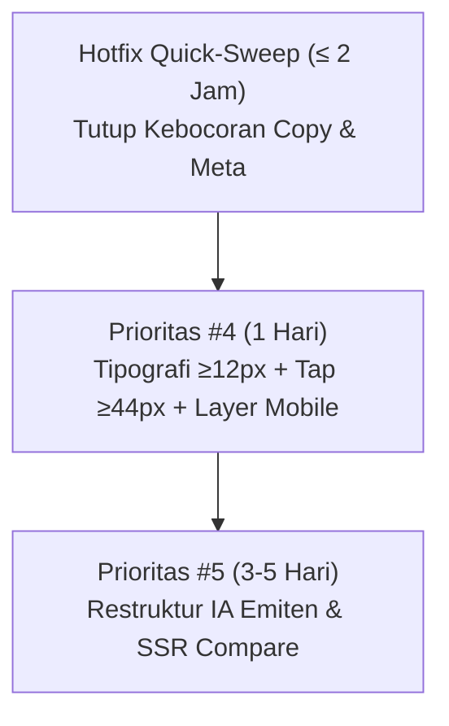

# Re-Audit UI/UX teknikal.id — Verifikasi Pasca-Perbaikan

- **Tanggal Audit:** Sabtu, 31 Okt 2026 (sesi data terakhir: Jumat, 30 Okt 2026 pasca-close)
- **Auditor:** Claude (Antigravity) — Juri Produk Independen
- **Karakter Evaluasi:** Read-only, berbasis inspeksi HTML nyata post-fix (`/tmp/fresh_.html`, `/tmp/fresh_bbca.html`, `/tmp/fresh_pasar.html`, `/tmp/fresh_compare.html`)
- **Baseline Audit Sebelumnya:** [uiux-audit-claude-20261030.md](file:///Users/nicholasandriansurjadi/Documents/teknikalidnew/docs/agent-org/teknikal/uiux-audit-claude-20261030.md) (30 Okt 2026)

---

## 1. Verifikasi Fix #1 – #7 (PASS/FAIL & Bukti Nyata)

| Fix | Item Deskripsi | Status | Bukti Kutipan HTML Nyata & Catatan Lapangan |
|---|---|---|---|
| **#1** | Label skor: kini "Skor Sinyal (−1 s.d. +1)" — bukan lagi "0-1" | **PASS (UI Visual)**<br/>*FAIL (Meta & A11y)* | ✅ **UI Visual PASS**: di BBCA tertulis `<span class="text-[10px] font-semibold text-text-tertiary mt-0.5">Skor Sinyal (−1 s.d. +1)</span>` dan di `/pasar` tertulis `Skor sinyal (−1 s.d. +1)`.<br/>❌ **Bocor di Metadata & ARIA**: Tag SEO BBCA masih `<meta name="description" content="... Analisa teknikal &amp; skor sinyal 0-1 ..."/>` (juga di `og:description` & `twitter:description`). Atribut aksesibilitas masih `aria-valuemin="0" aria-valuemax="1" aria-label="Skor sinyal teknikal -0.36 dari 1,00"`. |
| **#2** | `/pasar` 3-fase: "Pasar sudah tutup" / "Bursa tutup (akhir pekan)" / "Pasar belum buka"; Gainers/Losers pakai tanggal sesi | **PASS** | ✅ Header & status: `<p class="... text-secondary mt-2 max-w-2xl leading-relaxed">Pasar sudah tutup — rekap sesi hari ini di bawah ini.</p>` dan `<Moon class="inline h-4 w-4" /> Pasar sudah tutup`.<br/>✅ Label sesi: `Gainers — sesi 30 Okt`, `Losers — sesi 30 Okt`, `IHSG — sesi 30 Oktober 2026`.<br/>✅ Teks lama `Pasar belum buka`, `Akhir pekan — bursa tutup`, `Gainers kemarin` sudah 0 hit pada HTML Jumat malam. |
| **#3** | "Brief Hari Ini" → "Brief Pagi · Rekap sesi {tanggal}" | **PARTIAL PASS**<br/>*(Bocor di Emiten)* | ⚠️ **Home**: Badge berubah jadi `Brief Pagi`, namun sublabel tertulis `Rekap sesi <!-- -->Hari ini<!-- --> · terbit tiap pagi` (kontradiktif dengan sesi trading yang direkap, lihat Temuan #2).<br/>❌ **Emiten (BBCA)**: Masih hardcoded menggunakan label lama: `<p class="text-[10px] font-bold uppercase tracking-wider text-accent">Disebut di Brief Pasar Hari Ini</p>` ([page.tsx#L1098](file:///Users/nicholasandriansurjadi/Documents/teknikalidnew/src/app/(public)/stocks/[ticker]/page.tsx#L1098)). |
| **#4** | Semua label EN → ID: Sangat Menguat/Menguat/Netral/Melemah; Di Atas/Di Bawah; Jenuh Beli/Jual; Rentang 52 Minggu; Tertinggi Hari Ini; jt lembar; mlr/miliar (bukan "M") | **PARTIAL PASS**<br/>*(Bocor Kamus)* | ✅ **Diterapkan**: `Sinyal: Melemah` (BBCA skor), `Sangat Menguat`/`Menguat` (/pasar), `Rentang 52 Minggu` (BBCA), `Tertinggi Hari Ini` (BBCA), `Jenuh Jual` (BBCA).<br/>❌ **Bocor EN**: `Day Low` masih EN di Statistik Utama emiten (tepat di bawah `Tertinggi Hari Ini`); `Open`, `Range`, `Market Cap`, `Forward P/E` masih EN; `Below` 3× di Moving Averages; `Bearish` 15× dan `Bullish` 2× di rincian indikator emiten; `Bottom Fishing Radar` masih EN di Home.<br/>❌ **Satuan "M"**: Masih muncul 6× di emiten (`−233,6 M`, `+Rp410,9 M`) dan 20× di `/pasar` (`+Rp51 M`, `−Rp35 M`), belum diganti `mlr`/`miliar`. |
| **#5** | Support/resistance pemula = pivot SAMA dengan trader (Bollinger dobel dihapus) | **PASS** | ✅ **100% Selaras**: Ringkas untuk pemula: `batas bawah (support) sekitar Rp4.912 · batas atas (resistance) sekitar Rp5.037`.<br/>Untuk Trader: `Support kunci di Rp4.912 ... Resistance terdekat di Rp5.037`. Selisih 30% akibat Bollinger Bands di ringkasan pemula resmi hilang. |
| **#6** | TP Monte Carlo: warna netral + warning "Setup belum layak" bila R:R<1/EV<0 | **PASS** | ✅ Teks persentase 75% dinetralkan menjadi abu-abu: `<span class="text-lg font-mono font-bold tabular-nums text-text-tertiary">75%</span>` (bukan lagi `text-bullish` hijau).<br/>✅ Peringatan muncul jelas: `<p class="text-[10px] leading-snug text-text-tertiary bg-bg-hover -mx-1 px-2.5 py-1.5 rounded-lg">⚠️ Setup belum layak (Risk : Reward 1 : 0.1) — angka peluang di atas hanya simulasi statistik, bukan sinyal entry.</p>`. |
| **#7** | Bahasa Sederhana default ON; berita sektor >14 hari hidden; purple → sky | **PASS** | ✅ **Bahasa Sederhana ON**: Tombol aktif dengan label `Lihat Angka` (`bg-accent/10 text-accent`), penjelasan indikator langsung bahasa manusia (mis. "Momentum belum kuat, tapi pergerakan masih sehat").<br/>✅ **Berita basi hidden**: Berita sektor >14 hari (Sept 2026) bersih dari emiten BBCA (0 hit).<br/>✅ **Purple bersih**: Tombol Story diganti `from-sky-400 to-sky-600`. 0 hit `purple` / `indigo` di seluruh HTML. |

---

## 2. Temuan Baru (Max 10, Diurutkan Berdasarkan Dampak pada TRUST)

### 1. [KRITIS] Metadata SEO, OpenGraph, dan Twitter Card Masih Menyebut "Skor Sinyal 0-1"
- **Lokasi:** `<head>` di halaman emiten ([page.tsx#L104](file:///Users/nicholasandriansurjadi/Documents/teknikalidnew/src/app/(public)/stocks/[ticker]/page.tsx#L104))
- **Bukti HTML:**
  ```html
  <meta name="description" content="Harga saham BBCA (Bank Central Asia) hari ini Rp4.980 (+0,81%). Analisa teknikal &amp; skor sinyal 0-1, RSI, MACD, support-resistance, modal 1 lot, dan aliran dana asing — gratis tanpa login."/>
  <meta property="og:description" content="... Analisa teknikal &amp; skor sinyal 0-1 ..."/>
  <meta name="twitter:description" content="... Analisa teknikal &amp; skor sinyal 0-1 ..."/>
  ```
- **Dampak Trust:** Saat tautan dibagikan di WhatsApp, Telegram, Twitter, atau muncul di hasil pencarian Google, calon pengguna membaca "skor sinyal 0-1". Begitu membuka halaman, nilainya adalah `-0,36` pada skala `(−1 s.d. +1)`. Pembaca awam langsung menganggap platform inkonsisten sebelum mulai menggunakan.

### 2. [KRITIS] Paradoks Waktu Sesi Brief Pagi di Home ("Rekap sesi Hari ini" vs Strip Live)
- **Lokasi:** Home `/` strip hero & brief card ([daily-brief-hero.tsx#L50](file:///Users/nicholasandriansurjadi/Documents/teknikalidnew/src/components/berita/daily-brief-hero.tsx#L50))
- **Bukti HTML:**
  - Strip IHSG Live: `IHSG 5.057,05 -0,80% | 194 naik 552 turun`
  - Brief Card di bawahnya:
    ```html
    <span class="... text-accent">Brief Pagi</span>
    <span class="... text-text-primary">IHSG Runtuh 3,49% ke 5.098 — Brief IDX 30 Oktober</span>
    <span class="block text-xs text-text-tertiary">Rekap sesi Hari ini · terbit tiap pagi</span>
    ```
- **Dampak Trust:** Fungsi `relativeDayId` mengevaluasi tanggal terbit artikel (hari ini jam 07:00), bukan tanggal sesi bursa yang dianalisis (sesi kemarin 29 Okt). Akibatnya, pada Jumat malam muncul dua data yang bertolak belakang dalam satu viewport: strip bilang IHSG turun 0,80%, tetapi brief "Rekap sesi Hari ini" bilang IHSG runtuh 3,49%. Pemula tidak tahu mana angka yang benar.

### 3. [TINGGI] Satuan "M" Masih Digunakan untuk Nilai Uang di Aliran Dana Asing
- **Lokasi:** `/pasar` ([pasar/page.tsx#L383](file:///Users/nicholasandriansurjadi/Documents/teknikalidnew/src/app/(public)/pasar/page.tsx#L383)) dan emiten BBCA ([page.tsx#L1033](file:///Users/nicholasandriansurjadi/Documents/teknikalidnew/src/app/(public)/stocks/[ticker]/page.tsx#L1033))
- **Bukti HTML:**
  - `/pasar` (20× hit): `<span class="text-bearish">−Rp35 M</span>`, `<span class="text-bullish">+Rp51 M</span>`
  - Emiten BBCA (6× hit): `−233,6 M`, `+Rp410,9 M`
- **Dampak Trust:** Dalam konvensi finansial internasional / teknologi, `M` = Million (Juta). Walaupun bahasa percakapan lokal sering menyingkat miliar sebagai "M", pemula atau pengguna berlatar belakang finansial rentan salah menafsirkan nominal sebesar 1.000× lipat. Direktif owner mengharuskan `mlr` atau `miliar`.

### 4. [TINGGI] Dropdown "Rincian 9 Indikator" di Emiten Masih Full Jargon Inggris
- **Lokasi:** Komponen accordion skor emiten tepat di bawah harga ([page.tsx#L858](file:///Users/nicholasandriansurjadi/Documents/teknikalidnew/src/app/(public)/stocks/[ticker]/page.tsx#L858))
- **Bukti HTML:**
  ```html
  <span class="w-[52px] shrink-0 text-right text-[10px] font-semibold" style="color:#dc2626">Bearish</span>
  <span class="w-[52px] shrink-0 text-right text-[10px] font-semibold" style="color:#059669">Bullish</span>
  ```
  Muncul 6× `Bearish` dan 2× `Bullish` tepat di samping nama indikator.
- **Dampak Trust:** Kartu utama sudah diterjemahkan `Sinyal: Melemah`, namun ketika user menekan tombol "Rincian 9 indikator ▾" untuk mencari tahu penjelasannya, isi tabelnya kembali berbahasa Inggris teknis tanpa keterangan bahasa Indonesia.

### 5. [TINGGI] Inkompatibilitas Bahasa dalam 1 Komponen: Statistik Utama Emiten
- **Lokasi:** Tabel "Statistik Utama" halaman emiten ([page.tsx#L1195](file:///Users/nicholasandriansurjadi/Documents/teknikalidnew/src/app/(public)/stocks/[ticker]/page.tsx#L1195))
- **Bukti HTML:**
  ```html
  <span>Open</span> <span>Rp4.900</span>
  <span>Tertinggi Hari Ini</span> <span>Rp5.025</span>
  <span>Day Low</span> <span>Rp4.900</span>
  <span>Range</span> <span>2.49%</span>
  <span>Market Cap</span> <span>614,07 T</span>
  ```
- **Dampak Trust:** Label "Day High" diterjemahkan menjadi `Tertinggi Hari Ini`, tetapi baris di atasnya tetap `Open` dan baris di bawahnya tetap `Day Low`. Campuran kata bahasa Inggris dan Indonesia dalam 5 baris berurutan memberi kesan pengerjaan tidak tuntas.

### 6. [SEDANG-TINGGI] Label Kartu Brief di Halaman Emiten Masih Hardcoded "Hari Ini"
- **Lokasi:** Section brief terkait di halaman emiten ([page.tsx#L1098](file:///Users/nicholasandriansurjadi/Documents/teknikalidnew/src/app/(public)/stocks/[ticker]/page.tsx#L1098))
- **Bukti HTML:**
  ```html
  <p class="text-[10px] font-bold uppercase tracking-wider text-accent">Disebut di Brief Pasar Hari Ini</p>
  ```
- **Dampak Trust:** Logika query mengambil brief hingga 3 hari ke belakang (`subDays(now, 3)`). Jika artikel terbit kemarin atau 2 hari lalu, label tetap memaksakan "Hari Ini". Fix #3 lupa menyentuh komponen emiten ini.

### 7. [SEDANG-TINGGI] Klarifikasi "Sangat Menguat" Saham Minus di `/pasar` Tidak Bisa Dibaca di Mobile
- **Lokasi:** Top-20 Skor Sinyal `/pasar` ([pasar/page.tsx#L450](file:///Users/nicholasandriansurjadi/Documents/teknikalidnew/src/app/(public)/pasar/page.tsx#L450))
- **Bukti HTML:**
  ```html
  <span class="w-24 text-right text-xs font-semibold tabular-nums" title="Skor sinyal 0.66 — rangkuman indikator teknikal, bukan rekomendasi. Catatan: skor teknikal ≠ pergerakan harga hari ini — saham bisa turun hari ini walau skornya kuat.">0.66<span class="block text-[10px] font-normal text-text-tertiary">Sangat Menguat</span></span>
  ```
- **Dampak Trust:** Saham NEST turun `-6,30%`, namun diberi label `0.66 Sangat Menguat`. Klarifikasi penting diletakkan pada atribut HTML `title="..."`. Pada layar sentuh smartphone (390px), atribut `title` tidak memiliki interaksi tap/hover, sehingga 100% pengguna mobile tidak akan pernah bisa membaca catatan tersebut dan tetap mengira itu bug.

### 8. [SEDANG] Skala ARIA Progress Bar Emiten Bertentangan Secara Matematis
- **Lokasi:** Progress bar skor emiten ([page.tsx#L850](file:///Users/nicholasandriansurjadi/Documents/teknikalidnew/src/app/(public)/stocks/[ticker]/page.tsx#L850))
- **Bukti HTML:**
  ```html
  <div role="progressbar" aria-valuenow="-0.36" aria-valuemin="0" aria-valuemax="1" aria-label="Skor sinyal teknikal -0.36 dari 1,00">
  ```
- **Dampak Trust & A11y:** Nilai `-0.36` berada di luar rentang `valuemin="0"`, dan label suara membacakan "-0.36 dari 1,00". Screen reader dan alat bantu disabilitas membaca informasi yang cacat logika.

### 9. [SEDANG] `/compare` Mengirim Markup Kosong di SSR + Ditumpuk Bottom Sheet Registrasi
- **Lokasi:** Halaman `/compare` ([compare/page.tsx](file:///Users/nicholasandriansurjadi/Documents/teknikalidnew/src/app/(public)/compare/page.tsx))
- **Bukti HTML:**
  ```html
  <div class="fade-in"><!--$!--><template data-dgst=""></template><!--/$--></div>
  ```
- **Dampak Trust:** Halaman perbandingan tidak memiliki SSR konten atau perbandingan default (mis. BBCA vs BBRI). Saat JavaScript lambat dimuat, halaman tampak mati. Ironisnya, modal bottom-sheet ajakan daftar ("Suka fitur analisa teknikal ini?") tetap dirender dan menutupi halaman yang kosong tersebut.

### 10. [SEDANG] Format Pemisah Desimal Belum Seragam (Titik vs Koma)
- **Lokasi:** Halaman emiten BBCA
- **Bukti HTML:**
  - Format Indonesia (Koma): Perubahan harga `+0,81%`, skor sinyal `−0,36`, Market Cap `614,07 T`.
  - Format Inggris (Titik): `P/E 10.31`, rentang harian `2.49%`, ATR `4.5 %`.
- **Dampak Trust:** Ketidakkonsistenan pemisah angka desimal di halaman yang sama mengurangi kesan ketelitian data teknikal.

---

## 3. Update Skor UI/UX (vs Baseline 30 Okt)

| Aspek | Skor Lama | Skor Baru | Delta | Alasan & Justifikasi Delta |
|---|---|---|---|---|
| **1. Spacing** | 6/10 | **6.5/10** | **+0.5** | **Whitespace makro tetap lega.** Pada level mikro, teks `text-[9px]` pada badge emiten sudah dibersihkan (turun dari 6 menjadi 0), dan total font di bawah 12px turun dari 173 ke 152 elemen. Namun skor belum bisa tembus 7/10 karena tombol tooltip `h-8` (32px) masih ada 28× di emiten dan 3 lapisan bottom fixed di mobile (sticky bar, sheet register, FAB AI) belum dibongkar (Prioritas #4). |
| **2. Ribet** | 5/10 | **6.0/10** | **+1.0** | **Beban kognitif berkurang signifikan.** Berita basi >14 hari berhasil dieliminasi (menghemat vertical scroll emiten), dukungan "Bahasa Sederhana" langsung aktif tanpa harus dicari, dan kebingungan dua angka pivot support/resistance tuntas. Namun duplikasi data (OHLC 2×, SMA 2×, Telegram 2×) dan jalur perbandingan di `/compare` yang masih kosong di SSR menahan kenaikan lebih lanjut (Prioritas #5). |
| **3. Beginner-Friendly** | 5/10 | **7.0/10** | **+2.0** | **Kemenangan terbesar ada pada Integritas & Safety.** Fix #5 (S/R konsisten), Fix #6 (Monte Carlo dinetralkan + banner peringatan R:R), Fix #2 (fase pasar `/pasar` akurat), dan Fix #1 (label skor visual tidak lagi mengklaim 0-1) secara drastis menghapus jebakan salah ambil posisi bagi pemula. Nilai belum bisa 8/10 karena kebocoran kamus bahasa Inggris, pemakaian satuan "M", dan paradoks tanggal Brief Pagi di Home. |
| **Keseluruhan** | **6.0/10** | **6.8/10** | **+0.8** | Platform kini jauh lebih layak dipercaya oleh publik. Perbaikan berikutnya tinggal mematangkan micro-copy dan merapikan layout mobile. |

---

## 4. Evaluasi Prioritas: Status #4 & #5 vs Temuan Baru

> [!IMPORTANT]
> **Keputusan Strategis:** Apakah Prioritas #4 (Tipografi & Tap Target) dan #5 (Restruktur Emiten) tetap menjadi target berikutnya, atau digeser oleh temuan baru?

### Analisis & Rekomendasi
Temuan baru yang terdeteksi di atas mayoritas adalah **kebocoran copy & metadata (Micro-Copy Leaks)** akibat scope perbaikan Batch 1 yang belum menyentuh semua file (mis. SEO meta, atribut ARIA, kamus Statistik Utama, dan satuan "M").

Memindahkan fokus langsung ke restrukturisasi besar (#5) saat label masih bocor akan melipatgandakan hutang teknis. Sebaliknya, menunda perbaikan mobile (#4) membuat pengguna smartphone (mayoritas trafik IDX) tetap kesulitan menekan tombol 32px.

Oleh karena itu, urutan roadmap yang paling efisien adalah **Pola 1 Hari Quick-Sweep + Eksekusi Prioritas**:



### Rincian Rekomendasi Next Batch

1. **Batch 2A — Hotfix Quick-Sweep Micro-Copy (Estimasi: 1–2 jam, Quick-Win, Trust Level Tinggi):**
   - Perbaiki deskripsi SEO emiten di [page.tsx](file:///Users/nicholasandriansurjadi/Documents/teknikalidnew/src/app/(public)/stocks/[ticker]/page.tsx) (`skor sinyal 0-1` → `skor sinyal (−1 s.d. +1)`).
   - Perbaiki ARIA di skor progress bar (`valuemin="-1"`, `valuemax="1"`, `aria-label="Skor sinyal teknikal -0.36 skala -1 hingga +1"`).
   - Ganti satuan `M` menjadi `mlr` di [pasar/page.tsx#L383](file:///Users/nicholasandriansurjadi/Documents/teknikalidnew/src/app/(public)/pasar/page.tsx#L383) dan [stocks/[ticker]/page.tsx#L1033](file:///Users/nicholasandriansurjadi/Documents/teknikalidnew/src/app/(public)/stocks/[ticker]/page.tsx#L1033).
   - Tuntaskan kamus di Statistik Utama (`Open` → `Buka`, `Day Low` → `Terendah Hari Ini`, `Range` → `Rentang Harian`, `Market Cap` → `Kapitalisasi Pasar`).
   - Ubah teks `Bearish`/`Bullish` pada dropdown "Rincian 9 indikator ▾" menjadi `Melemah`/`Menguat`.
   - Ubah sublabel brief di home dari `Rekap sesi Hari ini` menjadi `Rekap sesi kemarin` atau tanggal sesi spesifik agar tidak bertabrakan dengan strip pasar live.
   - Tambahkan trigger tap/modal pada skor saham minus di `/pasar` agar pengguna mobile dapat membaca alasan "Sangat Menguat".

2. **Batch 2B — Eksekusi Prioritas #4 (Estimasi: 1 hari, Mobile Ergonomics):**
   - Naikkan 152 elemen font <12px menjadi minimal `text-xs` (12px).
   - Perbesar area tap seluruh tombol tooltip `?` dari `w-8 h-8` (32px) menjadi `min-w-11 min-h-11` (44px) di viewport mobile.
   - Selesaikan konflik 3 layer tumpukan bawah di mobile: sembunyikan FAB AI ketika sticky bar saham aktif, dan cegah register sheet muncul di halaman tanpa interaksi.

3. **Batch 2C — Eksekusi Prioritas #5 (Estimasi: 3–5 hari, Redesign IA & Compare):**
   - Susun ulang halaman emiten secara hierarkis (Verdict & Plan ringkas di atas lipatan layar; Chart & Indikator di tingkat kedua; Profil/Fundamental di tingkat terbawah).
   - Sediakan SSR data perbandingan default di `/compare` (mis. BBCA vs BBRI) agar halaman tidak blank saat pertama kali dibuka.
   - Ganti daftar peer emiten dari urutan alfabetis (`ABDA, ADMF...`) menjadi peer kapitalisasi pasar sejenis (`BBRI, BMRI, BBNI`).
